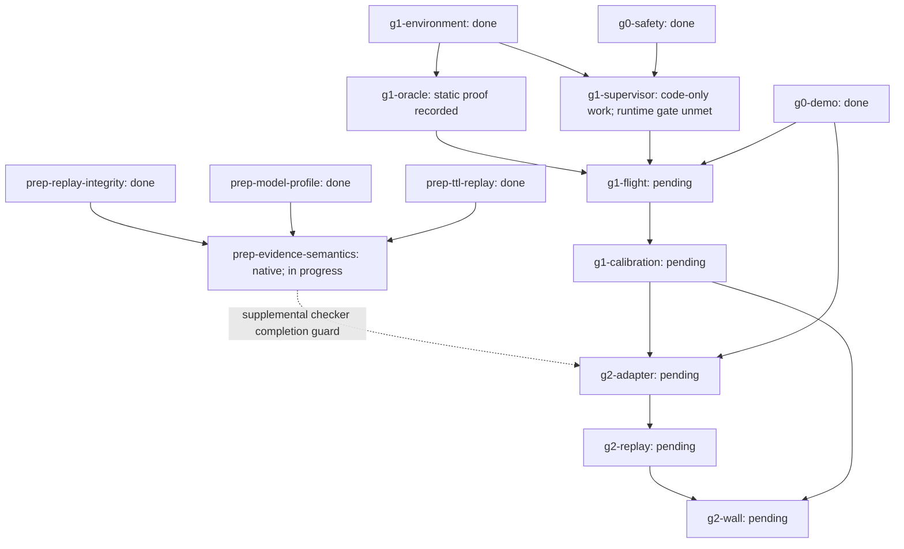

# G1 oracle: unarmed implementation contract

## Scope and authority

The approved implementation task is `g1-oracle`, using the completed `g1-environment` prerequisite. This document refines its existing acceptance; it is not runtime evidence or a completed task. At native revision 61, `g1-oracle` is in progress and `g1-supervisor` remains pending and ready. The operator approved the lossless same-bag adapter and bounded unarmed simulator fixtures after the pinned TF conversion experiment failed.

The slice includes physical visual/collision geometry completeness (E8), a geometric contact/clearance oracle, continuous evaluator-only truth recording, and an additional target with a world-y normal. Approved execution is limited to frozen unarmed fixtures in the existing pinned image. It does not authorize arming, control publishers, setpoints, vehicle teleportation, `set_pose`, installation/downloads, or flight. Reuse the pinned image and assets from the existing [environment evidence](environments/g1-bridge-observation.json) and [preparation results](PREPARATION_RESULTS.md).

No preparation repair blocks G1. The proposed evidence-semantics branch blocks G2 only. Existing flight, supervisor and calibration gates remain unmet.

Actual pinned-image implementation and retained failures are documented in [G1 oracle results](G1_ORACLE_RESULTS.md). Native completion remains separate from this contract.

## Native mapping and intended dependency change

Current native edges remain authoritative. The agreed target graph is:



Solid edges are current native dependencies. The native API cannot update existing task dependencies, and native JSON/HTML is never hand-edited. The operator explicitly approved a supplemental gate: `scripts/check_project.py` rejects every completed `g2-*` task unless `prep-evidence-semantics` is done. This is a project verification guard, not a native dependency edge or runtime motion-admission mechanism. The new task's three prerequisite edges are native. G1 tasks are unaffected. Migrate the dashed edge into the native DAG only when a supported update exists; preserve the checker until equivalent enforcement is established.

`prep-model-profile` supplies the rest-height/profile inputs for E2/E5; `prep-ttl-replay` supplies E4's replay baseline. Reusing these artifacts does not certify oracle completeness or localization error.

## Task `g1-oracle`

### 1. Physical geometry and asset provenance

- Keep the pinned vehicle SDF and model assets unchanged. Hash every consumed SDF/mesh and record the resolver, image and source identities. Historical replay bundles remain byte-identical.
- Cover collision geometry and all physical visual meshes, including body, motors, camera and propellers. A collision-only proxy is insufficient. Unsupported geometry, unresolved assets or incomplete transforms fail closed; do not silently omit `.dae` files or download substitutes.
- For COLLADA, resolve `<unit meter>`, `<up_axis>`, geometry instances and nested node transforms in their specified order. Preserve instance identity, scale and frame provenance. Reject constructs the bounded adapter cannot resolve rather than treating raw vertex coordinates as body coordinates.
- Support ASCII and binary STL with explicit format/length validation. Apply SDF mesh scale in mesh coordinates, then the visual pose, then the resolved link/model-to-body transform.
- Derive each rotor sweep around its resolved joint axis. The visual origin is not the hub: the pinned rotor visual has a nonzero translation. Compute maximum perpendicular vertex distance to the joint axis after all transforms, plus axial minimum/maximum. For the pinned body-z axis these axial limits become z limits. Include both collision and visual geometry over the full revolution; an AABB radius about the mesh origin is not the sweep radius.
- Preserve component identity. A global body/propeller bound may be used for conservative clearance, but cannot identify an allowed gear/support contact. A bound containing both gear and body must never exempt body contact. Ambiguous component coverage is a blocker, not a new allowlist entry.
- Resolve full body orientation at observation time. Do not reuse the level/yaw-only diagnostic envelope as a tilted-body certificate. Physical clearance excludes planner inflation: do not subtract the navigation margin twice.

### 2. Oracle choice: conservative geometric contact

Use geometric contact/clearance against the frozen static-world geometry, not a newly inserted contact sensor. Do not change the pinned model to add `<sensor type="contact">`.

For each named vehicle component and world surface, compute a conservative signed separation or intersection predicate from enclosing geometry at the truth pose. Separation at or below zero is an unsafe geometric intersection unless that exact pair is allowed in the current phase and support zone. Record this as geometric intersection, not a physics-engine contact event. An outer bound may produce false positives; disclose its conservatism and never interpret an intersecting bound as proven physical impact.

- Freeze world geometry, support region, exact component/surface pair allowlist, phase rules and numeric tolerances before each trial.
- Permit only designated gear/support pairs while resting, in the declared takeoff transition, or during intentional landing. Body/propeller contact is never exempt.
- Evaluate simultaneous pairs independently: allowed support plus body-wall intersection is unsafe.
- Record phase-specific clearance and the contact ledger from preflight through final bounded collection. Navigation requires the existing 0.5 m physical-envelope clearance; this static slice does not exercise navigation.
- Invalid geometry, unknown phase, ambiguous entity identity or insufficient truth coverage cannot produce a clearance pass.

### 3. Truth transport, recording and health

Forward `/world/<frozen-world>/dynamic_pose/info` one-way through the installed native Gazebo transport binding. Preserve the complete generated `gz.msgs.Pose_V` serialization inside `std_msgs/msg/UInt8MultiArray` on `/drone_cv_g1/evaluator/truth_pose_v`, using the fixed layout label `gz.msgs.Pose_V;oracle_schema=1`. Decode it with the pinned generated protobuf class, not a custom CDR parser. Record it in the same bag as depth, CameraInfo, clock and PX4 telemetry. No second subprocess JSON acquisition path is introduced.

The original `ros_gz_bridge` 1.0.24 `Pose_V` to `TFMessage` proposal was rejected by an actual pinned-image transport experiment: all seven transforms retained positions but had zero stamps and empty parent/child names. Gazebo publishes names/IDs and the outer `Pose_V` stamp; the installed conversion expects inner pose headers instead. The approved adapter preserves those missing fields without modifying the pinned model or bridge package. Retain the failed conversion evidence with the successful native-wire evidence.

- Validate required model and link identities and parent relationships. Dynamic pose contains dynamic entities, not a complete static-world map. Static surfaces come from the hashed world manifest.
- Reconstruct `world_from_body` by composing the actual world-model and model-link transforms. Do not treat link-relative coordinates as world poses or select an unscoped `base_link` when multiple entities exist. Any static transform used in the chain must be resolved from pinned assets and declared.
- Validate the outer Gazebo stamp, each required entity's exact name/ID, quaternion and progress. A live unrelated rotor must not hide an absent model/body chain. Scene messages before vehicle spawn are discovery-only, not healthy trial observations; after the identities are frozen, a missing or ambiguous chain invalidates recording. Preserve explicit schema-four incompatibility with historical recordings.
- Extend the existing acquisition schema/policy explicitly for this required stream: sequences, per-message monotonic receive trace, advancing source stamps, simulation age, epoch/reset binding, bag counts, finite storage queue and hash inventories. Do not silently upgrade old manifests or reuse incompatible policies.
- Keep Gazebo `/clock` as simulation time, `use_sim_time=true`, and `UXRCE_DDS_SYNCT=0`. Preserve source stamps; do not substitute receive time or wall time.
- Store Gazebo truth stamps, PX4 `timestamp_sample`, both bracket endpoint deltas, interpolation fraction/gap and epoch. Report their temporal relationship and unavailable synchronization evidence. Nearest-sample differences also include sampling cadence; they do not independently prove clock offset or synchronization.
- No cross-epoch/reset interpolation, extrapolation, unbounded bracket or silent time shift. A shared clock-epoch assumption must be justified before pose-error grading; if it cannot be justified, retain the raw data but mark the diagnostic invalid.
- Keep truth evaluator-only. Do not publish it into planner/localization inputs or use it to improve estimated depth online. Do not refit frozen alignment per window.

### 4. Observer coverage and result precedence

Keep `safety_outcome` and `execution_outcome` independent under [SAFETY S03](SAFETY.md#s03-infrastructure-errors-do-not-overwrite-safety-failures).

| Observation history | Required result |
| --- | --- |
| Observer lost before any known unsafe event | `UNKNOWN` safety and incomplete/`INFRA_ERROR` execution; never `SUCCESS` or a demonstrated safe abort |
| Unsafe observed, then observer/simulator/logger fails | Retain `UNSAFE_OBSERVED` and the infrastructure/collection reason |
| Truth coverage missing over an interval | Mark that interval unobserved; never count it as meeting clearance |
| Complete fixture coverage, valid geometry, no violation | May report `NO_VIOLATION_OBSERVED` for that fixture only; not flight acceptance |

Record coverage intervals and gap reasons, not merely message totals. Freeze coverage/gap/interpolation rules before trials. Sampled clearances do not certify the inter-sample swept volume without a justified bound; explicitly report such unsupported intervals. Keep the unsafe latch through bounded collection/cleanup and retain all attempts. Negative-fixture classification success does not turn the intentionally unsafe scene into navigation success.

### 5. Continuous truth as an E3 diagnostic input

The oracle owns acquisition and provenance of the continuous truth stream. The evidence-semantics branch owns consumption for uncertainty diagnostics; it is not a prerequisite of the oracle.

For column-vector transforms, define `T_c` and `T_q` as truth world-from-body transforms and `T_hat_c` and `T_hat_q` as estimated transforms in the consistently aligned frame. Use:

```text
A_hat = inverse(T_hat_q) @ T_hat_c
A     = inverse(T_q) @ T_c
E     = inverse(A_hat) @ A
```

Measure both absolute pose error and the relative-transform error `E`. Evaluate every retained capture/query pair with `0 <= t_q - t_c <= TTL`, within one valid epoch. Adjacent-frame differences alone are insufficient. Retain the worst-pair IDs/stamps and translation/rotation errors for each declared TTL window. Freeze the query-time population and report its coverage; discrete queries are not all possible continuous query times.

Let `delta_theta` be the geodesic rotation angle of `E`, computed from normalized relative quaternions with sign equivalence handled. Include roll, pitch and yaw, not yaw alone. For a point at radius `rho` from the body origin:

```text
point displacement <= norm(delta_t) + 2*sin(delta_theta/2)*rho
                   <= norm(delta_t) + delta_theta*rho
```

The rotation term is exact when `rho` is the perpendicular distance to the rotation axis. Using distance to the body origin gives a conservative bound, not equality for every point.

Compute `rho` using ray range, not optical Z. For optical Z and calibrated pixel direction:

```text
r = Z * sqrt(1 + ((u-cx)/fx)^2 + ((v-cy)/fy)^2)
rho = max norm(lever_arm_body + R_body_optical @ (r * unit_ray_optical))
rho <= r_max + norm(lever_arm_body)
```

Use calibrated pixel-cone corners for the maximum over supported image area and the actual trusted-Z cap of the diagnostic. The pinned renderer far clip is 19.1 m; its corner range is approximately 26 m for the reported FOV. This does not increase a sensor profile's shorter trusted range. Record inputs and the derived maximum rather than hardcoding the approximation.

Plane residuals remain useful cross-checks but contain depth/extrinsic/timing/geometry error too. Add a fixed target with world-y normal to the next fixture. Preserve the original grading ROIs and thresholds. Do not fit alignment, erosion or uncertainty to improve correlation or force admission. Stationary measured errors and their geometric propagation remain diagnostics, not calibrated future-motion bounds; `g1-calibration` still requires motion.

### 6. Acceptance and verification

Completion requires real current-run smoke evidence from the pinned execution path, not only parser/unit tests:

1. Resolve and hash all required model/mesh assets; exercise component and full-rotor containment with independent geometric answers, including nonzero visual offsets, scale, COLLADA unit/up-axis/nested transforms and tilted body poses. Unknown constructs remain explicit failures.
2. Exercise the continuous one-way truth bridge and the actual recorder/decoder. Prove required model/body transform progress, stamp/epoch binding and missing/stale-stream rejection. Record the additional y-normal target with unchanged primary grader rules.
3. Run frozen known-free and known-intersection static fixtures through the real observer. Check known clearance, allowed support, simultaneous support/body-wall intersection and propeller-envelope intersection. Keep analytic expected answers separate from the oracle implementation.
4. Exercise observer loss before unsafe, loss after unsafe, missing truth intervals and collection failure. Retain the latch, interval coverage, raw logs and independent execution reasons. Exit semantics follow SAFETY/HARNESS; classification checks report separately from intentionally unsafe trial outcomes.
5. Inspect the topic/interface boundary: ground truth reaches only evaluator/logger consumers. No arming or control publisher exists in the slice.
6. Keep all attempts and exact effective inputs. Re-run relevant behavioral checks and `python scripts/check_project.py`; update readable results only after real execution. Mark `g1-oracle` complete only when all its existing native criteria and this contract hold.

Static fixture placement is frozen at world initialization, not applied through runtime teleportation. Numeric health/geometry tolerances must be justified and frozen before the attempts; do not tune them after seeing failures. A no-return near-box probe is outside this task and is not required to keep `-Inf` globally fail-closed.

## Proposed task `prep-evidence-semantics`

Prerequisites: `prep-replay-integrity`, `prep-model-profile`, `prep-ttl-replay`, all currently done. Add this prerequisite to `g2-adapter`; `g2-replay` and `g2-wall` inherit the gate. Do not add it to any G1 task. Acquisition with continuous truth may be reused when its actual artifact dependencies are unchanged; otherwise leave the dependent diagnostic incomplete.

- **E1:** Localize finite positive TOO_CLOSE values with conservative pixel cones from optical Z zero to `near_trusted_m`, transformed by capture-time pose. Cell grouping encloses every contributing pixel's corner rays. Retain/inflate hazards with declared translation/rotation uncertainty and fixed margin; test intersection with the query envelope. Never count their possible occupied volume as FREE. Preserve epoch/TTL and new-near-evidence retention. Keep `-Inf` as global STOP until a separate sensor-specific experiment proves its meaning.
- **E3:** Use the continuous truth contract above and the pinned ROS decoder, not a custom CDR parser. Report all-pairs TTL relative errors, absolute errors, clock/bracket coverage, full quaternion rotation and ray-range/body-lever-arm propagation. If truth or time alignment is unavailable, do not synthesize a bound from odometry spans. Label stationary results uncalibrated and non-admitting.
- **E2:** Derive rest height from the complete physical profile/support geometry, not the historical 0.15 m fixture. Reject below-support poses; retain the old fixture only as explicitly historical. Re-evaluate rest height when E8 changes the physical lower bound.
- **E4:** Compare retained frame identities with an independent stamp/epoch oracle. Exercise a mid-trace camera gap longer than TTL with clock/odometry still progressing, followed by recovery using only valid retained evidence. Exercise an explicitly derived early-only-obstacle variant before/after expiry. Preserve original bags and label transformations/identities; neither a duplicated retention predicate nor an unchanged final STOP proves evidence transitions.
- **E5:** Run historical and model-derived diagnostic envelopes on real replay, recording profile hashes, uncertainty inputs, reasons and spatial evidence counts. Stationary STOP is expected; no floor exemption or motion claim follows.
- **E6:** Keep original ROI erosion and acceptance thresholds. Explain support limitations without changing the primary grader. Any auxiliary uncertainty-based ROI must report excluded pixels and coverage separately and must not replace the baseline.

Verify the changed path with meaningful boundary regressions, a frozen synthetic safety sweep retaining all failures, corrected liveness and actual pinned-decoder replay/fault variants. Preserve original seeds and thresholds; never choose new pose budgets or remove early hazards to force ALLOWED. Report diagnostic conservatism separately from false admission. No result in this branch completes G1 calibration or G2 wall-stop.

## E9 resolver regression

Use the installed pinned SDFormat resolver if available: inspect `gz sdf -p` and any Python binding rather than assuming binding availability or installing one. Resolve include/link frames explicitly; expanded output alone is not proof that every pose is expressed in a common frame.

The [SDFormat model-kinematics specification](http://sdformat.org/tutorials/specification/spec_model_kinematics/1.4/) distinguishes the joint frame from initial link placement. The pinned SDF 1.9 `CameraJoint` explicitly uses `relative_to="base_link"`; resolve that frame rather than treating the numeric joint pose as child-relative. Do not multiply the joint pose into the camera link a second time. An independent resolved optical-to-body transform must agree with the derived mount. Retain historical recording results as supporting evidence, not as a substitute for this resolver regression.
