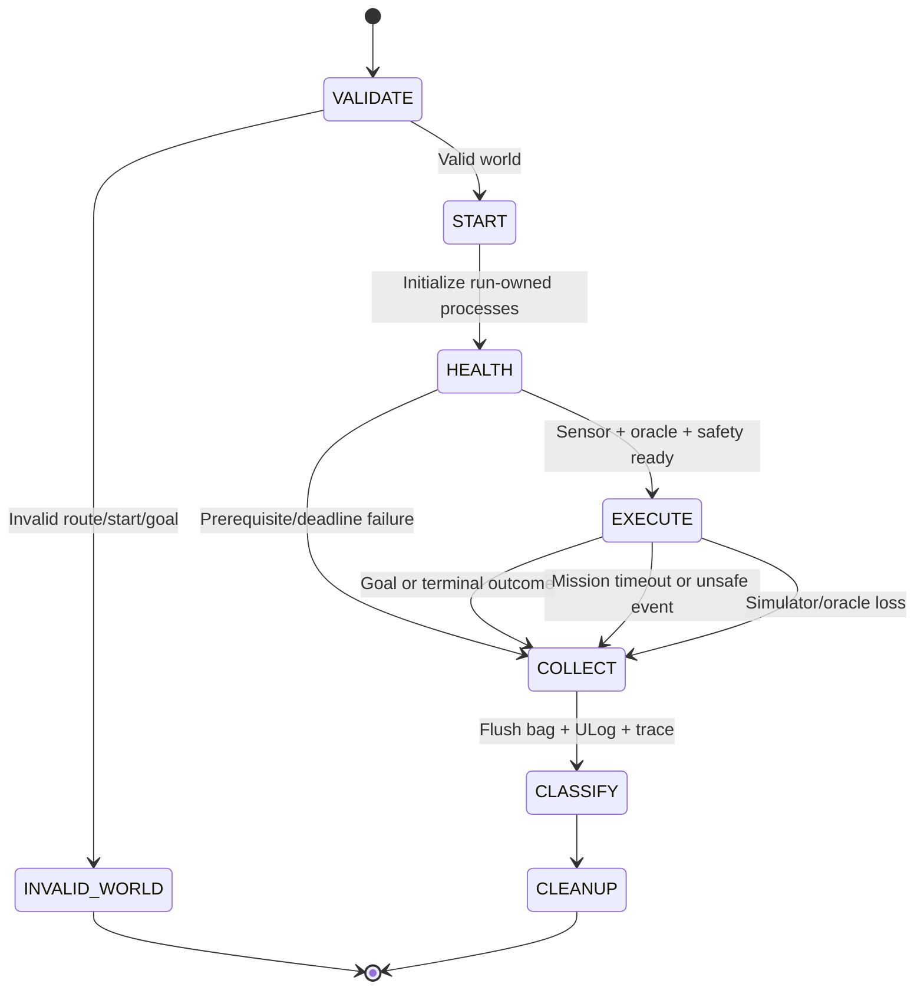

# Development and evaluation harness

## 1. Two different harnesses

1. **Coding-agent harness:** small tasks, clear contracts, evidence before Git operations, and bounded operational permissions. Repository guidance is in [`.omp/AGENTS.md`](../.omp/AGENTS.md).
2. **Simulation-evaluation harness:** runs scenarios, injects faults, records logs, and provides independent oracles and aggregation. The SITL portion remains a specification; the G0 core/demo and offline CI exist, but **there is no runner/evaluator/flight CI yet**.

Do not use an LLM to control the drone in the control loop. The state machine, planner, supervisor, and runtime judge must be deterministic for a given input/configuration.

## 2. What can currently be claimed

| Available | Not yet available |
| --- | --- |
| PDF/plan/contracts, native + portable roadmap, NumPy G0 core, pytest, synthetic demo, and offline CI workflow | ROS nodes, simulator launcher, fault injector, rosbag dataset, scenario runner, flight acceptance CLI, flight benchmark CI |

Do not relabel a design as a “harness that has run.” Do not treat Markdown gates as technical guarantees: only a real runner/CI can enforce them.

The [SAFETY.md](SAFETY.md) contract is a mandatory supplement: phase-specific contact/clearance, suite membership before a run, an unsafe latch, finite deadlines, and an oracle/supervisor before flight.

## 3. Coding-agent workflow

### Task contract

Each implementation request needs:

- **Goal:** observable behavior, gate, and scenario ID.
- **Scope:** files/modules that may change and non-goals; read the actual code before selecting files.
- **Inputs:** units, frame, encoding, clock domain, validity, and configuration.
- **Acceptance:** stimuli, independent oracle, failure conditions, and evidence to retain.
- **Verification:** actual commands already in the repository or commands added with the feature; do not list nonexistent commands as having been run.

Bounded workflow:

1. Read PLAN and the relevant scenario sections; check local/remote state before Git operations.
2. Choose a small vertical slice and complete it end-to-end; do not create a collection of empty modules.
3. Write boundary/behavioral tests where there is a real risk; use fixtures with independent geometric answers for geometry.
4. Implement, run the relevant tests once after the changes, and smoke-test the actual product execution path.
5. Update contracts/documentation if behavior changes. Clearly report checks not run because the environment is unavailable.
6. Commit the task changes, push the branch, create an English-language PR, and merge when the gates are met and the user has authorized it.

Allow at most three repair attempts for the same failure without new evidence of its cause; then stop the loop and report the root cause/blocker. Do not retry login, policy, dependency installation, or network operations indefinitely. Do not change criteria yourself to make checks “green.”

### Automation boundaries

- The user has authorized commit/push/merge for changes within this project request. Operate only on the verified `minhtri-bi/drone-CV` repository, task branch, and `main` base.
- That permission does not authorize force-push, reset/stash/clobber of unfamiliar work, deletion of branches you do not own, changes to branch protection, or bypassing required checks/review.
- Do not grant account permissions, install drivers/WSL/Docker, change the model provider, or run real hardware yourself.
- Do not schedule daemons or unbounded agent loops yourself. Do not extend this task's permissions to another repository.
- Builders must not change safety thresholds, frozen test seeds, or oracles to fix a failure. Contract changes require a user decision, rationale, and a new baseline.
- After docs-only changes: check links/content/PDF provenance; do not require installing ROS just to merge documentation.
- After control/safety changes: the relevant SITL smoke and fault injection are required. Unit tests or a fake simulator do not replace that evidence.
- If required checks or reviews have not passed, leave the PR pending; do not use `--admin` to force a merge.

### Resume

Read the current task/gate, branch, PR/checks, and evidence for the exact revision. Reuse results only when the relevant code/configuration/input/environment is unchanged. Do not rerun successful Git operations just because the agent has restarted. Do not treat a previous session's narrative as a flight log.

## 4. Simulation harness build order

| Slice | Required runnable product | Evidence for acceptance |
| --- | --- | --- |
| H0 / G0 | Pure NumPy projection/frame transforms/validity/histogram and braking API, without ROS | Analytic answers in optical/body/world frames; invalid/near/far, thin objects, wrap, braking boundaries; fixtures run through the real API |
| H1a / G1 | Unarmed environment probe; minimal oracle/logger + supervisor/bridge before flight | Clock/QoS/TF/versions; known-contact/free, phase allowlist, ownership/TTL, and live logging |
| H1b / G1 | Mission bootstrap in a known-clear volume, then braking/delay calibration and fault handoff | Bag/ULog; arm/takeoff/square/hold/land/disarm; bounds/deadlines tied to configuration/workload; bootstrap does not count toward navigation success |
| H2 / G2 | Perception replay on bags, then wall-stop using the oracle and supervisor that passed G1 | 10/10 wall-stops with logs, near evidence not removed by filters, and fresh/stale data distinguished |
| H3a / G3 | Single-world runner reusing the G1 oracle, adding lifecycle/fault injection | One wall/corridor run can be evaluated automatically; every branch has bounded collection/cleanup with correct ownership |
| H3b / G3 | Bounded planner/recovery + batch seeded worlds | Cases A–D/E/F in the correct suites; a manifest for every attempt, an unsafe latch, and a report with no missing seeds |
| H4 / G4 | Stereo/model adapter with the same input/output contract | Offline scale/focal/near-overestimation gate before flight; comparison using the same seeds and measured latency |

Do not build a scheduler/distributed fleet/dashboard before H3a has a working oracle. H0 can be implemented on Windows; H1 onward requires a validated Linux environment.

## 5. Preflight and reproducible environments

Each environment record needs: OS/architecture, CPU/RAM/GPU/driver, image digest, PX4 commit or package version, `px4_msgs` revision, Agent version, ROS distro/RMW, Gazebo/plugins/assets revisions, Python/packages, camera calibration, DDS configuration, and PX4 parameter export.

- Do not use `latest`/`main` as a lock; the candidate digest in PLAN only pins the image, not every externally downloaded asset.
- Do not assume installed means working. G1 must observe discovery, actual message rates, clock, units, TF, and acknowledgments.
- Before a batch, fresh camera/odom data, oracle telemetry, logger, and supervisor must be available; do not arm if any component is missing.
- Each run has its own namespace/domain/ports and process ownership. Do not clean up by killing every Gazebo/Docker process on the machine.
- Separate the debug GUI from headless benchmarks; pin the physics step, sensor rates, noise settings, seed, and RTF policy.
- A seed does not guarantee bitwise determinism when the scheduler/GPU changes; retain repeated trials and environment identity.

### Derived smoke recipe and observed results

The base image lacks the ROS camera bridge; the [old probe](environments/g1-observation.json) is historical, not a current blocker. After approval, the [derived image](../docker/g1/Dockerfile) passed an [unarmed smoke check](environments/g1-bridge-observation.json). The lock retains the base digest and 13 new archives; no base packages were upgraded and nothing was installed on the host.

Run from the repository root in PowerShell or a POSIX shell, only with permission to use the engine/downloads. With Git Bash on Windows, set `MSYS_NO_PATHCONV=1` before `docker exec` commands containing Linux paths. An existing container with the same name causes `docker run` to fail; do not delete unfamiliar containers yourself.

```sh
docker build --platform linux/amd64 --tag drone-cv/g1-bridge:local --file docker/g1/Dockerfile docker/g1
docker run -d --name drone-cv-g1 --label drone-cv.owner=manual-g1 --network none --cpus 4 --memory 6g --shm-size 256m --cap-drop ALL --security-opt no-new-privileges -e ROS_DOMAIN_ID=83 -e ROS_LOCALHOST_ONLY=1 -e GZ_PARTITION=drone_cv_g1_manual -e HEADLESS=1 -e PX4_SIM_MODEL=gz_x500_depth -e PX4_UXRCE_DDS_NS=drone_cv_g1 -e LIBGL_ALWAYS_SOFTWARE=1 drone-cv/g1-bridge:local sleep infinity
```

Run the following four processes in four separate terminals in the same container, in this order: Agent, PX4, bridge, static TF. Wait for PX4 to report `Startup script returned successfully` before probing:

```sh
docker exec -i drone-cv-g1 /usr/local/bin/ros2-entrypoint.sh MicroXRCEAgent udp4 -p 8888 -v 4
```

```sh
docker exec -i drone-cv-g1 /usr/local/bin/ros2-entrypoint.sh px4-gazebo
```

```sh
docker exec -i drone-cv-g1 /usr/local/bin/ros2-entrypoint.sh ros2 run ros_gz_bridge parameter_bridge --ros-args -r __node:=drone_cv_g1_camera_bridge -p config_file:=/opt/drone_cv/g1/bridge.yaml -p use_sim_time:=true -p override_timestamps_with_wall_time:=false
```

```sh
docker exec -i drone-cv-g1 /usr/local/bin/ros2-entrypoint.sh ros2 run tf2_ros static_transform_publisher --x 0.13233 --y 0 --z 0.26078 --qx -0.5 --qy 0.5 --qz -0.5 --qw 0.5 --frame-id drone_cv_g1/base_link --child-frame-id drone_cv_g1/camera_optical
```

In another terminal, copy the two read-only observers and run a finite observation window:

```sh
docker cp scripts/g1_probe.py drone-cv-g1:/tmp/g1_probe.py
docker cp scripts/g1_ros_observer.py drone-cv-g1:/tmp/g1_ros_observer.py
docker exec -i drone-cv-g1 /usr/local/bin/ros2-entrypoint.sh python3 /tmp/g1_probe.py --ros
```

`--ros` requires an actual `UXRCE_DDS_SYNCT=0` setting, matching Image/CameraInfo stamps, encoding, intrinsics, optical TF, QoS, clock, and odometry in the same simulation-time domain. There is no control publisher. Exit 2 preserves an incomplete observation; do not bypass it to obtain video. Static TF is an invariant relationship, not a dynamic pose at capture time.

Two environment faults were fixed: `GZ_CONFIG_PATH=/usr/share/gz` preserves native `gz sim` when ROS vendor hooks are present; `PX4_PARAM_UXRCE_DDS_SYNCT=0` makes Gazebo the sole time source before the DDS client starts. [PX4 requires this mode when ROS uses the Gazebo clock](https://docs.px4.io/main/en/ros2/user_guide.html#ros-gazebo-and-px4-time-synchronization), rather than synchronizing OS time at an RTF other than 1. Failed windows from before the changes remain in the evidence.

After collecting output, stop/remove only the container created by this run:

```sh
docker stop --timeout 10 drone-cv-g1
docker rm drone-cv-g1
```

The name/partition in the recipe is an example for one run; the evidence records the actual identity of the run performed. There is no promise of a bitwise-identical rebuild or perpetual download availability: missing/mismatched archives must fail closed. Software rendering achieved approximately 4.5 Hz camera wall-time frequency in the final window; flight performance/calibration has not been achieved. Sensor `+Inf` has not been certified as free.

## 6. Runner/evaluator contract to implement

### Run lifecycle



The executor does not decide success itself. The evaluator obtains geometry/contact from Gazebo or an independent calibrated geometry oracle, and status/odom from PX4 to check handoff. Missing telemetry does not mean zero collisions.

COLLECT is deadline-bounded best effort for every terminal branch, not just success. Record the initial failure before collecting logs; collection/cleanup errors add reasons rather than overwrite a collision.

### Minimum inputs

| Group | Required fields and meaning |
| --- | --- |
| Experiment | schema version, experiment ID, source revision, dirty flag, suite/gate, config hash, environment record |
| Scenario | scenario ID, suite membership, world/noise seed, asset/world hash, start/goal ENU, physical/planning envelope, support-contact pair/phase allowlist, geofence, expected outcome class |
| Run | run ID, attempt index, namespace/domain/ports, process ownership, sim epoch, wall start/end and sim start/end |
| Policy | frozen seed set, validity validator revision, timeouts, speed/clearance limits, depth/command deadlines, retry cap |

World and noise seeds must be separate. Run IDs/attempts must not overwrite old files. IDs and paths must not be used as raw shell commands; if a CLI is implemented later, pass argv and validate path scope.

### Minimum trace

- Capture stamp/epoch/frame ID, receive monotonic time, preprocess/inference finish, safety decision, publication, and tracking response.
- Source sequences for depth, pose, proposal, and safety command; fresh/stale/invalid state with a reason.
- Actual pose/velocity, requested/safe setpoint, PX4 nav/arming state, acknowledgments, EKF resets, and failsafe events.
- Ground-truth contact, surface clearance, bounds, tilt, goal dwell, and observer health.
- Fault injection command, requested time, and confirmed application time.

The depth source/model must not see ground-truth distance to correct itself online. Simulation odometry may be used during the core stage, but must be explicitly recorded as ideal localization, not called VIO.

### Safety outcome is separate from execution outcome

Keep `safety_outcome` and `execution_outcome` separate under SAFETY S03. `UNSAFE_OBSERVED` is latched for the entire attempt, even if execution later becomes `INFRA_ERROR`. `NO_VIOLATION_OBSERVED` only permits success/safe abort when observer coverage and telemetry are sufficient. A missing observer means `UNKNOWN`, not “safe.”

### Results and exit contract

| Outcome | When used | Counts toward navigation success? |
| --- | --- | --- |
| `SUCCESS` | Completed with the correct goal/termination, sufficient observer coverage, and no unsafe event throughout the trial; contact/clearance follows the phase contract | Yes |
| `SAFE_ABORT` | Goal not completed, but stopping/handoff was correct, observer coverage was sufficient, and there was no violation | No |
| `UNSAFE_FAIL` | Primary label for latched unsafe events: non-allowlisted contact, phase-clearance/geofence violation, overturning/loss of control | No; retain execution/infra reasons as well |
| `TASK_FAIL` | Timeout/non-completion, with no unsafe event and sufficient logs | No |
| `INFRA_ERROR` | Simulator/oracle/recording is insufficient for evaluation; does not erase known unsafe events | No; batch is incomplete unless an already observed failure is conclusive |
| `INVALID_WORLD` | Rejected by the validator before executing the trial | No; report generator rejection |

Negative safety and stress-diagnostic suites have their suite membership/expected outcomes frozen before the run under SAFETY S04. Passing a classification test does not turn a stress collision into navigation success; do not change suites after a failure. Only the navigation suite uses the 45/50 target and zero unsafe events. Errors must not fall back to success by default.

When implemented, the evaluator CLI must distinguish: `0` for passing the entire gate, `1` for an observed failure, and `2` for invalid/incomplete evidence or infrastructure problems. An unsafe event takes failure precedence in aggregation; without a failure, missing trials still prevent a pass.

### Planned artifact layout

Each run stores its manifest, effective configuration, events/metrics, rosbag2, ULog, and stdout/stderr from owned processes. A batch retains the seed list, rejected-world ledger, every attempt, and the report. Keep large artifacts outside Git; commit only small fixtures with clear provenance/licenses.

Minimum report: numerator/denominator, Wilson CI, outcome counts, missing/invalid/infra counts, worst clearance, collision IDs, goal-time/route ratio, wall latency p50/p95/p99, deadline misses, sim data age, RTF, and links to raw evidence. A benchmark without raw evidence is not accepted.

## 7. Merge and acceptance gates

- Source integrity: `python scripts/check_project.py` checks the PDF, DAG, scenario IDs, links, and portable roadmap; it does not replace behavioral tests.
- H0: behavioral unit/regression tests and offline smoke without a simulator.
- H1–H3: tests for the changed components plus SITL smoke for the relevant scenario. If the environment is unavailable, do not merge with a claim that the flight gate has passed.
- G3 acceptance: 50 valid frozen navigation worlds, ≥45 successes, zero unsafe events, navigation clearance ≥0.5 m under the phase contract, performance gates, all required scenarios for each suite, and no missing trials.
- G4 acceptance: each source declared accepted must achieve ≥40/50 as in the PDF, without lowering the contact/phase-clearance gate. Changing the source invalidates G3 evidence for that source until rerun.
- The user decides whether to change targets/scope or move to hardware. Merging a documentation PR does not mean the flight system has been accepted.

## 8. G0 commands and G1 handoff

`python -m pytest -q` runs behavioral regression tests; `python scripts/g0_demo.py --output artifacts/<new-name>` runs the real API and exports SVG/NPZ/summary. The demo uses only synthetic data; see README for sampling support, the independent local-clear certificate, and braking limitations.

`g1-environment` passed an unarmed smoke check on the pinned derived image. The next ready items are the oracle/logger and minimal supervisor; bootstrap flight/calibration remains pending, and permission to arm must not be inferred from the roadmap. The test container was cleaned up, while Docker Desktop/images were retained; do not install packages on the host or change drivers/WSL.
