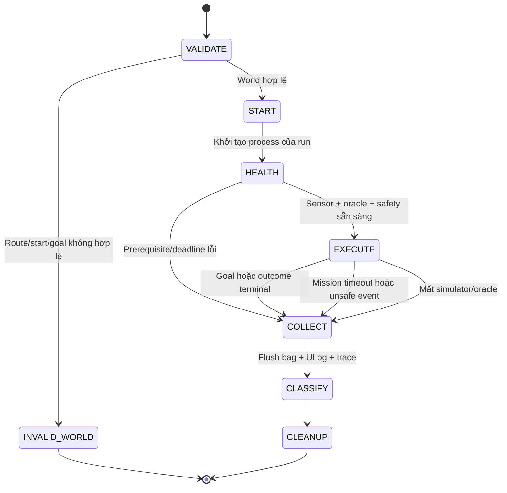

# Harness phát triển và đánh giá

## 1. Hai harness khác nhau

1. **Coding-agent harness:** task nhỏ, contract rõ, evidence trước Git, quyền thao tác có giới hạn. Có hướng dẫn repo tại [`.omp/AGENTS.md`](../.omp/AGENTS.md).
2. **Simulation-evaluation harness:** chạy scenario, inject fault, ghi log, oracle độc lập và aggregate. Phần SITL vẫn là đặc tả; đã có core/demo G0 và CI offline, **chưa có runner/evaluator/flight CI**.

Không dùng LLM điều khiển drone trong control loop. State machine, planner, supervisor và judge runtime phải deterministic theo input/config.

## 2. Trạng thái có thể khẳng định hiện tại

| Có | Chưa có |
| --- | --- |
| PDF/plan/contracts, native + portable roadmap, NumPy G0 core, pytest, synthetic demo và workflow CI offline | ROS nodes, simulator launcher, fault injector, rosbag dataset, scenario runner, acceptance flight CLI, CI flight benchmark |

Không được đổi tên thiết kế thành “harness đã chạy”. Không dùng Markdown gate làm bảo đảm kỹ thuật: chỉ runner/CI thật mới enforce được.

Contract [SAFETY.md](SAFETY.md) là bổ sung bắt buộc: contact/clearance theo phase, suite membership trước run, unsafe latch, finite deadlines và oracle/supervisor có trước flight.

## 3. Coding-agent workflow

### Task contract

Mỗi yêu cầu triển khai cần:

- **Goal:** hành vi quan sát được, gate và scenario ID.
- **Scope:** file/module được sửa và non-goals; đọc code thật trước khi chọn file.
- **Inputs:** units, frame, encoding, clock domain, validity và config.
- **Acceptance:** kích thích, oracle độc lập, điều kiện fail và evidence cần giữ.
- **Verification:** command thật đã có trong repo hoặc command được thêm cùng feature; không ghi lệnh chưa tồn tại như đã chạy.

Quy trình hữu hạn:

1. Đọc PLAN và phần scenario liên quan; kiểm tra trạng thái local/remote trước thao tác Git.
2. Chọn một vertical slice nhỏ, hoàn tất end-to-end; không mở hàng loạt module rỗng.
3. Viết test biên/hành vi khi có nguy cơ thực; dùng fixture có đáp án hình học độc lập cho geometry.
4. Implement, chạy test liên quan một lần sau sửa và smoke đúng đường chạy sản phẩm.
5. Cập nhật contract/tài liệu nếu hành vi thay đổi. Báo rõ chưa chạy do thiếu môi trường.
6. Commit phần thay đổi của task, push branch, tạo PR tiếng Anh, merge khi đủ gate và được người dùng cho phép.

Tối đa ba lần sửa cho cùng một failure mà không có bằng chứng nguyên nhân mới; sau đó dừng vòng lặp và báo root cause/blocker. Không retry login, policy, dependency install hay network bất tận. Không tự thay tiêu chí để “xanh”.

### Ranh giới tự động hoá

- Người dùng đã cho phép commit/push/merge các thay đổi thuộc yêu cầu project này. Chỉ thao tác repo `minhtri-bi/drone-CV`, branch của task và base `main` đã xác minh.
- Quyền đó không cho phép force-push, reset/stash/clobber work lạ, xoá branch không sở hữu, đổi branch protection hoặc bypass required checks/review.
- Không tự cấp quyền tài khoản, cài driver/WSL/Docker, đổi model provider hoặc chạy hardware thật.
- Không tự lập lịch daemon hay vòng agent vô hạn. Không biến permission của task này thành quyền ở repo khác.
- Safety thresholds, frozen test seeds và oracle không bị builder sửa để chữa failure. Thay contract cần quyết định người dùng, rationale và baseline mới.
- Sau sửa docs-only: kiểm tra link/nội dung/PDF provenance; không bắt cài ROS chỉ để merge tài liệu.
- Sau sửa điều khiển/safety: cần smoke SITL và fault injection liên quan. Unit tests hoặc simulator giả không thay thế bằng chứng đó.
- Nếu có required checks hoặc review chưa đạt, PR giữ nguyên chờ; không dùng `--admin` để ép merge.

### Resume

Đọc task/gate hiện tại, branch, PR/checks và evidence của đúng revision. Tái dùng kết quả chỉ khi code/config/input/environment liên quan không đổi. Không re-run hành động Git đã thành công chỉ vì agent vừa khởi động lại. Không coi lời kể phiên trước là flight log.

## 4. Thứ tự xây harness mô phỏng

| Slice | Sản phẩm phải chạy được | Evidence để nhận |
| --- | --- | --- |
| H0 / G0 | Pure NumPy projection/frame transforms/validity/histogram và braking API, không ROS | Đáp án analytic ở optical/body/world frame; invalid/near/far, vật mảnh, wrap, braking biên; chạy fixture qua API thật |
| H1a / G1 | Environment probe không arm; oracle/logger + supervisor/bridge tối thiểu trước flight | Clock/QoS/TF/versions; known-contact/free, phase allowlist, ownership/TTL và log sống |
| H1b / G1 | Mission bootstrap trong known-clear volume rồi calibration braking/delay và fault handoff | Bag/ULog; arm/takeoff/square/hold/land/disarm; bounds/deadlines gắn config/workload; bootstrap không cộng navigation success |
| H2 / G2 | Replay perception trên bag, rồi wall-stop dùng oracle và supervisor đã qua G1 | 10/10 wall-stop có logs, near evidence không bị filter xoá, dữ liệu mới/cũ được phân biệt |
| H3a / G3 | Single-world runner dùng lại oracle G1, thêm lifecycle/fault injection | Một run wall/corridor tự chấm được; mọi nhánh bounded collect/cleanup đúng ownership |
| H3b / G3 | Bounded planner/recovery + batch seeded worlds | Các case A–D/E/F đúng suite; manifest mỗi attempt, unsafe latch và report không thiếu seed |
| H4 / G4 | Stereo/model adapter cùng input/output contract | Scale/focal/near-overestimation gate offline trước flight; so cùng seeds và measured latency |

Không xây scheduler/distributed fleet/dashboard trước khi H3a có oracle hoạt động. H0 có thể làm ở Windows; H1 trở đi cần môi trường Linux được xác nhận.

## 5. Preflight và môi trường tái lập

Mỗi environment record cần: OS/architecture, CPU/RAM/GPU/driver, image digest, PX4 commit hoặc package version, `px4_msgs` revision, Agent version, ROS distro/RMW, Gazebo/plugins/assets revisions, Python/packages, camera calibration, DDS config và PX4 parameter export.

- Không dùng `latest`/`main` như lock; digest ứng viên ở PLAN chỉ pin image, không chứng minh mọi asset tải ngoài đã pin.
- Không tự coi installed là working. G1 phải quan sát discovery, actual message rates, clock, units, TF và ack.
- Trước batch phải có camera/odom mới, oracle telemetry, logger và supervisor; thiếu một thành phần thì không arm.
- Mỗi run có namespace/domain/ports và process ownership riêng. Không chạy cleanup bằng kill mọi Gazebo/Docker trên máy.
- Tách debug GUI và headless benchmark; pin physics step, sensor rates, noise settings, seed và RTF policy.
- Một seed không bảo đảm bitwise determinism khi scheduler/GPU thay đổi; giữ repeated trials và environment identity.

### Recipe smoke dẫn xuất và kết quả đã quan sát

Image nền thiếu ROS camera bridge; [probe cũ](environments/g1-observation.json) là lịch sử, không phải blocker hiện tại. Sau phê duyệt, [image dẫn xuất](../docker/g1/Dockerfile) đã qua [smoke không arm](environments/g1-bridge-observation.json). Lock giữ base digest và 13 archive mới; không nâng cấp package nền, không cài lên host.

Chạy từ repo root trong PowerShell hoặc POSIX shell, chỉ khi đã có quyền dùng engine/download. Với Git Bash trên Windows, đặt `MSYS_NO_PATHCONV=1` trước các lệnh `docker exec` có đường dẫn Linux. Tên container đã tồn tại làm `docker run` thất bại; không tự xoá container lạ.

```sh
docker build --platform linux/amd64 --tag drone-cv/g1-bridge:local --file docker/g1/Dockerfile docker/g1
docker run -d --name drone-cv-g1 --label drone-cv.owner=manual-g1 --network none --cpus 4 --memory 6g --shm-size 256m --cap-drop ALL --security-opt no-new-privileges -e ROS_DOMAIN_ID=83 -e ROS_LOCALHOST_ONLY=1 -e GZ_PARTITION=drone_cv_g1_manual -e HEADLESS=1 -e PX4_SIM_MODEL=gz_x500_depth -e PX4_UXRCE_DDS_NS=drone_cv_g1 -e LIBGL_ALWAYS_SOFTWARE=1 drone-cv/g1-bridge:local sleep infinity
```

Chạy bốn process sau ở bốn terminal riêng trong cùng container, theo thứ tự Agent, PX4, bridge, static TF. Chờ PX4 báo `Startup script returned successfully` trước probe:

```sh
docker exec -i drone-cv-g1 /usr/local/bin/ros2-entrypoint.sh MicroXRCEAgent udp4 -p 8888 -v 4
```

```sh
docker exec -i drone-cv-g1 /usr/local/bin/ros2-entrypoint.sh px4-gazebo
```

```sh
docker exec -i drone-cv-g1 /usr/local/bin/ros2-entrypoint.sh ros2 run ros_gz_bridge parameter_bridge --ros-args -r __node:=drone_cv_g1_camera_bridge -p config_file:=/opt/drone_cv/g1/bridge.yaml -p use_sim_time:=true -p override_timestamps_with_wall_time:=false
```

```sh
docker exec -i drone-cv-g1 /usr/local/bin/ros2-entrypoint.sh ros2 run tf2_ros static_transform_publisher --x 0.13233 --y 0 --z 0.26078 --qx -0.5 --qy 0.5 --qz -0.5 --qw 0.5 --frame-id drone_cv_g1/base_link --child-frame-id drone_cv_g1/camera_optical
```

Ở terminal khác, copy hai observer chỉ đọc và chạy cửa sổ hữu hạn:

```sh
docker cp scripts/g1_probe.py drone-cv-g1:/tmp/g1_probe.py
docker cp scripts/g1_ros_observer.py drone-cv-g1:/tmp/g1_ros_observer.py
docker exec -i drone-cv-g1 /usr/local/bin/ros2-entrypoint.sh python3 /tmp/g1_probe.py --ros
```

`--ros` yêu cầu `UXRCE_DDS_SYNCT=0` thực tế, Image/CameraInfo cùng stamp, encoding, intrinsics, optical TF, QoS, clock và odometry cùng sim-time. Không có control publisher. Exit 2 giữ observation thiếu; không bỏ qua để lấy video. Static TF là quan hệ bất biến, không phải pose động tại capture time.

Hai lỗi môi trường đã sửa: `GZ_CONFIG_PATH=/usr/share/gz` giữ native `gz sim` khi ROS vendor hooks có mặt; `PX4_PARAM_UXRCE_DDS_SYNCT=0` đặt Gazebo làm nguồn thời gian duy nhất trước khi DDS client khởi động. [PX4 yêu cầu chế độ này khi ROS dùng Gazebo clock](https://docs.px4.io/main/en/ros2/user_guide.html#ros-gazebo-and-px4-time-synchronization), thay vì đồng bộ OS time ở RTF khác 1. Failed windows trước thay đổi vẫn có trong evidence.

Sau khi thu output, chỉ dừng/xoá container do chính run này tạo:

```sh
docker stop --timeout 10 drone-cv-g1
docker rm drone-cv-g1
```

Name/partition trong recipe là ví dụ cho một run; evidence ghi identity thực tế của run đã chạy. Không hứa bitwise-identical rebuild hoặc download còn tồn tại mãi: archive thiếu/lệch phải fail closed. Software rendering đạt khoảng 4.5 Hz camera wall-time trong cửa sổ cuối, chưa đạt flight performance/calibration. `+Inf` sensor chưa được chứng nhận free.

## 6. Contract runner/evaluator cần triển khai

### Vòng đời run



Executor không tự quyết success. Evaluator lấy geometry/contact từ Gazebo hoặc oracle geometry độc lập đã calibrate; status/odom từ PX4 để kiểm tra handoff. Missing telemetry không có nghĩa zero collision.

COLLECT là best-effort có deadline cho mọi nhánh terminal, không chỉ success. Ghi failure ban đầu trước khi thu log; lỗi collect/cleanup thêm reason chứ không ghi đè collision.

### Input tối thiểu

| Nhóm | Fields cần có và nghĩa |
| --- | --- |
| Experiment | schema version, experiment ID, source revision, dirty flag, suite/gate, config hash, environment record |
| Scenario | scenario ID, suite membership, world/noise seed, asset/world hash, start/goal ENU, physical/planning envelope, support-contact pair/phase allowlist, geofence, expected outcome class |
| Run | run ID, attempt index, namespace/domain/ports, process ownership, sim epoch, wall start/end và sim start/end |
| Policy | frozen seed set, validity validator revision, timeouts, speed/clearance limits, depth/command deadlines, retry cap |

World seed và noise seed phải riêng. Run ID/attempt không ghi đè file cũ. IDs và paths không được dùng như raw shell command; nếu làm CLI về sau, truyền argv và kiểm tra path scope.

### Trace tối thiểu

- Capture stamp/epoch/frame ID, receive monotonic time, preprocess/inference finish, safety decision, publish và tracking response.
- Source sequence cho depth, pose, proposal và safety command; trạng thái fresh/stale/invalid với reason.
- Actual pose/velocity, requested/safe setpoint, PX4 nav/arming state, ack, EKF reset và failsafe events.
- Ground-truth contact, surface clearance, bounds, tilt, goal dwell và observer health.
- Fault injection command, thời điểm yêu cầu và thời điểm áp dụng được xác nhận.

Depth source/model không được thấy ground-truth distance để tự sửa online. Sim odometry được dùng trong giai đoạn lõi nhưng phải ghi rõ là localization lý tưởng, không gọi đó là VIO.

### Safety outcome không gộp với execution outcome

Giữ `safety_outcome` và `execution_outcome` riêng theo SAFETY S03. `UNSAFE_OBSERVED` được latch toàn attempt, kể cả nếu execution sau đó là `INFRA_ERROR`. `NO_VIOLATION_OBSERVED` chỉ cho phép success/safe abort khi observer đủ coverage và telemetry. Thiếu observer là `UNKNOWN`, không phải “an toàn”.

### Kết quả và exit contract

| Outcome | Khi dùng | Có cộng navigation success? |
| --- | --- | --- |
| `SUCCESS` | Completed đúng goal/termination, observer đủ, không unsafe toàn trial; contact/clearance theo phase contract | Có |
| `SAFE_ABORT` | Không hoàn thành goal nhưng dừng/handoff đúng, observer đủ và không vi phạm | Không |
| `UNSAFE_FAIL` | Primary label cho unsafe đã latch: contact không allowlist, phase-clearance/geofence violation, lật/mất kiểm soát | Không; giữ cả execution/infra reasons |
| `TASK_FAIL` | Timeout/không hoàn thành, chưa có unsafe event và log đủ | Không |
| `INFRA_ERROR` | Simulator/oracle/recording không đủ để chấm; không xoá unsafe event đã biết | Không; batch incomplete nếu chưa có failure đủ kết luận |
| `INVALID_WORLD` | Validator loại trước khi thực hiện trial | Không; báo generator rejection |

Negative safety và stress-diagnostic có suite membership/expected outcome đóng băng trước run theo SAFETY S04. PASS test phân loại không biến collision stress thành navigation success; không đổi suite sau failure. Chỉ navigation suite áp mục tiêu 45/50 và zero unsafe. Lỗi không được rơi về success mặc định.

CLI evaluator khi được viết phải phân biệt: `0` pass toàn bộ gate, `1` failure quan sát được, `2` invalid/incomplete evidence hoặc infra. Aggregate có unsafe event ưu tiên failure; nếu không có failure nhưng thiếu trial thì vẫn không pass.

### Artifact layout dự kiến

Mỗi run lưu manifest, effective config, events/metrics, rosbag2, ULog và stdout/stderr của process sở hữu. Batch giữ seed list, rejected-world ledger, mọi attempt và report. Đặt artifacts lớn ngoài Git; chỉ commit fixture nhỏ có nguồn/license rõ.

Report tối thiểu: numerator/denominator, Wilson CI, outcome counts, missing/invalid/infra counts, worst clearance, collision IDs, goal-time/route ratio, wall latency p50/p95/p99, deadline misses, sim data age, RTF và link tới raw evidence. Không có raw evidence thì không nhận benchmark.

## 7. Gate merge và acceptance

- Source integrity: `python scripts/check_project.py` kiểm tra PDF, DAG, scenario IDs, links và portable roadmap; không thay thế test hành vi.
- H0: unit/regression hành vi và offline smoke không cần simulator.
- H1–H3: test phần thay đổi cộng SITL smoke đúng scenario. Nếu thiếu môi trường thì không merge với tuyên bố đã đạt flight gate.
- Acceptance G3: 50 frozen navigation worlds hợp lệ, ≥45 success, zero unsafe, navigation clearance ≥0.5 m theo phase contract, performance gates, đủ required scenario theo suite và không trial thiếu.
- Acceptance G4: mỗi source được công bố đạt ≥40/50 như PDF, không hạ contact/phase-clearance gate. Đổi source làm mất hiệu lực bằng chứng G3 cho source đó đến khi rerun.
- Người dùng quyết định thay mục tiêu/phạm vi hoặc chuyển sang hardware. Một PR tài liệu được merge không đồng nghĩa hệ thống bay đã được chấp nhận.

## 8. Commands G0 và handoff G1

`python -m pytest -q` chạy regression hành vi; `python scripts/g0_demo.py --output artifacts/<new-name>` chạy API thật và xuất SVG/NPZ/summary. Demo chỉ dùng dữ liệu tổng hợp; xem README về sampling support, independent local-clear certificate và giới hạn braking.

`g1-environment` đã qua smoke không arm trên image dẫn xuất đã pin. Ready tiếp theo là oracle/logger và supervisor tối thiểu; bootstrap flight/calibration vẫn pending và không được suy ra quyền arm từ roadmap. Container thử đã cleanup, Docker Desktop/images được giữ; không cài package lên host hoặc đổi driver/WSL.
