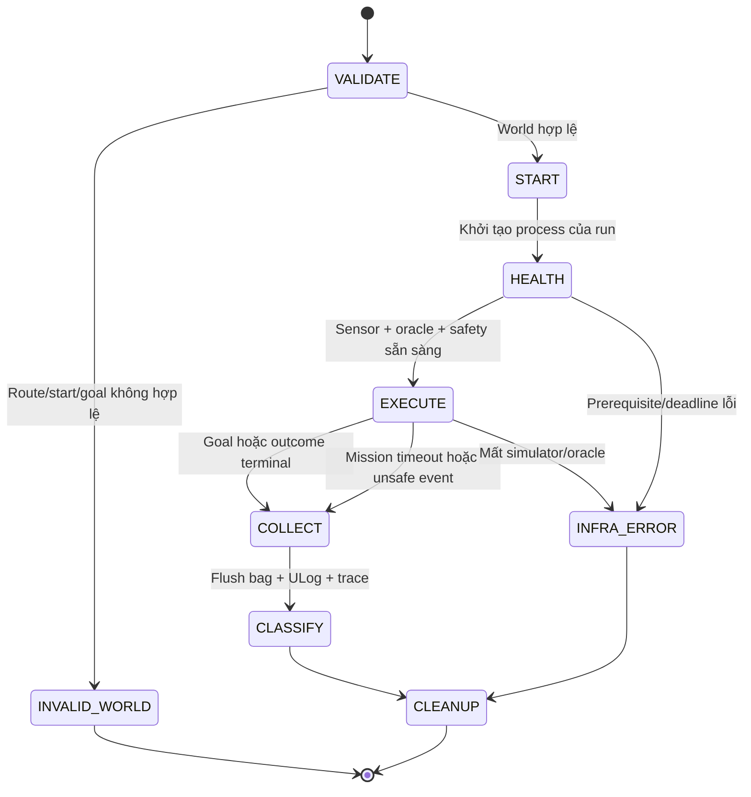

# Harness phát triển và đánh giá

## 1. Hai harness khác nhau

1. **Coding-agent harness:** task nhỏ, contract rõ, evidence trước Git, quyền thao tác có giới hạn. Có hướng dẫn repo tại [`.omp/AGENTS.md`](../.omp/AGENTS.md).
2. **Simulation-evaluation harness:** chạy scenario, inject fault, ghi log, oracle độc lập và aggregate. Tài liệu này là đặc tả để triển khai; **chưa có runner/evaluator/CI hoạt động**.

Không dùng LLM điều khiển drone trong control loop. State machine, planner, supervisor và judge runtime phải deterministic theo input/config.

## 2. Trạng thái có thể khẳng định hiện tại

| Có | Chưa có |
| --- | --- |
| PDF gốc, plan sửa, phản biện có nguồn, 65 scenario, contract này, hướng dẫn agent | ROS nodes, pure geometry module, simulator launcher, fault injector, rosbag dataset, scenario runner, acceptance CLI, CI flight benchmark |

Không được đổi tên thiết kế thành “harness đã chạy”. Không dùng Markdown gate làm bảo đảm kỹ thuật: chỉ runner/CI thật mới enforce được.

## 3. Coding-agent workflow

### Task contract

Mỗi yêu cầu triển khai cần:

- **Goal:** hành vi quan sát được, gate và scenario ID.
- **Scope:** file/module được sửa và non-goals; đọc code thật trước khi chọn file.
- **Inputs:** units, frame, encoding, clock domain, validity và config.
- **Acceptance:** kích thích, oracle độc lập, điều kiện fail và evidence cần giữ.
- **Verification:** command thật đã có trong repo hoặc command được thêm cùng feature; không ghi lệnh chưa tồn tại như đã chạy.

Quy trình hữu hạn:

1. Đọc PLAN và phần scenario liên quan; kiểm tra trạng thái local/remote trước thao tác Git.
2. Chọn một vertical slice nhỏ, hoàn tất end-to-end; không mở hàng loạt module rỗng.
3. Viết test biên/hành vi khi có nguy cơ thực; dùng fixture có đáp án hình học độc lập cho geometry.
4. Implement, chạy test liên quan một lần sau sửa và smoke đúng đường chạy sản phẩm.
5. Cập nhật contract/tài liệu nếu hành vi thay đổi. Báo rõ chưa chạy do thiếu môi trường.
6. Commit phần thay đổi của task, push branch, tạo PR tiếng Anh, merge khi đủ gate và được người dùng cho phép.

Tối đa ba lần sửa cho cùng một failure mà không có bằng chứng nguyên nhân mới; sau đó dừng vòng lặp và báo root cause/blocker. Không retry login, policy, dependency install hay network bất tận. Không tự thay tiêu chí để “xanh”.

### Ranh giới tự động hoá

- Người dùng đã cho phép commit/push/merge các thay đổi thuộc yêu cầu project này. Chỉ thao tác repo `minhtri-bi/drone-CV`, branch của task và base `main` đã xác minh.
- Quyền đó không cho phép force-push, reset/stash/clobber work lạ, xoá branch không sở hữu, đổi branch protection hoặc bypass required checks/review.
- Không tự cấp quyền tài khoản, cài driver/WSL/Docker, đổi model provider hoặc chạy hardware thật.
- Không tự lập lịch daemon hay vòng agent vô hạn. Không biến permission của task này thành quyền ở repo khác.
- Safety thresholds, frozen test seeds và oracle không bị builder sửa để chữa failure. Thay contract cần quyết định người dùng, rationale và baseline mới.
- Sau sửa docs-only: kiểm tra link/nội dung/PDF provenance; không bắt cài ROS chỉ để merge tài liệu.
- Sau sửa điều khiển/safety: cần smoke SITL và fault injection liên quan. Unit tests hoặc simulator giả không thay thế bằng chứng đó.
- Nếu có required checks hoặc review chưa đạt, PR giữ nguyên chờ; không dùng `--admin` để ép merge.

### Resume

Đọc task/gate hiện tại, branch, PR/checks và evidence của đúng revision. Tái dùng kết quả chỉ khi code/config/input/environment liên quan không đổi. Không re-run hành động Git đã thành công chỉ vì agent vừa khởi động lại. Không coi lời kể phiên trước là flight log.

## 4. Thứ tự xây harness mô phỏng

| Slice | Sản phẩm phải chạy được | Evidence để nhận |
| --- | --- | --- |
| H0 / G0 | Pure NumPy projection/frame transforms/validity/histogram và braking API, không ROS | Đáp án analytic ở optical/body/world frame; invalid/near/far, vật mảnh, wrap, braking biên; chạy fixture qua API thật |
| H1 / G1 | Linux environment manifest + camera/odom/ack probe + mission trống | Versions/clock/QoS/TF thật; bag, ULog; arm/takeoff/square/hold/land/disarm và mất heartbeat |
| H2 / G2 | Replay perception trên bag + evidence/coverage trace | 10/10 wall-stop có logs, near evidence không bị filter xoá, dữ liệu mới/cũ được phân biệt |
| H3a / G3 | Single-world runner và oracle ground truth, không cần random đầu tiên | Known-contact/known-free calibration; một run wall/corridor tự chấm được, restart/cleanup đúng ownership |
| H3b / G3 | Fault injector + supervisor/recovery + batch seeded worlds | Các case A–D/E/F đúng scope, manifest mỗi attempt, report không thiếu seed |
| H4 / G4 | Stereo/model adapter cùng input/output contract | Scale/focal/near-overestimation gate offline trước flight; so cùng seeds và measured latency |

Không xây scheduler/distributed fleet/dashboard trước khi H3a có oracle hoạt động. H0 có thể làm ở Windows; H1 trở đi cần môi trường Linux được xác nhận.

## 5. Preflight và môi trường tái lập

Mỗi environment record cần: OS/architecture, CPU/RAM/GPU/driver, image digest, PX4 commit hoặc package version, `px4_msgs` revision, Agent version, ROS distro/RMW, Gazebo/plugins/assets revisions, Python/packages, camera calibration, DDS config và PX4 parameter export.

- Không dùng `latest`/`main` như lock; digest ứng viên ở PLAN chỉ pin image, không chứng minh mọi asset tải ngoài đã pin.
- Không tự coi installed là working. G1 phải quan sát discovery, actual message rates, clock, units, TF và ack.
- Trước batch phải có camera/odom mới, oracle telemetry, logger và supervisor; thiếu một thành phần thì không arm.
- Mỗi run có namespace/domain/ports và process ownership riêng. Không chạy cleanup bằng kill mọi Gazebo/Docker trên máy.
- Tách debug GUI và headless benchmark; pin physics step, sensor rates, noise settings, seed và RTF policy.
- Một seed không bảo đảm bitwise determinism khi scheduler/GPU thay đổi; giữ repeated trials và environment identity.

### Smoke môi trường ứng viên — chưa chạy

Chỉ dùng khi Docker Linux engine đã có và người dùng đã cho phép tải image. Các lệnh từ mô tả image nhà cung cấp, được pin digest; không phải installer. Chạy trong ba terminal riêng, ở Linux hoặc host có Docker Linux engine:

```sh
docker run --rm -it --name drone-cv-smoke px4io/px4-sitl-gazebo-ros2@sha256:2c01c89215a5f541d3a819c1bd2115ff27c9423679f3738dbb4096271d77084b MicroXRCEAgent udp4 -p 8888
```

```sh
docker exec -it drone-cv-smoke /usr/local/bin/ros2-entrypoint.sh env HEADLESS=1 px4-gazebo
```

```sh
docker exec -it drone-cv-smoke /usr/local/bin/ros2-entrypoint.sh ros2 topic list
```

Các lệnh này khởi tạo **X500 mặc định**, chưa chọn depth model và chưa điều khiển bay. Việc chọn depth model qua packaged wrapper phải đọc help/config trong image rồi ghi lệnh đã thử; không đoán flags. Nếu dùng PX4 source build, lệnh chính thức riêng là `make px4_sitl gz_x500_depth` trong checkout PX4 đã pin, không phải trong repo này.

Chỉ thấy topic names chưa đủ qua G1. Kiểm tra rates/encoding/clock/QoS, pose và camera frames, firmware/messages, rồi mới chạy mission. Không disable preflight checks để lấy video demo.

## 6. Contract runner/evaluator cần triển khai

### Vòng đời run



Executor không tự quyết success. Evaluator lấy geometry/contact từ Gazebo hoặc oracle geometry độc lập đã calibrate; status/odom từ PX4 để kiểm tra handoff. Missing telemetry không có nghĩa zero collision.

### Input tối thiểu

| Nhóm | Fields cần có và nghĩa |
| --- | --- |
| Experiment | schema version, experiment ID, source revision, dirty flag, suite/gate, config hash, environment record |
| Scenario | scenario ID, world seed, noise seed, asset/world hash, start/goal ENU, footprint, geofence, expected outcome class |
| Run | run ID, attempt index, namespace/domain/ports, process ownership, sim epoch, wall start/end và sim start/end |
| Policy | frozen seed set, validity validator revision, timeouts, speed/clearance limits, depth/command deadlines, retry cap |

World seed và noise seed phải riêng. Run ID/attempt không ghi đè file cũ. IDs và paths không được dùng như raw shell command; nếu làm CLI về sau, truyền argv và kiểm tra path scope.

### Trace tối thiểu

- Capture stamp/epoch/frame ID, receive monotonic time, preprocess/inference finish, safety decision, publish và tracking response.
- Source sequence cho depth, pose, proposal và safety command; trạng thái fresh/stale/invalid với reason.
- Actual pose/velocity, requested/safe setpoint, PX4 nav/arming state, ack, EKF reset và failsafe events.
- Ground-truth contact, surface clearance, bounds, tilt, goal dwell và observer health.
- Fault injection command, thời điểm yêu cầu và thời điểm áp dụng được xác nhận.

Depth source/model không được thấy ground-truth distance để tự sửa online. Sim odometry được dùng trong giai đoạn lõi nhưng phải ghi rõ là localization lý tưởng, không gọi đó là VIO.

### Kết quả và exit contract

| Outcome | Khi dùng | Có cộng navigation success? |
| --- | --- | --- |
| `SUCCESS` | Goal hold + mission kết thúc đúng, không vi phạm an toàn, telemetry đủ | Có |
| `SAFE_ABORT` | Không hoàn thành goal nhưng dừng/handoff đúng contract, không vi phạm | Không |
| `UNSAFE_FAIL` | Contact, clearance/geofence violation, lật hoặc mất kiểm soát quan sát được | Không |
| `TASK_FAIL` | Timeout/không hoàn thành mà chưa có unsafe event; log đủ | Không |
| `INFRA_ERROR` | Simulator/oracle/recording không đủ để chấm | Không; báo riêng, batch acceptance incomplete |
| `INVALID_WORLD` | Validator loại trước khi thực hiện trial | Không; báo generator rejection |

Negative safety scenario có `expected_outcome` và oracle riêng; `SAFE_ABORT` có thể pass scenario đó nhưng vẫn không là mission success. Lỗi không được rơi về success mặc định.

CLI evaluator khi được viết phải phân biệt: `0` pass toàn bộ gate, `1` failure quan sát được, `2` invalid/incomplete evidence hoặc infra. Aggregate có unsafe event ưu tiên failure; nếu không có failure nhưng thiếu trial thì vẫn không pass.

### Artifact layout dự kiến

Mỗi run lưu manifest, effective config, events/metrics, rosbag2, ULog và stdout/stderr của process sở hữu. Batch giữ seed list, rejected-world ledger, mọi attempt và report. Đặt artifacts lớn ngoài Git; chỉ commit fixture nhỏ có nguồn/license rõ.

Report tối thiểu: numerator/denominator, Wilson CI, outcome counts, missing/invalid/infra counts, worst clearance, collision IDs, goal-time/route ratio, wall latency p50/p95/p99, deadline misses, sim data age, RTF và link tới raw evidence. Không có raw evidence thì không nhận benchmark.

## 7. Gate merge và acceptance

- Docs-only hiện tại: PDF readback/provenance, local links, coverage 30+35 scenario và đối chiếu nguồn. Không có runtime test để báo green.
- H0: unit/regression hành vi và offline smoke không cần simulator.
- H1–H3: test phần thay đổi cộng SITL smoke đúng scenario. Nếu thiếu môi trường thì không merge với tuyên bố đã đạt flight gate.
- Acceptance G3: 50 test worlds hợp lệ đóng băng, ≥45 success, không unsafe event, clearance ≥0.5 m, performance gates, đủ required scenario và không trial thiếu.
- Acceptance G4: ≥40/50 như PDF, nhưng không hạ gate collision/clearance. Đổi depth source làm mất hiệu lực bằng chứng G3 cho source đó cho đến khi rerun.
- Người dùng quyết định thay mục tiêu/phạm vi hoặc chuyển sang hardware. Một PR tài liệu được merge không đồng nghĩa hệ thống bay đã được chấp nhận.

## 8. Lệnh giao task đầu tiên

> Triển khai G0/H0 của docs/PLAN.md và docs/HARNESS.md. Chỉ làm geometry/validity/histogram/braking offline bằng NumPy, không ROS/GPU/SITL. Dùng docs/SCENARIOS.md để chọn các case G0; viết test hành vi cho optical/FLU/ENU/NED, encoding/unknown/near/far, vật ít pixel, wrap, inflation và stopping-distance boundaries. Chạy fixture qua API thật và báo kết quả. Không tạo node/runner giả, không tự sửa seed/threshold để pass. Hoàn tất đúng slice rồi commit/push/PR/merge theo quyền hiện có và gate thật.
