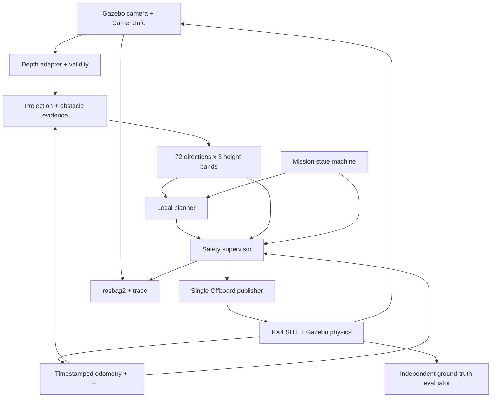

# Plan: camera-based drone obstacle avoidance, simulation first

## Status and sources

- The overall design has not passed flight acceptance. G0 offline has code/tests/a demo; see the README and native roadmap for the scope of the evidence.
- When the plan was imported, the repo contained only a README; there were no ROS nodes, simulator launcher, runner, or CI.
- The [original 15-page PDF](source/drone-obstacle-avoidance-plan.pdf) is preserved byte-for-byte.
- Original filename, preserved for provenance: `Plan Computer Vision tránh vật cản cho Drone (mô phỏng trước).pdf`. English translation: “Computer Vision Plan for Drone Obstacle Avoidance (Simulation First)”; see the [unchanged original](source/drone-obstacle-avoidance-plan.pdf).
- SHA-256: `bfa563dfdab513089d9006581eae0011a78a1d67e46e885cb4db0e84adbaf26c`.
- This version normalizes the content and addresses the risks in the [review](REVIEW.md). It is not a verbatim transcription of the PDF.
- The [scenario catalog](SCENARIOS.md) retains all 30 original cases and adds missing cases.
- The [harness](HARNESS.md) defines how the agent develops and how the evaluator assesses independently.
- The [supplementary safety contract](SAFETY.md) corrects phase-specific contact/clearance, outcome precedence, coverage, and implementation order. G0 verifies geometry/freshness offline; the flight contracts do not yet have SITL proof.

## 1. Goals and limits

A simulated drone flies from A to B, avoiding obstacles with a depth camera. Core milestone: at least 45/50 valid missions succeed on a frozen seed set, with no collisions and with the safety gates below satisfied. This is an experimental target, not proof that the real-world success probability is ≥90%.

Initial defaults: an indoor environment, static obstacles, one drone, and fixed-altitude flight within a verified region. This deliberately narrows the initial problem; outdoor environments and moving obstacles are evaluated in separate sets.

Retain the PDF's learning direction:

- Simulation depth first; stereo SGBM next; monocular metric depth last.
- No ML in stages 0–3. Stage 4 uses pretrained inference only; no training/fine-tuning.
- Do not buy hardware to solve simulation software defects.
- No RL, multi-drone operation, full SLAM, or real flight in the core scope.
- The PDF's pace of 8–10 hours/week and 16–20 weeks is a reference only, not a commitment.

## 2. Architecture decisions

| Component | Decision | Condition |
| --- | --- | --- |
| Benchmark platform | Ubuntu 24.04, ROS 2 Jazzy, Gazebo Harmonic, PX4 SITL | Windows is for reading/coding; WSL2/containers need a separate smoke test before being considered equivalent |
| Initial model | `gz_x500_depth` | Read the actual collision dimensions, extrinsics, and FOV from the pinned model |
| Language | Python, NumPy, OpenCV, `rclpy` | Optimize after measuring bottlenecks; do not rewrite in C++ first |
| PX4 transport | Micro XRCE-DDS | `px4_msgs` must match the firmware; do not mix arbitrary branches |
| Perception | Metric depth, validity state, projection, 72×3 histogram | Do not use a PX4 message as the internal multi-height-band contract |
| Planner | Local histogram/VFH-inspired, hysteresis, bounded recovery | Call it VFH+ only after implementing and checking the complete original algorithm |
| Control | Velocity + yaw through Offboard; PX4 provides stabilization | One final publisher; no safety bypass path |
| Safety | Supervisor independent of planner/inference | Do not rely on Collision Prevention in Offboard |
| Evaluator | Separate ground truth, contacts, clock, and logs | Do not give the planner an oracle/ground-truth map |

Do not freeze PX4 to a release merely because the PDF mentions v1.16. The v1.16 contracts in the review are fixed-source reference points; the actual firmware in the running environment must be recorded. Do not infer firmware from an image name.

The image `px4io/px4-sitl-gazebo-ros2` exists, and its provider describes it as containing firmware, `px4_msgs`, the Agent, and a ROS/Gazebo environment. Multi-architecture digest observed on 2026-11-03:

```text
px4io/px4-sitl-gazebo-ros2@sha256:2c01c89215a5f541d3a819c1bd2115ff27c9423679f3738dbb4096271d77084b
```

The base image ran an unarmed X500 depth model but lacked the ROS bridge; retain the [historical probe](environments/g1-observation.json). After approval to add the bridge, the [derived image](../docker/g1/Dockerfile) passed the [environment smoke test](environments/g1-bridge-observation.json): ROS Image/CameraInfo, optical TF, and Gazebo `/clock` aligned with raw PX4 odometry when `UXRCE_DDS_SYNCT=0`. The dependency lock pins 13 archives and does not upgrade the base; firmware/messages/assets/Agent were recorded from actual observations. This is only `g1-environment`, not flight/calibration G1. If DDS topics/firmware change, build the corresponding messages.

## 3. Pipeline and safety boundaries



Layer 0 orchestrates; layers 1–8 still correspond to the PDF. Initially, adapter/projection/histogram may be combined in one node; safety and the Offboard bridge may share a small process, **not the planner/inference process**. The evaluator runs in a separate, read-only process.

| Layer | Input and output | Main invariant |
| --- | --- | --- |
| 0 | PX4 status/ack + health → mission state | Transition based on acknowledgments and observed state, not fixed waiting periods |
| 1 | Camera → image + intrinsics + capture timestamp | Dimensions, encoding, FOV, QoS, and clock domain must be explicit |
| 2 | Sim/stereo/model → `32FC1` meters + validity | Distinguish `VALID`, `TOO_CLOSE`, `NO_RETURN`, `UNKNOWN`; the adapter must verify semantics |
| 3 | Depth + pose at the same instant → ENU obstacle evidence | Correct optical frame; do not mix the current pose with an old image |
| 4 | Evidence → 72 bins × 5° × 3 height bands | Each bin has distance, coverage, timestamp/epoch, and validity; blind regions are not free |
| 5 | Histogram + odom + goal → velocity/yaw proposal with expiry | No ground-truth access; cost/hysteresis must not override safety |
| 6 | Proposal + health + coverage → safe command | Check actual velocity and stopping distance; reject old commands even while the bridge still sends a heartbeat |
| 7 | Safe command → PX4 setpoint + `OffboardControlMode` | Publish only fields appropriate to the control mode; do not automatically reclaim lost authority |
| 8 | PX4 + physics → motion, status, odom | Configure and fault-inject failsafes; do not trust defaults |

### Geometry contract

- Standard ROS depth is **Z along the optical axis**, not inherently distance along the ray.
- For a rectified image: `X=(u-cx)*Z/fx`, `Y=(v-cy)*Z/fy`; then apply TF optical → body → ENU.
- Camera optical: x right, y down, z forward. ROS body FLU: x forward, y left, z up.
- ENU → NED vector conversion: `(x,y,z) -> (y,x,-z)`; FLU → FRD: `(x,y,z) -> (x,-y,-z)`.
- Quaternions require a basis change and the correct field order; do not permute elements as if they were vectors.
- All internal units are meters/radians/seconds. Convert to cm only at the `ObstacleDistance` adapter.
- Radius/height include propellers, pose error, tracking error, and margin; obtain them from the model/configuration, not from guessing based on the X500 name.
- Distinguish the physical envelope used to measure clearance from the inflated planning envelope; do not subtract margins twice. Support-surface contact is exempt only under the pair/phase allowlist frozen in SAFETY.
- Retain every height band that the swept volume could contact. Exclude floor/ceiling only after proving they are outside the envelope.

### Depth and histogram contract

1. `NaN`, dropouts, unclear encoding, and bins outside the FOV are all unknown/blocked.
2. Treat “no obstacle within measurement range” as such only after the adapter has verified that the sensor correctly represents `NO_RETURN`.
3. Newly appearing near pixels have an immediate blocking fast path. The 5% percentile and temporal median only help reduce noise; they must not erase that evidence.
4. Do not apply a median directly to the same pixel across different poses; motion compensation or discarding history is required.
5. Inflate the footprint/swept volume in Cartesian space before selecting a direction. Do not treat `atan(r/d)` as a geometric guarantee.
6. Reduce 3D bands to conservative 2.5D commands. Altitude-changing flight requires a new planner/safety design.
7. Use `ObstacleDistance` only for Collision Prevention debugging in Position mode. Retain a separate internal message for metadata/height bands.
8. One valid ray does not clear an entire bin/corridor. Coverage must support the footprint/swept path under the sampling model; gaps between rays, occluded regions, and areas outside the trusted range remain unknown.

### Velocity and latency contract

For static obstacles and a constant-deceleration braking model:

```text
available = max(0, d - d_safe)
v_limit = max(0, -a_brake * latency + sqrt((a_brake * latency)^2 + 2*a_brake*available))
```

- `d` is the distance along the swept path to the obstacle surface; the measurement reference and `d_safe` must be consistent.
- `a_brake > 0` is a conservative **measured** braking acceleration, not a configured acceleration limit.
- `latency >= 0` includes acquisition, buffering, inference, filtering, scheduling, transport, and tracking delay.
- `d <= d_safe` returns 0; non-finite distance/latency or invalid configuration blocks motion.
- PDF example: `a=2`, `latency=0.3`, `d=4`, `d_safe=1` gives approximately `2.916 m/s`.
- The formula does not model jerk, wind, approaching obstacles, or oscillation. G2/G3 must measure the actual stopping envelope and use more conservative limits.
- Command limiting cannot remove existing momentum. The supervisor checks actual velocity, side-slip, and the braking path.
- p95 is a performance metric, not a safety bound. Frames that miss their deadline must be rejected separately.
- Capture/sim age and monotonic wall progress are separate domains. Freeze finite deadlines for sensor/pose/proposal/handoff; capture-to-publish and publish-to-tracking traces must not double-count delay. Calibration must be tied to workload/RTF/config.

Exploratory parameters from the PDF: 320×240 camera if needed; 0.3–10 m range; stale depth 0.3 s; setpoint/heartbeat target 20 Hz; stuck threshold 5 s sim time; at most 3 recoveries. All must be recorded in the config and remeasured, not treated as certified constants.

### Mission state and abort

Normal flow: `IDLE -> PREFLIGHT -> ARM -> TAKEOFF -> NAVIGATE <-> RECOVER -> GOAL_HOLD -> LAND -> DONE`.

- PREFLIGHT verifies clock, pose, depth/coverage, namespace, control authority, takeoff volume, and failsafe configuration.
- Prime `OffboardControlMode` for over 1 second before entry; send at >2 Hz, target 20 Hz, and confirm that PX4 actually enters Offboard.
- Check arm/mode acknowledgments and `VehicleStatus`; retries are bounded. Landing is complete only after landed + disarmed are confirmed.
- Goal reached: distance <0.3 m and speed ≤0.1 m/s continuously for 1 s sim time; latch the goal, without circling back.
- RECOVER: stop first; yaw-scan only when the rotation envelope is safe; translate only when the corridor has fresh data.
- Do not reverse into blind regions. A 360° scan does not make all directions “fresh” simultaneously; each bin has its own age.
- Depth lost but pose healthy: bounded braking/position hold; hovering is not indefinitely safe.
- Pose required for control lost: do not pretend to hold. Hand over to the configured PX4 behavior and observe the result.
- PX4 exits Offboard on its own: stop publishing interfering setpoints; do not automatically arm/reclaim authority.
- Fault while control authority remains: send the appropriate mode request, confirm handoff, then stop the stream. If the bridge dies, rely on tested PX4 failsafes.
- Do not establish an “all faults land in place” rule: without a downward sensor, a safe landing site is unknown. In simulation, this fault needs its own scenario and must not count as mission success.

## 4. Roadmap and gates

These are gate criteria; current status is in the native roadmap and its automatically generated portable version. G0 has an offline implementation; this does not mean G1–G4 have passed. Do not advance stages based on weeks elapsed.

| Gate | Work | Complete when |
| --- | --- | --- |
| G0 — Geometry offline | NumPy depth, intrinsics, frames, histogram, braking | Behavioral tests for geometry and invalid input; actual synthetic depth images run through the pipeline, with visible point cloud/histogram; A04, A05, B07, C08, E01–E08, E20 |
| G1 — Stack/offboard | Unarmed environment; minimal oracle/logger and supervisor; empty-world mission; calibration | Contact/clearance oracle and supervisor precede flight. Fly a 5 m square in a known-clear bootstrap volume, hold/land/disarm; measure stopping/delay; bag + ULog; C02–C04, E09–E12, E21–E23, F09 |
| G2 — Perception | Pose-compensated projection, evidence-preserving filters, inflation, coverage | Bag replay and 10/10 wall-test flights; group A, E01–E08, E13–E17, E20, E24–E25; Collision Prevention is auxiliary debugging only |
| G3 — Navigation/safety | Planner, state machine, recovery, runner, and batch using the oracle available since G1 | A–D, E01–E17, E20–E25, F01–F10 under the suite semantics in SAFETY; ≥45/50 frozen navigation worlds, zero unsafe events in navigation, separate safety/stress reports |
| G4 — Stereo/mono | Calibrated stereo first; DA2 Metric Hypersim Small is the initial indoor mono option | Offline scale/uncertainty and latency checks; ≥40/50 on the same 50 seeds as in the PDF, retaining the safety gates; A09–A10, E18–E19, F06 |
| G5 — Optional | Choose one: global map/planner, VIO, EGO-Planner benchmark, or hardware | New design/gates for the selected branch; do not combine all directions at once |

G0 must run without ROS/GPU. G1 is the first real Linux/SITL gate; if no compatible machine is available, record the blocker rather than fabricating logs.

The detailed order is in the native roadmap: unarmed G1 environment, static oracle/supervisor, bootstrap flight, calibration, then G2 wall-stop. Do not postpone oracle/safety until G3. Bootstrap is not navigation acceptance.

## 5. Evaluation and safeguards against easy self-grading

- Two separate sets: development seeds for tuning and test seeds frozen before benchmarking; do not tune against test failures.
- All 50 worlds must be valid for the footprint, fixed-altitude route, start/goal, and geofence. Map-aware A* runs only in the evaluator.
- Record every world rejected by the generator, the reason, and the number of attempts; do not regenerate a seed merely because the planner failed.
- Success = contractual goal hold + no unsafe event throughout the trial + complete telemetry + completed mission termination.
- Navigation clearance ≥0.5 m is measured from the physical body/propeller envelope in NAVIGATE/RECOVER/GOAL_HOLD, including floor/ceiling. Takeoff/landing use separate envelopes; only landing-gear/support-surface pairs allowlisted for the correct phase may contact.
- Navigation acceptance allows no unsafe events; reaching the goal in 45/50 does not compensate for one collision. Maintain a contact ledger for the entire trial, including after the goal and during shutdown.
- Navigation, safety-negative, and stress-diagnostic are three suites frozen before a run; negative/stress results do not add to navigation success. Do not change suite membership after observing failure.
- Time-to-goal is measured from entry into NAVIGATE through completion of goal hold, excluding takeoff/landing; the limit is ≤2× a feasible reference time under the same motion constraints. Without a dynamics-correct reference, report path/detour, but the time-efficiency gate remains unmet. Grid-centre A* requires additional continuous segment/footprint validation.
- Separate wall-time compute/transport latency, sim-time data age, and tracking delay. Sim-depth p95 capture-to-setpoint target ≤100 ms; log deadline misses, not just p95.
- Report execution outcome and safety outcome separately; observed unsafe events latch and are not overwritten by infrastructure crashes/telemetry loss. Do not hide crashes from reports or treat a missing observer as zero collisions.
- Include a Wilson 95% CI with the success rate. The lower bound for 45/50 is approximately 78.6%; it does not prove ≥90% across all worlds.
- Evaluate by geometry type, density, clearance, and noise, not only the overall average.
- Moving obstacles/glass/thin wires belong to a stress suite with sensor limitations; do not claim protection against what has not been observed.

## 6. Immediate actions

1. Run the G0 core with `python -m pytest -q` and `python scripts/g0_demo.py --output artifacts/<new-name>`; do not use synthetic fixtures to certify the sensor/flight stack.
2. The unarmed Linux/SITL environment has been smoke-tested and locked; retain the clock policy, assets, and dependency lock. Do not automatically install Docker/WSL/dual boot or infer performance from a software-rendering smoke test.
3. Implement the minimal oracle/logger and supervisor before G1 flight; enable perception wall-stop and navigation only after calibration. All unmeasured numerical bounds remain pending.

Technical documentation and sources: [REVIEW.md](REVIEW.md). Operating procedures, evidence, and automation scope: [HARNESS.md](HARNESS.md).
