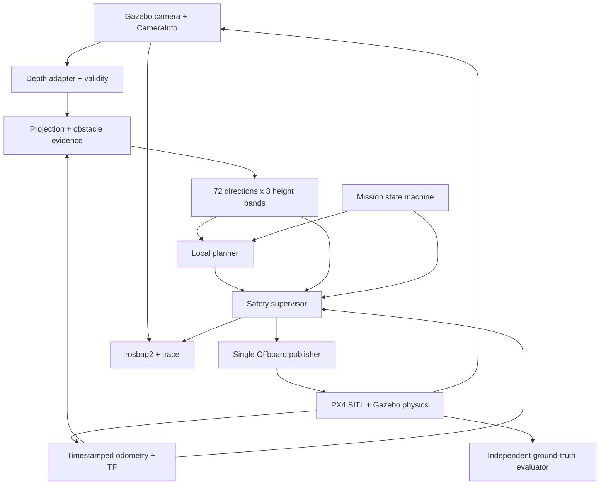

# Plan: drone tránh vật cản bằng camera, mô phỏng trước

## Trạng thái và nguồn

- Thiết kế tổng thể chưa đạt flight acceptance. G0 offline đã có code/test/demo; xem README và native roadmap để biết phạm vi bằng chứng.
- Repo khi nhập plan chỉ có README; chưa có ROS node, simulator launcher, runner hay CI.
- [PDF gốc, 15 trang](source/drone-obstacle-avoidance-plan.pdf) được giữ nguyên byte.
- Tên gốc: `Plan Computer Vision tránh vật cản cho Drone (mô phỏng trước).pdf`.
- SHA-256: `bfa563dfdab513089d9006581eae0011a78a1d67e46e885cb4db0e84adbaf26c`.
- Bản này chuẩn hoá nội dung và sửa các rủi ro trong [phản biện](REVIEW.md). Không phải bản chép nguyên văn PDF.
- [Danh mục scenario](SCENARIOS.md) giữ đủ 30 case gốc và thêm các case còn thiếu.
- [Harness](HARNESS.md) quy định cách agent phát triển và cách evaluator chấm độc lập.
- [Contract an toàn bổ sung](SAFETY.md) sửa contact/clearance theo phase, outcome precedence, coverage và thứ tự triển khai. G0 kiểm chứng geometry/freshness offline; các contract bay chưa có SITL proof.

## 1. Mục tiêu và giới hạn

Drone mô phỏng bay từ A tới B, né vật cản bằng depth camera. Mốc lõi: ít nhất 45/50 nhiệm vụ hợp lệ thành công trên bộ seed đóng băng, không va chạm, cùng các gate an toàn bên dưới. Đây là mục tiêu thực nghiệm, không chứng minh xác suất thành công thực tế ≥90%.

Mặc định ban đầu: môi trường trong nhà, vật cản tĩnh, một drone, bay ở độ cao cố định trong vùng đã kiểm tra. Đây là lựa chọn thu hẹp bài toán ban đầu; ngoài trời và vật cản động được đánh giá thành bộ riêng.

Giữ nguyên hướng học của PDF:

- Simulation depth trước; stereo SGBM sau; monocular metric depth cuối cùng.
- Giai đoạn 0–3 không ML. Giai đoạn 4 chỉ inference pretrained; không train/fine-tune.
- Không mua phần cứng để giải quyết lỗi phần mềm mô phỏng.
- Không RL, multi-drone, SLAM đầy đủ hay bay thật trong phạm vi lõi.
- Nhịp 8–10 giờ/tuần và 16–20 tuần trong PDF chỉ là tham khảo, không phải cam kết.

## 2. Các quyết định kiến trúc

| Thành phần | Quyết định | Điều kiện |
| --- | --- | --- |
| Nền tảng benchmark | Ubuntu 24.04, ROS 2 Jazzy, Gazebo Harmonic, PX4 SITL | Windows dùng để đọc/code; WSL2/container cần smoke riêng trước khi coi tương đương |
| Model ban đầu | `gz_x500_depth` | Đọc kích thước collision, extrinsics và FOV thực từ model đã pin |
| Ngôn ngữ | Python, NumPy, OpenCV, `rclpy` | Tối ưu sau khi đo bottleneck; không viết lại C++ trước |
| PX4 transport | Micro XRCE-DDS | `px4_msgs` phải khớp firmware; không trộn branch ngẫu nhiên |
| Perception | Metric depth, trạng thái hợp lệ, projection, histogram 72×3 | Không dùng message PX4 làm contract nội bộ nhiều dải cao |
| Planner | Local histogram/VFH-inspired, hysteresis, recovery giới hạn | Chỉ gọi VFH+ khi thực hiện và đối chiếu đủ thuật toán gốc |
| Điều khiển | Velocity + yaw qua Offboard; PX4 giữ ổn định | Một publisher cuối cùng; safety không có đường bypass |
| Safety | Supervisor độc lập với planner/inference | Không dựa vào Collision Prevention trong Offboard |
| Evaluator | Ground truth, contacts, clock và log riêng | Không đưa oracle/ground-truth map cho planner |

Không đóng băng PX4 vào một release chỉ vì PDF nhắc v1.16. Các contract v1.16 trong phản biện là mốc có nguồn cố định; firmware thực của môi trường chạy phải được ghi nhận. Không suy luận firmware từ tên image.

Image `px4io/px4-sitl-gazebo-ros2` tồn tại và nhà cung cấp mô tả có firmware, `px4_msgs`, Agent cùng môi trường ROS/Gazebo. Digest đa kiến trúc quan sát ngày 2026-11-03:

```text
px4io/px4-sitl-gazebo-ros2@sha256:2c01c89215a5f541d3a819c1bd2115ff27c9423679f3738dbb4096271d77084b
```

Image nền đã chạy unarmed X500 depth nhưng thiếu ROS bridge; giữ [probe lịch sử](environments/g1-observation.json). Sau phê duyệt bổ sung bridge, [image dẫn xuất](../docker/g1/Dockerfile) đã qua [environment smoke](environments/g1-bridge-observation.json): ROS Image/CameraInfo, optical TF và Gazebo `/clock` khớp raw PX4 odometry khi `UXRCE_DDS_SYNCT=0`. Dependency lock pin 13 archive và không upgrade nền; firmware/messages/assets/Agent được ghi nhận thực tế. Đây chỉ là `g1-environment`, chưa phải flight/calibration G1. Nếu sửa DDS topics/firmware phải build messages tương ứng.

## 3. Pipeline và ranh giới an toàn



Tầng 0 điều phối; tầng 1–8 vẫn tương ứng PDF. Ban đầu có thể gộp adapter/projection/histogram thành một node; safety và Offboard bridge có thể cùng process nhỏ, **không cùng process planner/inference**. Evaluator ở process riêng, chỉ đọc.

| Tầng | Input và output | Bất biến chính |
| --- | --- | --- |
| 0 | PX4 status/ack + health → trạng thái nhiệm vụ | Chuyển state theo ack và trạng thái quan sát; không theo thời gian chờ cố định |
| 1 | Camera → image + intrinsics + capture timestamp | Kích thước, encoding, FOV, QoS, clock domain phải rõ |
| 2 | Sim/stereo/model → `32FC1` mét + validity | Phân biệt `VALID`, `TOO_CLOSE`, `NO_RETURN`, `UNKNOWN`; adapter phải xác minh semantics |
| 3 | Depth + pose cùng thời điểm → obstacle evidence ENU | Optical frame đúng; không trộn pose hiện tại với ảnh cũ |
| 4 | Evidence → 72 bin × 5° × 3 dải cao | Mỗi bin có distance, coverage, timestamp/epoch, validity; vùng mù không phải free |
| 5 | Histogram + odom + goal → velocity/yaw proposal có hạn dùng | Không truy cập ground truth; cost/hysteresis không được thắng safety |
| 6 | Proposal + health + coverage → safe command | Kiểm tra cả vận tốc thật và quãng phanh; reject lệnh cũ dù bridge còn heartbeat |
| 7 | Safe command → PX4 setpoint + `OffboardControlMode` | Chỉ phát trường đúng control mode; mất quyền không tự chiếm lại |
| 8 | PX4 + physics → chuyển động, status, odom | Failsafe được cấu hình và fault-inject; không tin giá trị mặc định |

### Contract hình học

- Depth ROS chuẩn là **Z theo trục optical**, không mặc nhiên là khoảng cách dọc tia.
- Với ảnh rectified: `X=(u-cx)*Z/fx`, `Y=(v-cy)*Z/fy`; sau đó TF optical → body → ENU.
- Camera optical: x phải, y xuống, z trước. ROS body FLU: x trước, y trái, z lên.
- Chuyển vector ENU → NED: `(x,y,z) -> (y,x,-z)`; FLU → FRD: `(x,y,z) -> (x,-y,-z)`.
- Quaternion phải chuyển basis và đúng thứ tự field; không hoán vị phần tử như vector.
- Tất cả nội bộ dùng mét/radian/giây. Chỉ đổi cm tại adapter `ObstacleDistance`.
- Bán kính/chiều cao gồm propellers, sai số pose, tracking và margin; lấy từ model/cấu hình, không đoán từ tên X500.
- Phân biệt envelope vật lý để đo clearance với envelope inflate cho planning; không trừ margin hai lần. Contact support surface chỉ được miễn theo pair/phase allowlist đóng băng trong SAFETY.
- Giữ toàn bộ dải độ cao mà swept volume có thể chạm. Chỉ loại floor/ceiling khi chứng minh chúng ngoài envelope.

### Contract depth và histogram

1. `NaN`, dropout, encoding không rõ và bin ngoài FOV đều là unknown/chặn.
2. Chỉ coi “không có vật trong tầm đo” khi adapter đã xác minh sensor biểu diễn đúng `NO_RETURN`.
3. Pixel gần mới xuất hiện có fast path chặn ngay. Percentile 5% và temporal median chỉ hỗ trợ giảm nhiễu, không được xoá bằng chứng đó.
4. Không median trực tiếp cùng pixel qua các pose khác nhau; cần motion compensation hoặc bỏ history.
5. Inflation theo footprint/swept volume trong không gian Cartesian trước khi chọn hướng. Không coi `atan(r/d)` là bảo đảm hình học.
6. Dải 3D gộp thành lệnh 2.5D bảo thủ. Bay đổi độ cao cần thiết kế planner/safety mới.
7. `ObstacleDistance` chỉ dùng cho debug Collision Prevention ở Position mode. Giữ message nội bộ riêng cho metadata/dải cao.
8. Một ray hợp lệ không clear cả bin/corridor. Coverage phải đủ cho footprint/swept path theo sampling model; khoảng giữa ray, vùng occlusion và phần ngoài tầm tin cậy vẫn unknown.

### Contract vận tốc và độ trễ

Với vật tĩnh và mô hình phanh gia tốc không đổi:

```text
available = max(0, d - d_safe)
v_limit = max(0, -a_brake * latency + sqrt((a_brake * latency)^2 + 2*a_brake*available))
```

- `d` là khoảng cách theo swept path đến obstacle surface; mốc đo và `d_safe` phải nhất quán.
- `a_brake > 0` là gia tốc phanh bảo thủ **đã đo**, không phải giới hạn gia tốc cấu hình.
- `latency >= 0` gồm acquisition, buffering, inference, filtering, scheduling, transport và tracking delay.
- `d <= d_safe` trả 0; distance/latency không hữu hạn hoặc cấu hình vô lý thì chặn.
- Ví dụ PDF: `a=2`, `latency=0.3`, `d=4`, `d_safe=1` cho khoảng `2.916 m/s`.
- Công thức không mô hình jerk, gió, vật tiến lại hoặc rung lắc. G2/G3 phải đo stopping envelope thực và dùng giới hạn bảo thủ hơn.
- Giới hạn lệnh không xoá được quán tính hiện có. Supervisor kiểm tra velocity thật, side-slip và đường phanh.
- p95 là metric hiệu năng, không phải bound an toàn. Frame quá deadline phải bị từ chối riêng.
- Capture/sim age và monotonic wall progress là hai domain riêng. Đóng băng deadline finite cho sensor/pose/proposal/handoff; trace capture-to-publish và publish-to-tracking không được tính trùng delay. Calibration phải gắn workload/RTF/config.

Thông số thăm dò từ PDF: camera 320×240 nếu cần; tầm 0.3–10 m; stale depth 0.3 s; setpoint/heartbeat mục tiêu 20 Hz; kẹt 5 s sim time; tối đa 3 recovery. Tất cả phải ghi vào config và đo lại, không coi là hằng số chứng nhận.

### Mission state và abort

Luồng bình thường: `IDLE -> PREFLIGHT -> ARM -> TAKEOFF -> NAVIGATE <-> RECOVER -> GOAL_HOLD -> LAND -> DONE`.

- PREFLIGHT xác minh clock, pose, depth/coverage, namespace, quyền điều khiển, volume cất cánh và cấu hình failsafe.
- Prime `OffboardControlMode` trên 1 giây trước entry; gửi >2 Hz, mục tiêu 20 Hz, và xác nhận PX4 thực sự vào Offboard.
- Kiểm tra ack arm/mode và `VehicleStatus`; retries hữu hạn. Land hoàn tất chỉ khi landed + disarmed được xác nhận.
- Đạt goal: khoảng cách <0.3 m, tốc độ ≤0.1 m/s liên tục 1 s sim time; chốt goal, không bay vòng trở lại.
- RECOVER: dừng trước, chỉ yaw scan khi rotation envelope an toàn; chỉ tịnh tiến khi corridor đang có dữ liệu mới.
- Không lùi vào vùng mù. Scan 360° không làm mọi hướng “mới” cùng lúc; mỗi bin có tuổi riêng.
- Mất depth nhưng pose tốt: phanh/giữ vị trí có giới hạn thời gian; hover không phải hành động an toàn vô hạn.
- Mất pose cần cho control: không giả vờ hold. Chuyển sang hành vi PX4 đã cấu hình, quan sát kết quả.
- PX4 tự thoát Offboard: ngừng phát setpoint can thiệp, không tự arm/chiếm quyền lại.
- Lỗi còn quyền điều khiển: gửi mode yêu cầu phù hợp, xác nhận handoff rồi dừng stream. Bridge chết: dựa vào failsafe PX4 đã test.
- Không đặt quy tắc “mọi lỗi đều land tại chỗ”: không có cảm biến hướng xuống nên không biết điểm hạ cánh an toàn. Trong sim, lỗi này phải có scenario riêng và không được tính là mission success.

## 4. Lộ trình và gate

Đây là tiêu chí gate; trạng thái hiện tại nằm trong native roadmap và bản portable sinh tự động. G0 có triển khai offline, không đồng nghĩa G1–G4 đạt. Không chuyển giai đoạn theo số tuần.

| Gate | Công việc | Xong khi |
| --- | --- | --- |
| G0 — Geometry offline | NumPy depth, intrinsics, frames, histogram, braking | Test hành vi hình học và invalid input; chạy ảnh depth tổng hợp thật qua pipeline, nhìn được point cloud/histogram; A04, A05, B07, C08, E01–E08, E20 |
| G1 — Stack/offboard | Môi trường không arm; oracle/logger và supervisor tối thiểu; mission trống; calibration | Oracle contact/clearance và supervisor có trước flight. Bay vuông 5 m trong known-clear bootstrap volume, hold/land/disarm; đo stopping/delay; bag + ULog; C02–C04, E09–E12, E21–E23, F09 |
| G2 — Perception | Projection bù pose, evidence-preserving filters, inflation, coverage | Replay bag và bay kiểm tra tường 10/10; nhóm A, E01–E08, E13–E17, E20, E24–E25; Collision Prevention chỉ là debug phụ |
| G3 — Navigation/safety | Planner, state machine, recovery, runner và batch dùng oracle có từ G1 | A–D, E01–E17, E20–E25, F01–F10 theo suite semantics trong SAFETY; ≥45/50 frozen navigation worlds, zero unsafe trong navigation, safety/stress report riêng |
| G4 — Stereo/mono | Stereo hiệu chuẩn trước; DA2 Metric Hypersim Small là lựa chọn mono indoor ban đầu | Offline kiểm tra scale/uncertainty và latency; chạy cùng bộ 50 seed ≥40/50 như PDF, vẫn giữ gate an toàn; A09–A10, E18–E19, F06 |
| G5 — Tuỳ chọn | Chọn một: global map/planner, VIO, benchmark EGO-Planner hoặc phần cứng | Thiết kế/gate mới theo nhánh; không gộp mọi hướng cùng lúc |

G0 phải chạy không ROS/GPU. G1 là gate Linux/SITL thật đầu tiên; chưa có máy chạy tương thích thì ghi blocker, không chế log.

Thứ tự chi tiết nằm trong native roadmap: G1 environment không arm, oracle/supervisor tĩnh, bootstrap flight, calibration, rồi G2 wall-stop. Không trì hoãn oracle/safety đến G3. Bootstrap không phải navigation acceptance.

## 5. Đánh giá và chống tự chấm dễ

- Hai bộ tách biệt: development seeds để tune, test seeds đóng băng trước benchmark; không tune theo test failures.
- 50 world phải hợp lệ theo footprint, fixed-altitude route, start/goal và geofence. A* biết map chỉ chạy trong evaluator.
- Ghi mọi world bị generator loại, lý do và số lần thử; không sinh lại seed chỉ vì planner thất bại.
- Success = goal hold đúng contract + không unsafe event toàn trial + telemetry đầy đủ + hoàn tất kết thúc nhiệm vụ.
- Navigation clearance ≥0.5 m đo từ envelope vật lý thân/propellers trong NAVIGATE/RECOVER/GOAL_HOLD, gồm floor/ceiling. Takeoff/landing dùng envelope riêng; chỉ landing-gear/support-surface pair đã allowlist đúng phase được phép contact.
- Navigation acceptance không có unsafe event; 45/50 tới đích không bù một collision. Giữ contact ledger toàn trial, cả sau goal và khi shutdown.
- Navigation, safety-negative và stress-diagnostic là ba suite đóng băng trước run; negative/stress không cộng navigation success. Không chuyển suite sau khi thấy fail.
- Time-to-goal đo từ lúc vào NAVIGATE đến hết goal hold, không gồm takeoff/landing; giới hạn ≤2× reference time khả thi cùng motion constraints. Nếu chưa có reference đúng dynamics, report path/detour nhưng gate time-efficiency chưa đạt. Grid-centre A* phải thêm continuous segment/footprint validation.
- Tách compute/transport latency wall time, sim-time data age và tracking delay. Sim depth p95 capture-to-setpoint mục tiêu ≤100 ms; log deadline misses, không chỉ p95.
- Report execution outcome và safety outcome riêng; unsafe đã quan sát được latch, không bị infra crash/telemetry loss ghi đè. Không giấu crash khỏi report hoặc coi thiếu observer là zero collision.
- Wilson 95% CI đi kèm success rate. 45/50 có cận dưới khoảng 78.6%, chưa chứng minh ≥90% trên mọi world.
- Đánh giá theo loại geometry, density, clearance và nhiễu; không chỉ average toàn bộ.
- Điều kiện vật động/kính/dây mảnh là stress suite có giới hạn cảm biến; không tuyên bố được bảo vệ nếu chưa quan sát được.

## 6. Việc làm ngay

1. Chạy core G0 bằng `python -m pytest -q` và `python scripts/g0_demo.py --output artifacts/<new-name>`; không dùng fixture synthetic để chứng nhận sensor/flight stack.
2. Environment Linux/SITL không arm đã smoke và lock; giữ nguyên clock policy, assets và dependency lock. Không tự cài Docker/WSL/dual boot hoặc suy ra performance từ smoke software rendering.
3. Triển khai oracle/logger và supervisor tối thiểu trước G1 flight; chỉ sau calibration mới mở perception wall-stop và navigation. Mọi numerical bound chưa đo vẫn là pending.

Tài liệu và nguồn kỹ thuật: [REVIEW.md](REVIEW.md). Quy trình thao tác, evidence và phạm vi tự động hoá: [HARNESS.md](HARNESS.md).
