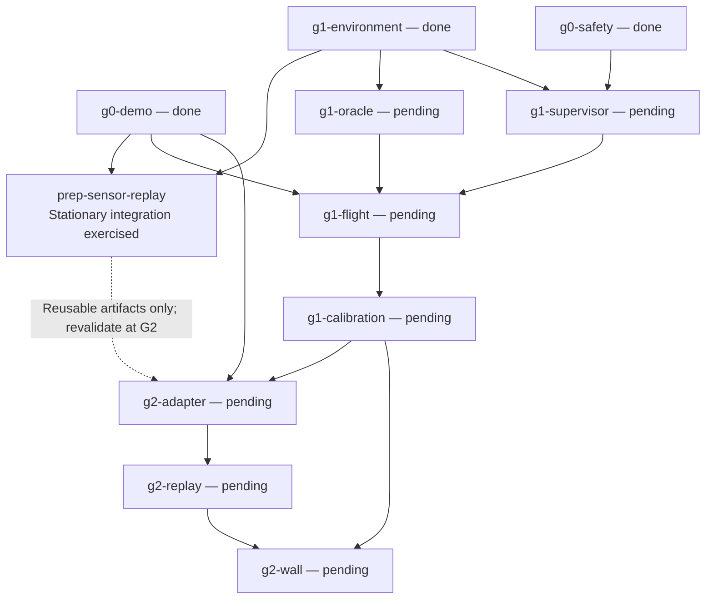

# Plan: replay real Gazebo depth through the offline freespace spike

**Status:** Implemented and exercised after user approval. See [observed results and reproducible artifacts](SENSOR_REPLAY_RESULTS.md); current task status remains in the native roadmap.

## Goal

Record an unarmed Gazebo sensor sequence, replay it through the perception spike, and show that reconstructed geometry and gating reasons agree with independently defined targets.

**This step validates data integration and geometry, not flight or perception-authorized A-to-B navigation.** A stationary forward camera is expected to leave a blind zone and may correctly keep the motion query blocked.

## Existing baseline

- PR #5 established a pinned X500 depth/ROS camera/clock environment; PR #7 integrated the corrected offline freespace spike.
- ROS depth is `32FC1`, 640×480, with the pinned optical mount and CameraInfo. Gazebo `/clock` is the common time source; `UXRCE_DDS_SYNCT=0`.
- At planning time, the spike's capture pose represented yaw-only level flight. The implemented boundary now preserves roll/pitch; this does not create a tilted-flight collision certificate.
- The spike has simulation-time TTL and sampled geometric gating, not a live wall-progress watchdog or continuous-volume safety proof.
- Native roadmap flight/calibration and G2 acceptance remain pending. This experiment will not mark those tasks complete.

## Scope

**Include:** one static simulator fixture, bounded recording, capture-time odometry conversion, deterministic offline replay, independent target checks, and English figures/results.

**Exclude:** arm/takeoff, model teleportation to manufacture history, setpoints, planner, supervisor, flight oracle implementation, GPU/driver/WSL changes, model weights, and a new mapping architecture.

## Roadmap alignment and branch

- Native task: `prep-sensor-replay`, added at roadmap revision 34. Its implementation and evidence are limited to this unarmed preparation branch.
- Required completed prerequisites: `g1-environment` and `g0-demo`.
- This is an unarmed preparation branch, not an early start or completion of `g2-adapter` or `g2-replay`.
- No existing dependency is removed or relaxed. The dashed edge below means optional artifact reuse after revalidation, not a new mandatory dependency or gate waiver.

Planning and implementation are separate: publishing this draft and adding the pending task do not authorize its runtime execution. The user reviews this plan before the task is started. Existing G1 oracle/supervisor work remains independently ready under its own scope and permissions.

## Implementation sequence

### 1. Preflight and one bounded recording

- Reuse the retained pinned image and isolated container policy. Check rosbag recording/reading and storage plugins first; their presence has not yet been established. Missing packages are a blocker, not permission to install them.
- Create a separate fixture world retaining the name `default` so the current clock bridge remains valid. Keep the stock image/assets and prior evidence unchanged; record the fixture's own SDF hash and declared spawn/target poses.
- Use visible plane/box targets at several declared distances and off-axis positions. Place them outside the resting vehicle envelope; do not change physics or preflight checks to obtain data.
- Record depth, CameraInfo, `/clock`, `/tf_static`, PX4 odometry and the actual discovered/versioned vehicle-status topic. Configure recorder QoS from the observed publishers, including transient-local static TF.
- Proposed recording limits: 30 seconds of monotonic wall time and a 1 GiB output budget. These are acquisition limits, not calibrated control deadlines. Stop on status leaving Disarmed, stalled clock, missing required streams or a limit breach; preserve the reason and partial output.
- Write to a new run directory containing the raw bag, run manifest and logs. Record actual image/firmware/messages/model identities, topic types/QoS, bag storage format, duration and counts. Clean up only run-owned processes/containers.

### 2. Decode and pair observations without controlling the vehicle

- Decode `32FC1` using width/height/stride/endianness and pair depth with matching CameraInfo. Calibration/frame changes invalidate affected history rather than falling back to default intrinsics or identity TF.
- Validate PX4 `pose_frame`; initially support the observed NED reference explicitly and reject unsupported/unknown references. Do not assume position, attitude and velocity fields share every frame convention.
- Validate finite quaternion components and bounded float32 norm error, then normalize in float64 at the PX4 boundary. Do not relax the core geometry validator globally. Verify the PX4-to-ROS basis conversion with independent axis/yaw/tilt cases.
- Use `timestamp_sample` to bracket image capture time. Interpolate position and orientation within the same reset/epoch; do not use bag receive time or the latest pose as capture pose. Reject unbracketed, duplicate/backward or excessive-gap data; choose and record the finite gap limit before evaluating the fixture.
- Extend the capture-pose boundary to preserve full orientation, while retaining the existing zero-tilt synthetic fixtures. This does not add a tilted-flight collision envelope or authorize movement.
- Keep reconstructed points in an explicitly named odometry ENU frame. The grader's world-to-odometry alignment must be declared independently from spawn/localization information and frozen before checking targets, not fitted to the depth result being graded.
- Bag record time is used for replay ordering/diagnostics only. Do not subtract it from simulation capture stamps or claim a live capture-to-decision wall-age bound.

### 3. Replay and inspect geometry

- Replay the immutable bag into a fresh epoch, preserving capture stamps, sequence identity and frame/pose pairing. Store normalized inputs separately so replay cannot overwrite raw evidence.
- Use the recorded sensor configuration, not synthetic defaults. Keep real-sensor `no_return_certified=False` in this slice: Gazebo `+Inf` has not yet passed dedicated semantics fixtures. Finite depth remains usable; uncertified no-return stays unsupported.
- Feed only depth, calibration and validated poses to the spike. Target coordinates/geometry are grader-only; never use them as a free-space certificate.
- Produce point-cloud/target overlays, the sampled envelope with FREE/UNSEEN/UNSUPPORTED/OBSTACLE labels, and a compact result summary with rejected-frame reasons and pairing coverage.
- Preserve the three recent guards: retained TOO_CLOSE survives dropout, an empty grid cannot allow motion, and trusted range cannot exceed the associated camera clip range.

### 4. Exercise failure boundaries and hand back results

- Test capture-pose interpolation and basis conversion with analytic fixtures, including nonzero roll/pitch and quaternion sign equivalence.
- Replay derived fault variants for missing CameraInfo/TF, pose gaps, backward/future stamps and reset-counter/epoch changes. Keep variants separate from the original bag and label injected faults explicitly.
- Unknown/stale/reset data must not silently refresh free history or authorize the query. After a reset, require valid new-epoch inputs before resuming processing.
- Keep the existing synthetic positive liveness case. Do not count it as a real-Gazebo positive-motion result.

## Acceptance for this step

| ID | Required observable outcome | Verification |
| --- | --- | --- |
| A1 | A bounded real recording contains the required streams and Disarmed status only; missing data produces an explicit failed/incomplete run. | Inspect bag metadata, manifest, status samples and recorder exit reason. |
| A2 | Each accepted depth frame has matching calibration and a valid capture-time pose; invalid pairings are rejected with reasons. | Adapter regressions plus pairing/rejection report from the bag. |
| A3 | Off-axis targets reconstruct in the declared frame without axis/sign/lever-arm mistakes. | Independent surface comparisons and overlays at multiple positions/ranges. |
| A4 | Stale/gap/reset fault variants cannot reuse invalid history to permit motion. | Behavioral regressions and derived-bag replay traces. |
| A5 | The stationary real-data query exposes its blind zone instead of obtaining a fabricated ALLOWED result. | Gating summary and sample-status visualization; a blocked query is expected here. |
| A6 | Original synthetic liveness and the three gating fixes remain intact; replay never creates a control publisher. | Existing regressions, changed-path tests and inspection of runtime interfaces. |

### Approved numeric checks

These acquisition/geometry checks are **not measured flight-safety bounds**:

- Evaluate at least 20 accepted frames after a declared 2-second wall-time warmup. At least 95% of post-warmup depth frames must have matching CameraInfo and valid bracketing odometry; report every exclusion.
- Require adjacent odometry samples bracketing capture time to be no more than 50 ms apart in simulation time. Larger gaps are rejected, not extrapolated.
- Use front-facing, off-axis and horizontal target surfaces within 2–5 m optical Z. Freeze target regions from declared geometry, with a 3-pixel edge exclusion, before inspecting depth errors.
- For each target and evaluated frame, require at least 95% finite valid support within its declared region. Point-to-surface error limits: p95 <= 0.10 m and maximum <= 0.20 m. Report every target/frame, missing support and outlier; pooled averages cannot hide a failure.

The error limits are initial integration checks for pixel discretization plus localization/alignment error, not proof of calibrated extrinsics or safe clearance. Review them against fixture geometry, pixel scale and independently established pose uncertainty before grading. If they are not defensible, revise this plan explicitly rather than relaxing them after a failed overlay. Configured sensor far clip is not itself a trusted detection-range bound.

## Implemented code scope

The [results](SENSOR_REPLAY_RESULTS.md) identify the actual recorder, pure capture-pose boundary, grader, bag replay and plotting entry points:

- Reuse `docker/g1/bridge.yaml` and the current environment recipe; add only fixture/recording configuration actually needed.
- Add a bag-to-spike adapter/replay entry point under `spike/freespace/`, keeping ROS imports outside the NumPy-only core.
- Extend `spike/freespace/camera.py` capture-orientation support and its behavioral tests where required.
- Keep grading/target geometry outside `evidence.py`; reuse existing plotting and no-clobber artifact conventions.
- Keep host/offline tests dependency-light; run actual bag decoding in the pinned ROS environment. Do not call a skipped ROS integration check a pass.

## Review handoff and next decision

Deliver code, the small fixture, raw bag provenance, replay outputs/figures, exercised checks and remaining blockers. Keep authored artifacts in English and user discussion in Vietnamese.

After explicit user approval, the implementation captured a fresh unarmed bag and exercised the frozen numeric criteria. The results preserve failed attempts and explain SDF-derived body-origin and physical-surface grader corrections. No G1 flight/calibration or G2 task was completed by this preparation slice, and no dependency was relaxed.

After this step, decide separately whether to collect sensor history with a camera-only rig or proceed to the G1 oracle/supervisor work. **No positive real-data navigation handoff is claimed until a valid moving observation history has actually been collected and tested.**
