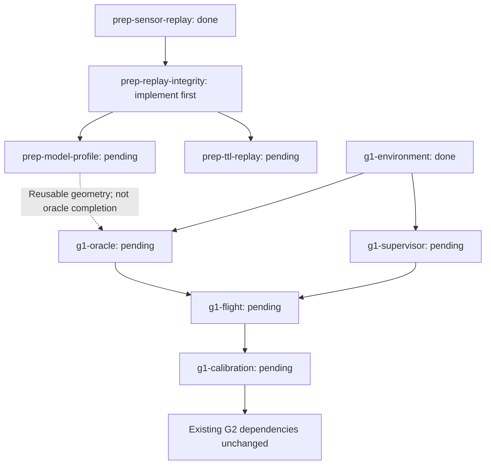

# Sensor replay review: approved repair plan

## Authority and scope

The user approved adding this plan to the native roadmap and continuing implementation, then explicitly authorized both remaining model-profile and rolling-TTL tasks. The [exercised preparation results](PREPARATION_RESULTS.md) record their scope and limitations. No arming, control publisher, vehicle teleportation, host installation, model/account changes or flight acceptance is authorized by this plan.

The existing stationary replay result remains historical evidence. It is not a calibrated body envelope or a positive navigation result. Raw bags, their manifests, hashes and failed attempts stay byte-identical; new diagnostics and acquisitions use new paths.

## Native task mapping

Solid edges are native dependencies for these branches or existing gate relationships; the dashed edge is artifact reuse only. The diagram omits unrelated prerequisites, which remain unchanged in canonical state. No pending preparation task waives an existing flight gate.

### 1. `prep-replay-integrity` — current implementation slice

Prerequisite: completed `prep-sensor-replay`.

- Bracket Gazebo alignment time using PX4 `timestamp_sample` poses; require the same reset/clock epoch, a finite pose gap and no extrapolation. Record alignment timestamp, reset identity and provenance. A changed epoch invalidates world grading rather than reusing the old transform.
- Track monotonic-wall clock progress and simulation age of every other dynamic required stream. Reject excessive lead relative to the latest delivered clock under an explicit acquisition-only allowance. These checks are not calibrated flight deadlines; static TF remains latched.
- Record publisher and subscriber QoS, total wall/sim duration, mean RTF and available receive-wall diagnostics. Report image gaps, calibration pairing versus image availability and estimator variance. Do not fabricate missing historical per-message wall stamps, reset provenance or minimum windowed RTF.
- Verify evidence file hashes and archive member/fixture identities through the existing cross-platform integrity command, which already runs in CI. Do not add an ad-hoc CDR implementation as a second production decoder.
- Exercise real pinned-schema bag reading, explicit alignment-reset/skew rejection and recording stream-loss failures. Preserve previous bags as legacy evidence; do not silently upgrade their manifest schema or claim new-profile admission.

Verification: behavioral boundary regressions; actual ROS decoder in the retained pinned image; bounded unarmed recorder smoke and negative stream-loss path; full existing offline checks; inspect new manifests/reports and preserved package hashes. No synthetic result substitutes for an exercised recorder/decoder path.

### 2. `prep-model-profile` — after integrity

Prerequisite: `prep-replay-integrity`.

Derive asymmetric physical collision bounds and rotating propeller sweep from pinned SDF/model sources. Separate physical geometry, phase clearance and uncertainty/tracking/angular budgets. New experiments use the body-relative optical mount; historical synthetic fixtures retain explicit provenance.

Rerun liveness with mount and effective envelope together. The earlier one-metre admission does not survive arbitrary envelope changes. Test real model points on body, landing gear and propeller sweep. Unsupported mesh or attitude assumptions must remain visible.

Verification: actual pinned SDF extraction plus analytic point/sweep checks and exercised synthetic liveness cases. This does not implement the independent contact ledger or complete `g1-oracle`.

### 3. `prep-ttl-replay` — longer stationary evidence

Prerequisite: `prep-replay-integrity`.

Record a bounded, stationary Disarmed sequence whose simulation span exceeds the declared evidence TTL. Query during the trace to show old frames expiring while fresh frames remain, then verify stale-all STOP. Keep capture messages separate from temporal queries and preserve raw evidence.

Verification: actual longer recording, intermediate retained-frame identities and decision traces. No `set_pose`, no positive real-data movement claim and no no-return certification.

## Existing G1 work

`g1-oracle` owns physical clearance/contact observation, support-pair allowlists and missing-observer failure semantics. `g1-supervisor` owns control authority/freshness before exploratory flight. `g1-calibration` still requires actual motion under those components before freezing braking/tracking/latency bounds.

Estimator variance is a diagnostic and future admission input, not a calibrated relative-error bound. Do not choose a sigma multiplier merely to make liveness pass. Moving camera/kinematic experiments remain a separately scoped decision; they cannot replace PX4 pose or actual-motion calibration.

## Delivery for each implemented slice

Publish code, exercised outputs, exact source/environment identities, English instructions and limitations. Complete only the corresponding native task using current-run smoke evidence; export the English portable roadmap afterward. Pending branches remain pending until their own acceptance is observed.
