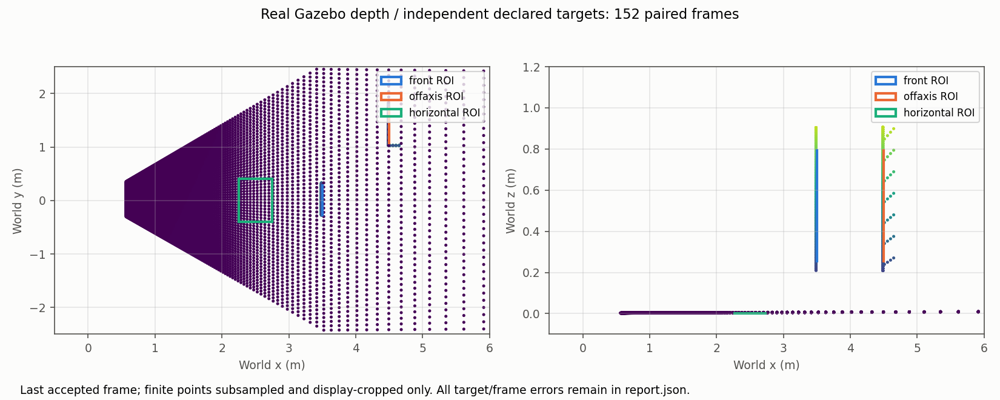
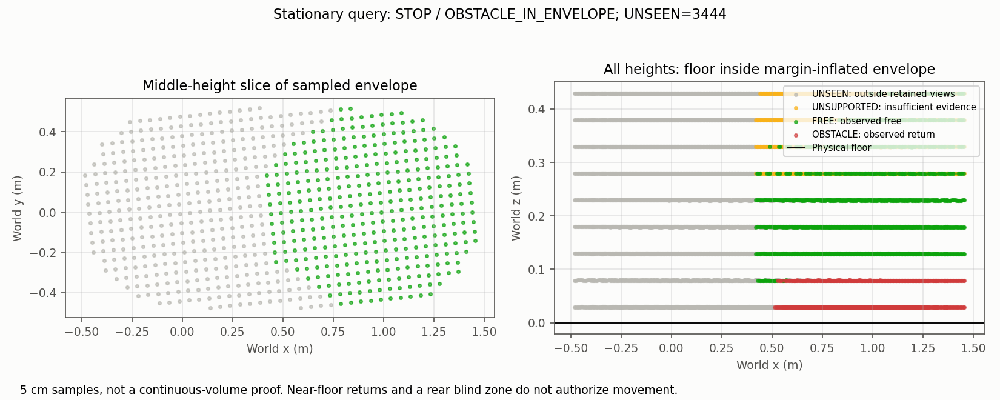

# Unarmed sensor recording and offline geometry replay

## Result and scope

The approved `prep-sensor-replay` experiment passed its stationary integration checks on a real Gazebo/ROS recording. It did not arm, move, teleport or control the vehicle. It does not complete G1 flight/calibration or G2 acceptance.

- Recorder: 30.0508 seconds of monotonic wall time; 167 depth images, 208 CameraInfo messages, 1,709 clock messages, one static TF, 684 odometry messages and 14 vehicle-status messages. Every observed status was Disarmed.
- After the fixed two-second wall warmup: **152/152 frames paired successfully** with CameraInfo and capture-time odometry. No evaluated frame was excluded. Maximum permitted pose bracket remained 50 ms in simulation time.
- All three targets passed on every evaluated frame. Each ROI retained at least 95% valid depth after three-pixel erosion.
- Query result: **STOP / `OBSTACLE_IN_ENVELOPE`**. Floor returns fall inside the margin-inflated resting envelope. There are also 3,444 UNSEEN samples. Neither issue was hidden or bypassed.
- Real `+Inf` semantics remain uncertified: `no_return_certified=False`.
- Offline regressions: **117 passed in 72.52 s**. An earlier 90-second suite run timed out while sharing the machine with the simulator/replay; it was not counted as a pass.

| Target | Minimum valid support | Worst frame p95 error | Maximum error |
| --- | ---: | ---: | ---: |
| Front surface | 98.5777% | 0.016583 m | 0.016601 m |
| Off-axis surface | 100% | 0.016493 m | 0.016512 m |
| Horizontal floor | 100% | 0.022381 m | 0.022419 m |

The limits stayed p95 <= 0.10 m and maximum <= 0.20 m. The table reports maxima across frames, not pooled averages. These are integration errors including localization/alignment uncertainty, not calibrated flight-clearance bounds.





## Capture-time boundary

`spike/freespace/capture_pose.py` validates PX4 NED position and FRD attitude, converts them to odometry ENU / body FLU, and preserves roll/pitch. It interpolates position and shortest-arc quaternion orientation using `timestamp_sample`, not publish or bag receive time. Analytic tests cover axes, tilt, yaw and quaternion sign equivalence.

Depth decoding honors 32FC1, row padding, byte count and endianness. Recorded zero-distortion pinhole CameraInfo supplies intrinsics; unknown distortion, incompatible dimensions/ROI/binning and frame mismatches are rejected. Static optical TF must match the pinned fixture. Missing/unsupported/nonmonotonic poses, calibration changes and clock/reset boundaries cannot interpolate across old history.

Points used by the spike remain in odometry ENU. A separate grader transforms them into world coordinates using an independently observed Gazebo resting body pose and PX4 pose, frozen before recording. Target geometry never enters `evidence.py` or supplies free-space evidence. This resting-pose alignment is not a moving-localization calibration or a live wall-age guarantee.

## Fault results

The variants modify an in-memory event stream. They are explicitly injected faults, not additional sensor recordings; archived raw bags remain unchanged.

| Injected fault | Accepted frames | Observed rejection / isolation |
| --- | ---: | --- |
| Missing CameraInfo | 0 | `CAMERA_INFO_MISSING`: 152 |
| Missing optical TF | 0 | `OPTICAL_TF_MISSING`: 152 |
| Pose gap | 0 | `POSE_GAP`: 152 |
| Backward image stamps | 0 | `CAPTURE_OUTSIDE_CLOCK_EPOCH`: 167; image history splits |
| Future image stamps | 0 | `CAPTURE_OUTSIDE_CLOCK_EPOCH`: 167 |
| Reset counter changes halfway | 151 | Two independent epochs; one boundary frame rejected; neither query allowed |

Stale evidence separately returns `NO_FRESH_FRAMES`. The existing synthetic positive-liveness case and retained TOO_CLOSE, empty-grid and camera-range guards still pass. Synthetic liveness is not a positive navigation result from this bag.

## Failures preserved, not relabeled

1. `recording-01-incomplete.tar.gz`: Jazzy `TopicMetadata` requires an explicit topic ID. The recorder failed before capturing frames. Its incomplete manifest remains preserved.
2. `recording-02-failed-geometry.tar.gz`: 147 frames paired, but the original grader failed horizontal geometry. Two implementation errors were corrected before a fresh recording:
   - The merged `x500_base` model puts `base_link` 0.24 m above the outer model origin. The sensor's outer-model z is 0.26078 m; body-relative z is **0.02078 m**. Both the static-TF recipe and SDF-derived observer were corrected. Grader alignment now composes world-model and model-body poses. Historical G1 evidence is unchanged and does not certify the old body-frame transform.
   - ROI bounds choose which rays to grade; they are not necessarily physical surface edges. The floor ROI is an interior patch of the stock 500 m visual plane. The initial grader incorrectly penalized tangential displacement outside that patch as leaving the physical floor. Explicit physical surface bounds now come from the unchanged SDF; ROI bounds and numeric tolerances did not move. A regression distinguishes a 5 cm height error from a genuinely excessive height error.
3. `recording-03.tar.gz`: fresh acquisition after these corrections, with a newly frozen fixture manifest. This is the accepted recording. Neither earlier bag nor its report was overwritten. Historical fixtures are forensic inputs, not current-profile replay passes.

## Evidence and reproducibility

All files are under [`replay/unarmed-r35/`](replay/unarmed-r35/):

- `recording-03.tar.gz`: original sqlite3 bag, metadata, fixture and capture manifest; approximately 206 MB unpacked.
- `recording-manifest.json`, `environment.json`: topic/QoS counts, independent alignment source, hashes, exact image/firmware and runtime limits.
- `report.json`: per-target/per-frame support and errors, pairing decisions, gate counts and all six fault outcomes.
- `preview.npz`, two PNG figures and `default.sdf`: saved last-frame diagnostics and the frozen fixture world.
- Two failed-attempt archives and `failed-geometry-report.json`: complete failure history for this slice.
- `SHA256SUMS`: package file identities. Tar members and archived bag hashes were read back after packaging.

No host package, driver, WSL, permission or account changes were made. The acquisition container had no network or host mounts, four CPUs, 6 GiB RAM, software rendering and dropped capabilities. Only the owned simulator container/processes were stopped and removed afterward. Docker Desktop and pinned images remain available.

### Replay the immutable bag

Use the already available pinned image from `environment.json`; missing ROS/storage packages block this check rather than authorizing installation. Commands below use a POSIX shell. On Git Bash, prefix Docker commands with `MSYS_NO_PATHCONV=1`. Choose unused names/directories; do not overwrite prior output.

```sh
mkdir -p artifacts/replay-r35-input
# Check SHA256SUMS with your platform's SHA-256 tool before extracting.
tar -xzf docs/replay/unarmed-r35/recording-03.tar.gz -C artifacts/replay-r35-input
docker create --name drone-cv-replay-check --network none --cpus 4 --memory 6g --shm-size 256m --cap-drop ALL --security-opt no-new-privileges --entrypoint /bin/sleep sha256:061a39905d2d84d40859bb46b67048241b6dacf2ed3983889da7f5fd3e718285 infinity
docker start drone-cv-replay-check
docker cp spike/freespace drone-cv-replay-check:/tmp/freespace
docker cp artifacts/replay-r35-input/recording-03 drone-cv-replay-check:/tmp/recording-03
docker exec -i drone-cv-replay-check /usr/local/bin/ros2-entrypoint.sh python3 /tmp/freespace/replay_bag.py --recording /tmp/recording-03 --output /tmp/replay-check
docker cp drone-cv-replay-check:/tmp/replay-check artifacts/replay-r35-check
docker stop drone-cv-replay-check
docker rm drone-cv-replay-check
```

The reader verifies fixture and bag hashes, pairs actual CDR messages, grades all targets, exercises the variants and exits nonzero if any required check fails. Replaying a saved bag does not require Gazebo, PX4, DDS or a graphics driver to run.

Optional plotting uses the existing host NumPy 2.0.0 / matplotlib 3.9.0 environment, not ROS:

```sh
python spike/freespace/plot_bag_replay.py --recording artifacts/replay-r35-input/recording-03 --replay artifacts/replay-r35-check --output artifacts/replay-r35-figures
python -m pytest -q
python scripts/check_project.py
```

### Acquire a new unarmed recording

Reuse the pinned, isolated [environment recipe](HARNESS.md#derived-smoke-recipe-and-observed-results), with `ROS_DOMAIN_ID=84`, `ROS_LOCALHOST_ONLY=1`, a unique `GZ_PARTITION`, `LIBGL_ALWAYS_SOFTWARE=1` and `PX4_PARAM_UXRCE_DDS_SYNCT=0`. Keep the existing bridge and corrected body-relative static optical TF. Use the frozen `default.sdf` above instead of the stock world. Start its headless server before PX4, retaining the resource/plugin/server configuration paths from the image:

```sh
docker cp docs/replay/unarmed-r35/default.sdf drone-cv-g1:/tmp/default.sdf
docker exec -i drone-cv-g1 /usr/local/bin/ros2-entrypoint.sh env GZ_SIM_RESOURCE_PATH=/opt/px4-gazebo/share/gz/models:/opt/px4-gazebo/share/gz/worlds GZ_SIM_SYSTEM_PLUGIN_PATH=/opt/px4-gazebo/lib/gz/plugins GZ_SIM_SERVER_CONFIG_PATH=/opt/px4-gazebo/share/gz/server.config gz sim -v 3 -r -s /tmp/default.sdf
```

In another terminal, start PX4 with `env PX4_GZ_MODEL_POSE=0,0,0.25,0,0,0 PX4_GZ_NO_FOLLOW=1 px4-gazebo`, then Agent/camera bridge/static TF as documented. Do not arm. Once required streams exist:

```sh
docker cp spike/freespace drone-cv-g1:/tmp/freespace
docker exec -i drone-cv-g1 /usr/local/bin/ros2-entrypoint.sh python3 /tmp/freespace/record_sensor_bag.py --fixture /tmp/freespace/replay_fixture.json --output /tmp/new-unarmed-recording
```

The recorder refuses an existing output directory, requires every stream, captures actual versioned status, enforces the wall/size/clock bounds and writes an incomplete manifest on failure. Copy the result out before cleaning up only the container/processes you started. A new acquisition is a new experiment; it must satisfy the same checks rather than inheriting this result.

## Next boundary

`g1-oracle` and `g1-supervisor` remain the next independent G1 items. A valid moving observation history and bootstrap admission still require separate design, authority and evidence. No arming permission, continuous-volume coverage proof, runtime watchdog guarantee or successful A-to-B flight follows from this stationary experiment.
