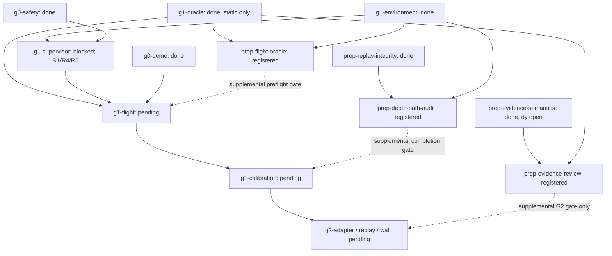

# Simulation repair plan after PR #12 review

**Current approval boundary:** sections 1–5 retain the first-round plan; section 6 retains the approved N1–N7 code/offline cutover. [Section 7](#7-third-round-policy-and-relative-uncertainty) is approved after review of `9ca1c80`. No section authorizes operational execution, new acquisition or parameter writes.

## 1. Review status and authority

**Approved for roadmap registration and code/offline implementation.** After reviewing this plan, the user instructed: “cập nhật road map và làm đi”. The source report at `C:\Users\TRI\Downloads\drone-CV-loi-can-sua-tong-hop.md` remains unchanged. Its findings are inputs to assess, not operational instructions or verified runtime results.

Baseline: PR #12, head `b83a88ea53056c25540ec0564970cd5db918ea39`; native roadmap revision **77**. The last exercised baseline has 502 passing offline tests and green Ubuntu/Windows CI. No tests or simulator runs were performed to create this plan. Those earlier checks do not certify the proposed repairs.

The four preparation tasks were registered through the native API at revision 78. Existing historical acceptance remains unchanged; supplemental gates are enforced separately. Keep PR #12 draft until its applicable gates pass. No publisher construction, mode command, arming, flight, installation, PX4 parameter write, teleportation or fresh simulator acquisition is authorized by this approval.

Scope: **R1–R10 and E7**, with R6 retained as a design constraint. H1–H10 hardware work, procurement, hardware profiles, flight procedures and legal conclusions are outside this plan. The sim-only guard discussed under H9 is considered solely to prevent accidental use of synthetic/offline settings; it does not establish a hardware track.

## 2. Current facts and native task mapping

| Native task | Current status / prerequisites | Meaning for this plan |
| --- | --- | --- |
| `g1-environment` | done; `prep-roadmap` done | Reuse exact image, clock and package identities; not permission to run it. |
| `g0-safety` | done; `g0-geometry` done | Existing offline safety evidence remains historical; inspect impacts before changing shared primitives. |
| `g1-oracle` | done; `g1-environment` done | Static sampled oracle only. It does not certify moving inter-sample coverage or mission phases. |
| `prep-evidence-semantics` | done; integrity/model-profile/TTL preparations done | Finite-near and sampled TTL diagnostics ran. **The independent y-axis plane crosscheck remains unmet.** Its failed geometry output is retained. |
| `g1-supervisor` | blocked; `g1-environment`, `g0-safety` done | R1/R4/R8 code/contract work belongs here; runtime stationary evidence and its operational approval are missing. Do not unblock from plan approval alone. |
| `g1-flight` | pending; oracle, supervisor and G0 demo prerequisites | R3 is an additional preflight acceptance requirement, not evidence that this task is ready. |
| `g1-calibration` | pending; `g1-flight` pending | E7 feeds workload/data-age analysis. Motion-dependent delay/braking/jerk/tracking remain this task's responsibility. |
| `g2-adapter` | pending; calibration and G0 demo prerequisites | R2/R5 must be resolved before completion; no preparation artifact bypasses calibration. |
| `g2-replay`, `g2-wall` | pending; existing G2 chain | Preserve actual replay and 10/10 wall-stop requirements. |
| `g3-worlds`, `g3-acceptance` | pending; existing G3 chain | R7 affects envelope/world feasibility and clearance reporting, not permission to lower clearance. |

The native API currently exposes no metadata/dependency-edit action for existing tasks. Do not hand-edit native JSON/HTML or recreate tasks to bypass that limit. The current supplemental G2 completion checker is real enforcement outside the native DAG, not a native edge and not a runtime guard. `start` notes can explain a gate when execution is actually authorized; do not claim they edit acceptance metadata.

### Approved bounded preparation tasks

These IDs are now registered through native `add`; implementation proceeds only within approved code/offline scope. Existing completed static results need not be reopened merely to add a new capability. If implementation invalidates an existing task's actual evidence, use the native reopen workflow, dependents first; never silently retain invalid certification.

| Registered ID | Prerequisites, all currently done | Scope and completion evidence | Downstream gate |
| --- | --- | --- | --- |
| `prep-evidence-review` | `prep-evidence-semantics`, `g1-oracle` | R5 explicit uncertainty migration; R2 offline visibility preflight plus fresh unarmed pinned y-sensitive recording, unchanged original grading and independent dy comparison | G2 completion only; never G1 |
| `prep-flight-oracle` | `g1-oracle`, `g1-environment` | R3 interval coverage, observer-isolation contract and evaluator-owned phase timeline; offline boundaries plus approved unarmed fault proofs | `g1-flight` preflight; no flight acceptance from unarmed proof |
| `prep-depth-path-audit` | `prep-replay-integrity`, `g1-environment` | E7 same-run matched source/bridge/recorder/storage identities and uncertainty-aware gap accounting | `g1-calibration` completion input; acquisition independent of flight |
| `prep-geometry-crosscheck` | `g1-oracle`, `prep-model-profile` | R10 mesh-loading comparison; R7 analytic containment/liveness study, preserving current outer bounds until justified | Diagnostic by default; any containment contradiction blocks use of affected geometry |



Solid edges shown are existing native dependencies; dashed downstream edges are supplemental acceptance gates, not native DAG edges. The four preparation tasks and their listed prerequisites are now registered. Unshown existing prerequisites remain unchanged. Geometry crosschecking has no mandatory gate unless it reveals a containment defect. No dependency from the y-fixture branch to G1 is introduced.

The project checker enforces the approved supplemental gates because existing native edges cannot be edited. Tests reject missing/incomplete preparation for affected gates while permitting unrelated G1 work. `docs/roadmap.en.json` binds the new task contracts; the exporter regenerates `docs/ROADMAP.md`. Canonical metadata is never edited by hand.

## 3. Findings, decisions and acceptance

### R1 — Stopping volume, not angular coincidence

At the reviewed PR #12 baseline, [`supervisor.py`](../src/drone_cv/supervisor.py), `_motion_error`, rejected every nonzero measured velocity for a zero command and demanded almost collinear measured/requested velocities otherwise. The old `Permit` supplied one scalar directional distance, not a drift-region certificate. The [implemented code/offline repair](SIM_REPAIR_RESULTS.md) replaces this contract; runtime admission remains unverified.

**Decision:** evolve the shared `Permit` contract first. Replace scalar directional evidence with an explicit conservative certified region and test containment of both requested-motion and measured-motion stopping sets. Start with one convex region representation (a frame-bound box is the conservative default), not a general geometry engine or multiple certificate shapes. The independent safety producer must prove the whole required volume, not sampled points or a scalar range.

Required contract fields/semantics:

- Named coordinate frame, origin/reference pose, epoch/reset identity, command identity, original capture identity/expiry and region bounds; no implicit world/odom/NED conversion.
- State whether the region bounds vehicle-reference centers after physical-footprint/uncertainty convolution, so footprint, clearance and error are included exactly once. Known-clear bootstrap evidence stays explicitly separate from perception-derived navigation evidence.
- A declared velocity-error set with units, provenance, workload and validity. Estimator variance is a health input, **not a deterministic error bound**. `k*sqrt(variance)` or an empirical maximum alone cannot establish a hard bound; do not choose k or a noise floor to obtain admission.
- Conservative stopping reachability from the measured-velocity error set and the proposed command, including response delay, braking model limitations, position/tracking uncertainty and local geofence. For zero commanded velocity, nonzero uncertain momentum still requires room in all possible directions.
- Explicit treatment of direction changes during response/tracking; two thin nominal centerlines do not enclose every transition. A conservative outer enclosure may overblock. Missing assumptions or unsupported dynamics remain STOP.

Migrate `supervisor.py`, strict JSON decoding in `px4_bridge.py`, offline smoke and supervisor fixtures atomically. `Permit` references currently occur in those files and `tests/test_supervisor.py`; there is no implemented live G2 safety producer to pretend has been integrated. Extend the future `g2-adapter` acceptance to produce the same region contract using real supported evidence. Do not present the sampled freespace spike's `decide()` as a whole-volume certificate.

Acceptance:

1. Zero command with noisy measured velocities remains admitted in `MODE_WAIT`/`OFFBOARD_DISARMED` only when the declared stopping set is contained in the certificate; insufficient room rejects.
2. Small directional differences are accepted with adequate coverage and reject `STOPPING_ROOM` when coverage is inadequate. The existing reverse-measured-velocity case remains rejected with its forward-only certificate. Do not authorize commanded reverse motion into blind space.
3. Boundary tests cover zero/nonzero velocity, diagonal/lateral/reverse drift, uncertainty axes, exact containment limits, invalid/stale/frame/reset certificates and missing budgets. A deterministic seeded property sweep uses an independent containment reference and retains every counterexample; a finite sweep is not a mathematical proof.
4. Replay actual pinned-decoded r39 and support-06 odometry/status through the transition interface with explicitly synthetic certificates. Freeze the input window/epoch and exploratory budgets before checking results. Require no *spurious direction rejection* in valid sufficiently covered stationary windows; resets, stale sources and real authority faults must still reject. Do not require blanket no-revoke across invalid trace regions or fabricate runtime ACKs/Offboard states as real telemetry.
5. Report replay as offline protocol/geometry evidence. Actual braking and runtime acceptance remain unmet until their own gates.

### R4 — Revocation and pinned PX4 behavior

Confirmed: `revoke()` returns empty output; `RosBridge._tick()` stops publishers and the CLI exits on revoked/released state. [`RuntimeAuthorization`](../src/drone_cv/px4_bridge.py) attests environment strings but does not read back failsafe parameters. Valid odometry alone does not justify sending a mode command after ownership loss.

**Decision:** define two distinct paths before modifying output: cooperative, bounded handoff while this bridge demonstrably still owns control; immediate output suppression on ownership conflict, observed failsafe/PX4 exit, invalid required state or process death. Keep the first failure latched. No auto re-entry, forced disarm or default land-in-place.

- Resolve the exact parameter names, enum meanings and activation conditions against firmware `61907962c9220437ec01a98fa26bfbf5cbb254b5`, not PX4 `main`. Candidates from the report include `COM_OF_LOSS_T`, `COM_OBL_RC_ACT`, relevant `GF_*`, RC/battery loss policy and `MPC_XY_VEL_MAX`; this is not a claim that wildcard names form a complete pin list.
- Freeze concrete expected values and rationale in an effective simulation manifest before any runtime trial. Read back from the actual PX4 instance before control admission; record expected/observed values and identity. Missing, mismatching or unsupported readback blocks admission. Do not silently write parameters or change protections to make them match.
- If cooperative handoff is selected, issue at most the frozen bounded mode request, record addressed ACK and fresh resulting status, and keep observing through the deadline. Extend the current CLI/adapter lifecycle so terminal-state exit does not discard that observation. A separate supervisor process may provide the same evidence if bridge death prevents in-process observation.
- For all other paths, stop output and observe the configured PX4 fallback independently. Never send a new Hold request after PX4 has already left Offboard or another owner is active.

Acceptance: offline policy/state/encoding tests and actual pinned serialization first; then separately authorized stationary SITL faults for expired command/permit, competing owner, source/clock loss and bridge death. Record last publication, revoke cause, ACK/status/mode sequence and sim/wall handoff delays. Do not infer an Offboard-loss action from a disarmed trial that cannot exercise it. Armed fallback/actual stopping trials require separate explicit approval and remain part of flight/calibration. Zero output alone is never `SAFE_ABORT`.

### R5 — Explicit near-evidence uncertainty

Confirmed: [`SensorProfile`](../spike/freespace/evidence.py) silently defaults both near translation/rotation uncertainty to zero. Real bag/TTL/temporal readers construct that default, whereas truth-relative diagnostics supply measured stationary values.

**Decision:** require explicit uncertainty inputs and source classification; no implicit zero or NaN fallback. Keep the model small: analytic synthetic fixture, historical non-admitting analysis, and stationary measured diagnostic. Operational/calibrated input must not exist merely because an enum or boolean says it is calibrated; G2 must bind actual calibration evidence before admission.

Migrate `evidence.py`, `replay_bag.py`, `replay_ttl.py`, `evidence_variants.py`, `replay_semantics.py`, `experiments.py`, `model_liveness.py`, plotting consumers and affected tests together. Explicit zero is allowed for exact analytic synthetic geometry and clearly historical comparisons; neither is operational evidence. Preserve original published bytes and label new analysis separately.

Acceptance: missing/nonfinite/negative values or absent provenance reject; real/diagnostic paths cannot accidentally select synthetic certification; truth-derived diagnostic values remain non-admitting; full-cone, original-capture, lever-arm, epoch/TTL and new-near-hazard retention tests remain valid. Do not force positive nonzero uncertainty by inventing a minimum value.

### R2 — Nonoccluding fixture and independent y crosscheck

Confirmed by [`geometry-report.json`](replay/evidence-semantics-01/geometry-report.json), [`occlusion-crosscheck.json`](replay/evidence-semantics-01/occlusion-crosscheck.json) and the [existing result](EVIDENCE_SEMANTICS_RESULTS.md): support-06 primary geometry fails; the side surface occludes off-axis and its own ROI is insufficient. Completing TTL/truth diagnostics did not close this independent check.

Plan:

1. Add an offline fixture preflight using the existing synthetic scene renderer plus independent target-identity ray intersections. Preserve original front/off-axis/floor geometry, primary ROIs, thresholds and erosion. An added target must not contaminate them.
2. Search only the auxiliary target placement/orientation/ROI in development. An oblique plane with a substantial y-normal component plus the original front plane is acceptable; 45 degrees is a candidate, not a frozen successful fixture. The current axis-aligned grader/scene primitives may need a bounded auxiliary plane adapter; do not silently repurpose original grading.
3. Declare the auxiliary plane's finite physical extent and separate interior ROI in metres. Preflight nominal profile-derived rest pose and a deterministic, declared translation/rotation grid covering the report's proposed +/-0.07 m and +/-0.1 degree offsets. Name sampled coverage; finite perturbations are not a proof for every intermediate pose. Physically below-support poses are rejected, not excused as good acquisitions.
4. Require at least 0.95 correct-target support for every included ROI/grid pose, keeping original 3-pixel erosion, p95 0.10 m and max 0.20 m limits. Include the old occluding fixture as an expected failing preflight and an independently known visible fixture as passing.
5. Freeze new world/fixture/source IDs only after offline preflight. A fresh **unarmed** pinned recording needs separate execution approval. Preserve support-06 and every failed new attempt unchanged.
6. For the fresh recording require the original primary target checks to pass unchanged. Derive dy from the independent plane residual equation `r = n_x*dx + n_y*dy + n_z*dz`, with signs/rotation/depth/extrinsic terms explicit. Compare with same-bag truth translation without fitting alignment or uncertainty to force agreement. Freeze the auxiliary residual/identifiability/error budget before collection; missing numerical justification blocks this acceptance rather than inventing a bound.

DoD: visibility negatives/positives, fresh baseline primary pass, y-sensitive support/error checks, per-frame independent dy comparison and explicit coverage/uncertainty limits. Same-bag truth can evaluate the estimate; it cannot generate a planner permit. This branch gates **G2 only**, not supervisor/oracle/G1 flight.

### R3 — Moving-oracle requirements before flight

**R3a: inter-sample coverage.** The current oracle explicitly reports sampled endpoints only. Add a separate interval result using declared conservative translation and angular-motion limits plus complete component radius/extent. Endpoint orientation difference alone is not an angular-rate bound; endpoint AABB union is not arbitrary swept coverage. With justified speed bound `v_max` and angular speed bound `omega_max`, displacement can be enclosed by `v_max*dt + 2*r*sin(min(omega_max*dt, pi)/2)`; an acceleration term is needed only when the chosen velocity assumption requires it, not double counted. Freeze assumptions and provenance before trials. Unsupported intervals are unobserved/UNKNOWN, never clear.

Acceptance: analytic thin obstacle crossed between clear endpoints; rotation-only corner sweep; curved/intermediate excursion; exact gap/rate boundaries; missing bounds/source/epoch. Distinguish demonstrated geometric intersection from conservative possible-intersection/enclosure failure; do not report an AABB overlap as a physical Gazebo contact. Preserve unsafe latching if observation later fails. Bootstrap bounds are explicit test constraints, not completed stopping calibration.

**R3b: truth isolation.** Current truth transport shares a domain with other inputs, although the bridge does not subscribe to truth and no planner runs in the static fixture. Start/end subscription snapshots alone cannot prove no transient reader existed. Define an evaluator allowlist using actual endpoint identities, continuous bounded discovery observations and retained graph failures; unknown discovery coverage prevents a claim of complete isolation. Test an unexpected/subsequently disappearing reader. This is cooperative detection, not DDS security. Before a planner participates in acceptance, keep truth in an evaluator-only process/domain path and expose only the allowed localization/health interface to control consumers. Domain IDs alone are not authentication or a hostile-party boundary; installation/security-policy changes remain outside scope.

**R3c: phase authority.** Static `REST` fixtures remain valid historical fixtures. Flight needs an evaluator-owned timeline from independently observed PX4 arming/landed/navigation status, truth/support geometry and a frozen authorized mission schedule. Planner stage text cannot switch evaluator phase or grant a support exemption. Supervisor intent is supporting evidence, not sole authority. Record phase source identities, timestamps, transitions and uncertainty. Invalid/ambiguous/missing phase evidence produces incomplete/UNKNOWN classification while retaining known unsafe evidence. Test skipped/backward transitions, early landing exemptions, body/rotor collisions during valid gear contact and source loss.

Complete the new oracle preparation before `g1-flight` preflight. Do not mark `g1-flight` complete from an unarmed phase/interval fixture or write dynamic certification onto old static receipts.

### R7 — Rotor envelope conservatism

The complete profile uses outer AABBs; its corner radial bound is about 0.454 m. The review's roughly 0.393 m disk reach is an analytic estimate requiring confirmation from the resolved meshes/hub/visual offsets. This is not evidence that the existing envelope undercontains the propeller. Keep conservative bounds for the first repairs; it is a liveness/metric-fidelity issue, not a reason to reduce the 0.5 m clearance.

If pursued, add a resolved-axis finite cylinder/disk-sweep primitive only with full mesh containment under scale, hub offset, joint transform and tilted poses. Migrate profile serialization, oracle distance/intersection calculations and liveness consumers together; retain body/gear components and provenance. Compare against an independent sweep/reference on the same frozen worlds. Freeze the selected representation before G3 world validation/acceptance. A smaller number alone is not a valid optimization result.

### R8 — One quaternion ingress contract

Confirmed: the bridge checks squared-norm deviation against 1e-3 and computes yaw directly; capture-time replay uses a stricter ingress check and bounded normalization. Review both paths as the same PX4 wire producer, not as inherently different float32 versus float64 sensors.

Define one shared wxyz/finiteness/nonzero/squared-norm ingress policy and bounded normalization before angle/matrix computation. Preserve raw samples and record normalization error. Choose the policy from pinned message representation, numerical analysis and observed raw norm residuals across retained valid bags; no new epsilon is chosen in this plan. Large invalid inputs remain errors, never normalized into validity. `q` and `-q` must agree; include near-pi rotations and norms on both sides of the chosen boundary. A norm error is not itself an angular-error formula, and decoding into float64 does not recover precision absent from the wire.

Use a pure core helper rather than importing the experimental spike into the ROS bridge. Migrate bridge/replay consumers and tests; inspect any shared core geometry impact before changing it. Re-run actual pinned decode/offline serialization and affected frame interpolation. No runtime simulation is needed for this code/decoder slice.

### R9 — Honest G2 gate reporting

Keep the supplemental checker, document it as such and extend it only after approval of new prerequisites. No existing-task dependency or metadata update is exposed by the current native API. Do not delete/re-add tasks, reset receipts, manually translate canonical state or claim a prose note installs an edge. The new plan/portable docs must show both existing DAG prerequisites and supplemental completion requirements. Unrelated G1 must remain unaffected by R2/R5.

### R10 — Independent Gazebo mesh-loading check

The resolver/mesh parser has analytic tests and static negative fixtures, but a direct rendered mesh-loading comparison is still missing. R10 is a bounded diagnostic, not automatic reopening of the historical static gate.

Choose one declared unchanged pinned mesh with asymmetric measurable features (for example `5010Base.dae`). Compare source-resolved transformed vertices/units/up-axis with an independent Gazebo-resolved geometry query if exposed, or calibrated depth/silhouette observations from declared views. A depth view reveals only visible surfaces; do not equate a single silhouette with the full 3D AABB. Freeze camera/pose/error tolerances and test an intentionally wrong axis/scale interpretation. Rendering may require a new evaluator-only fixture, not modification of the pinned vehicle asset. Offline planning authorizes no such execution. If the comparison reveals undercontainment, block use of the affected profile and handle evidence invalidation explicitly.

### E7 — Locate missing depth, do not relabel gaps as latency

Existing CameraInfo/image mismatches do not identify where images were lost, or prove that every CameraInfo implied an image was rendered. Current bag/receive integrity supports matching persisted events; it is not a renderer production counter.

Instrument a single approved unarmed run at **actual** Gazebo image publication, bridge image reception/publication, recorder callback entrance and queue/storage completion. Log compact `(stream, epoch, source_stamp, sequence, monotonic_receive, stage)` identities/counters without logging full image arrays. An additional BEST_EFFORT subscriber is not itself an authoritative bridge-publish counter; if the pinned bridge cannot expose a stage without rebuilding/installing, retain the coarser unresolved boundary and request that prerequisite rather than claiming exact localization.

Freeze QoS, workload, RTF measurement, finite queues, windows and bounded drain before capture. Count duplicates/reordering/late arrivals, probe loss and measurement overhead. Use only common fully observed windows and matched multisets; do not subtract unmatched startup/shutdown counts as losses. Portable exact enqueue/ack counters are preferable to approximate `qsize()`. Keep separate counters for images and CameraInfo.

Acceptance: no unexplained matched-identity deficit at claimed observed stages; controlled source skip, bridge-path loss and recorder/storage backpressure demonstrate different report classifications. Unknown source/probe coverage must remain unknown. Report image-gap p50/p95/p99/max in sim time and wall receive gaps separately; neither alone is end-to-end capture-to-actuation latency or a worst-case bound. Link the result as input to `g1-calibration`, which must measure actual delay/braking and select finite deadlines. Do not lengthen source-lead allowance, TTL or watchdogs merely to absorb observed gaps.

### R6 and sim-only configuration scope

Keep 0.5 m navigation clearance in every relevant direction and the full physical envelope. Downward-pitch liveness failure is a design tradeoff, not a bug to hide with a floor exemption, smaller envelope or erased old near evidence. Compare mount/approach strategies only on frozen diagnostic grids.

The numerical configuration in `g1_supervisor.py:offline_smoke` is an explicit synthetic fixture, **not a default deployment configuration**; `run` currently requires config/startup files. As part of R1/R4 provenance, require an explicit simulation/exploratory target and reject unsupported hardware targets or accidental offline-fixture use for runtime. Preserve Gazebo clock, `UXRCE_DDS_SYNCT=0` and `use_sim_time=true`. A target label or live `/clock` alone cannot attest physical hardware safety. Do not generate hardware settings, fabricate calibration, or adopt the hardware timesync suggestion for the existing sim.

## 4. Bounded implementation order after approval

1. **Contract/code slice:** R1 permit/stopping-set design, R8 shared quaternion policy, R4 failsafe/handoff policy and minimal sim provenance. Stay within `g1-supervisor`; no runtime publisher. Update every decoder/fixture/consumer, run targeted boundary tests, offline real-bag replay and guarded pinned-message smoke. R1 uncertainty budgets need a justified frozen diagnostic specification before replay; missing budgets remain a blocker, not guessed constants.
2. **Independent evidence slice:** proposed `prep-evidence-review` handles R5 then R2 offline preflight. Only after its offline fixture passes and new acquisition is approved, collect new unarmed evidence and finish dy comparison. Preserve all historical inputs/failures.
3. **Independent observation slice:** proposed `prep-flight-oracle` implements R3 offline contracts and separately approved unarmed faults. E7 acquisition under `prep-depth-path-audit` can share an explicitly frozen fixture/session with R2 if instrumentation changes are recorded and observer health is unaffected; one run is not automatic completion of both tasks.
4. **Supervisor runtime:** only after R1/R4/R8 code evidence and exact pinned failsafe/readback policy are ready, request explicit authorization for the exact stationary control-publisher scenario. No arming inferred. Separate tests requiring armed fallback remain unrun until separately approved. Complete `g1-supervisor` only when all actual native criteria hold.
5. **Existing flight/calibration/G2:** R3 preflight readiness plus completed supervisor precede an approved `g1-flight` mission; then actual-motion calibration uses E7 inputs. Only then G2 adapter/replay/wall-stop, with the added R2/R5 preparation gate. R7/R10 run as bounded diagnostics; any discovered containment failure overrides scheduling convenience.

Use coherent task-owned commits and one integration owner for shared `evidence.py`/geometry contracts; do not split work by file mechanically. R1 and R8 may touch the same decoder and must not race. Never drop failed seeds or relax acceptance. If three repairs fail without new causal evidence, stop and report the missing prerequisite.

## 5. Verification and review decisions

Planned checks after implementation, not executed by this plan:

- Targeted meaningful behavior regressions for each changed interface; the existing `python -m pytest -q` once after integration.
- Guarded actual pinned-message serialization and real retained-bag decoding/replay without ROS initialization/publishers for the code-only slice.
- Offline visibility preflight, inter-sample/phase/isolation negatives and deterministic independent stopping-set reference checks.
- Only explicitly approved real unarmed/runtime/flight paths produce the corresponding native smoke receipts. Offline mocks do not satisfy those gates.
- `python scripts/check_project.py --export-roadmap` after approved native changes, then `python scripts/check_project.py`; preserve source PDF and published hashes. Update English results with exact inputs, source identities, all attempts and limitations.
- Ubuntu/Windows CI after code publication; required checks/reviews remain enforced. Passing offline CI does not close runtime or hardware gates.

Review resolved: the user approved the conservative stopping-region contract, four bounded preparation tasks and supplemental gates, and requested implementation. Later operational trials remain separately authorized. No installation or operational permission follows merely from code/offline approval.

**Still unmet at this planning boundary:** independent dy crosscheck, supervisor runtime/ownership/fallback proof, moving oracle interval/phase/isolation proof, depth-loss localization, actual flight, braking/tracking/timing calibration, G2 wall-stop and every hardware gate.

## 6. Second-round plan (N1–N7)

### 6.1 Authority, baseline and non-goals

Input: `C:\Users\TRI\Downloads\drone-CV-de-xuat-sua-va-danh-sach-loi.md`, which reviews PR #12 head `46e1771455ba8c8457f47b657cf7866db762c9c1`. Preserve that source document unchanged. Its numerical/parser observations are review inputs; they are not new runtime acceptance or permission.

At approval the native state was revision **90**: 36 tasks, 14 done, 5 blocked and 17 pending. The last exercised first-round implementation had 648 passing tests, green Ubuntu/Windows CI and an integrity check covering 83 evidence hashes. See [first-round results](SIM_REPAIR_RESULTS.md). Those historical results do not verify second-round changes.

After the requested plan amendments, the user instructed **“ok làm đi”**. This approves implementation, existing-task progress updates and actual code/offline verification below. It does not authorize simulator startup, a new recording, publisher construction, mode/arming commands, parameter writes, installation or hardware. Keep immutable evidence and the original PDF unchanged; use the native API for task progress and regenerate the portable view. No new native task ID is authorized: this work refines the existing blocked scopes. A later genuinely separate preparation branch requires agreement before native registration.

R5/R8 remain closed for their exercised code boundary, not for flight. Keep the complete physical outer bound, 0.5 m navigation clearance, original grading limits, failed geometry/acquisition evidence and hardware exclusion. N4 is deferred; active braking is not selected merely because the external report proposes it.

### 6.2 Stable task mapping and readiness

| Findings | Existing task / current status | Prerequisites and remaining barrier |
| --- | --- | --- |
| N1, N2, N3; remaining R1/R4 | `g1-supervisor`: runtime blocked | Native prerequisites `g1-environment` and `g0-safety` are done. Code/offline work is approved; justified trial assumptions, held-out eligibility, live readback/ownership/fallback evidence and exact operational approval remain missing. |
| N5; remaining R3 | `prep-flight-oracle`: blocked | `g1-oracle` and `g1-environment` are done. Offline labels cannot supply actual phase/support/transport/graph evidence or calibrated motion bounds. |
| N6 | Cross-cutting maintenance for `prep-evidence-review`, `prep-flight-oracle`, `prep-depth-path-audit` | Record code/offline work through the existing tasks; their operational criteria stay unmet. Consolidating checker/display declarations does not install native edges or complete any preparation. |
| N7; remaining R2 | `prep-evidence-review`: blocked | Its native prerequisites are done. A witnessed replay exit improves provenance only; fresh matching-fixture primary/dy acquisition and justified numerical budgets remain unmet. |
| Remaining E7 | `prep-depth-path-audit`: blocked | Source/bridge authoritative instrumentation and an approved common-window acquisition remain missing. Recorder-only counts cannot close it. |
| Remaining R7/R10 | `prep-geometry-crosscheck`: blocked | Retain the current outer AABB. Independent Gazebo loading/multiview evidence remains missing. No new shape is authorized. |
| N4, R6 | Later G2/G3 design/liveness; existing tasks pending | Do not optimize admission geometry before the response/dynamics contract is justified. Do not lower clearance or remove retained near evidence. |

The existing chain remains `g1-supervisor` before `g1-flight`, `g1-flight` before `g1-calibration`, and calibration before G2. `prep-flight-oracle` is a supplemental **preflight** requirement; `prep-depth-path-audit` supplements calibration completion; the evidence/y branch gates G2 only. Dependency completion is not operational readiness.

**No calibration cycle:** requiring completed `g1-calibration` before the first `g1-flight` would contradict [S02](SAFETY.md#s02-no-circular-dependency). Bootstrap uses explicitly constrained, separately approved exploratory trials and cannot claim calibrated stopping/continuous-clearance guarantees. Actual calibration follows that flight and gates later navigation. Unmeasured behavior stays unmeasured; do not relabel exploratory constraints as calibrated bounds to make the graph appear ready.

#### Mandatory runtime fault-injection validity gate

This gate applies to every proposed `g1-supervisor` fault scenario. A supervisor that already revokes on `ODOMETRY_UNCERTAINTY` has not demonstrated stale-command or owner-conflict handling. Silence from an unreachable control stage is not a passing fault test.

1. **Name the trial profile.** Use an immutable empirical candidate produced by N2, with profile/input hashes, derivation membership, a distinct held-out recording/window, per-axis uncertainty/health assumptions and the frozen workload/clock/RTF envelope. The candidate must meet its predeclared held-out trial-eligibility criteria; observed bound violations or unresolved coverage block its runtime use. An in-sample fit, the existing synthetic 0.01 assumptions, or merely changing a target label is insufficient. Held-out agreement remains empirical evidence, not a future hard-bound/calibration certificate.
2. **Require a matched healthy baseline.** Before injecting a scenario's fault, its no-fault baseline must reach the exact stage being tested and remain there without revocation for the frozen pre-fault and matched observation windows. Bind the same profile, image/firmware, parameter policy, sources, workload/RTF, fixture/seed, authorization and scenario conditions; declare any intentional differences. Observe actual supervisor stage and corresponding PX4 telemetry/ACK/control-output eligibility, not a fabricated internal state. A disarmed stage cannot stand in for ACTIVE or armed fallback.
3. **Block the fault family if its baseline is invalid.** Failure to reach the target stage, any baseline revocation, insufficient independent observation or an out-of-envelope condition makes that scenario `test_validity: INVALID_TEST`; its fault behavior is not evaluated as PASS. Preserve the attempt, first reason, timestamps and missing prerequisite. Do not trim the baseline window, replace the seed or relax a ceiling until it passes.
4. **Prove fault activation and causality.** The fault run must independently reach the same healthy target stage before the frozen injection point. Retain evidence that the intended injection actually activated. Freeze the expected first revocation reason and any narrowly justified equivalent mapping before execution. A valid controlled fault run passes only if it revokes for that expected reason, suppresses authority/output within its declared deadline and satisfies the required observation coverage. Revoke for an unrelated reason is never success; absent/wrong expected response in an otherwise valid controlled trial is a failure. A pre-existing or independently demonstrated unrelated fault that masks the target makes the evidence invalid, not a substitute PASS.
5. **Keep validity separate from safety.** `test_validity`/fault verdicts supplement, not replace, the S03 safety/execution outcomes and exit rules. Known unsafe events stay latched even if the baseline, injection or observer is invalid. Report planned, valid, passed, failed and invalid counts; never turn invalid trials into successful exclusions or `SAFE_ABORT`.

Acceptance for the future classifier includes: variance revocation before the target stage yields invalid evidence; a healthy matched baseline plus the intended stale-command/owner fault yields the expected reason and bounded output suppression; an unactivated injection, wrong first reason or missing coverage never passes. Existing r39/support-06 no-admission diagnostics remain unchanged and cannot serve as healthy runtime baselines.


### 6.3 N1 — Bind response budgets to actual Offboard-loss behavior

Confirmed code gap: the current stopping calculation uses `Envelope.response_delay_s`, while live parameter validation reads `COM_OF_LOSS_T` without binding the two. An offline configuration-validation counterexample accepted response delay 0.2 s with a declared Offboard-loss timeout 0.5 s. It did not read a live PX4 instance or create ROS/control resources.

The [pinned firmware check](https://github.com/PX4/PX4-Autopilot/blob/61907962c9220437ec01a98fa26bfbf5cbb254b5/src/modules/commander/HealthAndArmingChecks/checks/offboardCheck.cpp) evaluates Offboard signal age using PX4 HRT and `COM_OF_LOSS_T`. That proves the timeout participates in signal validity; it does not by itself prove how long the last velocity is physically tracked or which fallback is executed.

**Selected design:** keep immediate output suppression as the default loss-of-authority/failure path, but require the stopping/admission model to cover the complete relevant persistence and transition window. Do not add `Stage.BRAKING` in this slice.

1. Define one small typed latency contract shared by `supervisor.py`, `px4_bridge.py`/`px4_failsafe.py`, config decoding and offline fixtures. State whether motion-response seconds are simulation-motion time; bind epoch, clock source, workload/RTF envelope, scope and provenance. No implicit clock-domain conversions.
2. Record the start/end of each budget leg: failure detection, last valid control publication, PX4 receipt/signal timeout, failsafe/mode transition and actual controller/braking response. Include transport, scheduling, clock-offset/lead allowances and any additional delay activated by the frozen failsafe policy. Check the effective pinned policy, including relevant `COM_FAIL_ACT_T` behavior, not only the name of one parameter.
3. Bind the observed readback values to the effective contract before admitting the corresponding motion authority. A missing, inconsistent, unsupported or unbounded leg rejects that admission. Do not invent `mode_switch_latency_s`, a safety multiplier or a default zero. Readback alone is not a measured transition bound.
4. Do not directly add `max_tick_gap_wall_s` to PX4/simulation seconds. Either justify a common-domain end-to-end bound or convert with a frozen, justified clock/RTF envelope and retain the original domains. A runtime outside that envelope revokes the assumption; adaptive rescaling must not indefinitely extend authority.
5. Do not count a measured end-to-end response interval and its constituent timeout/detection legs twice. Store interval endpoints and whether a leg is included. Treat cooperative handoff, immediate suppression, competing owner and process death as different paths; one short successful handoff does not bound a dead bridge.
6. A separately approved disarmed protocol-observation trial may measure readback/ACK/status timing without admitting motion. It cannot certify armed fallback or braking. If first-motion exploratory constraints are needed before calibration, keep their known-clear volume, low-speed/operator-stop scope and non-certified label explicit; do not bypass the bootstrap/calibration ordering.

**Per-admitted-tick crash invariant.** For every tick `k` that admits a control command, the certificate available at that tick and the local geofence must contain the entire required stopping reachability if the supervisor dies immediately after that tick and supplies no further command, heartbeat, permit or intervention. Cover the last actually issued or possibly still effective setpoint as well as the new request and measured-velocity error set; a new zero request must not erase an older nonzero setpoint from the loss case.

With every time term justified in the same simulation-motion domain, the conservative ball contract is:

```text
T_loss,k = tick_gap_sim_budget
           + COM_OF_LOSS_T_sim_budget
           + failsafe_transition_sim_budget(effective frozen policy, including COM_FAIL_ACT_T)
           + additional_nonoverlapping_transport_clock_tracking_onset_budget

d_loss,k = s_loss,k * T_loss,k + s_loss,k**2 / (2 * a_min,k)
           + position_error_k + tracking_error_k + extra_margin_k

B(p_reference,k, d_loss,k) is contained in certified_reference_center_region_k
and in local_geofence_k.
```

`s_loss,k` must upper-bound relevant true speed through the persistence/transition interval, including measured uncertainty and any retained effective velocity target; `a_min,k` must be justified for the actual fallback/braking path. Footprint and phase clearance are already applied to the certified reference-center region and are not added again. The reserve includes the maximum tick gap, the period in which the old setpoint may persist under `COM_OF_LOSS_T`, effective failsafe switching behavior, and the braking distance. The tick-gap term is a conservative allowance, not a claim that a dead process executes another tick.

If converting a wall tick-gap bound to maximum simulated travel time, use a justified **upper** simulation-clock/RTF rate over that interval, not `RTF_min`; retain clock/epoch and offset/lead assumptions. An end-to-end measured leg may cover constituent terms, but its inclusion mapping must count each leg once. A fallback without a justified finite braking bound cannot yield a finite stopping certificate. Unmeasured exploratory constraints remain conditional and do not bypass S02 or become calibrated guarantees.

Acceptance: exercise crash immediately after each admitted tick, including a prior nonzero setpoint followed by a zero/lower request; independently check the reachable enclosure through persistence, switching and braking. Reject a certificate/geofence short by any required leg, test exact containment boundaries, and do not rely on a later successful supervisor tick to stop the vehicle. Offline checks prove the conditional model only; actual process-death behavior still needs an independent observer and separately approved runtime evidence.

**Valid tightening option:** a lower positive `COM_OF_LOSS_T` in the frozen trial policy can legitimately shorten the retained-setpoint window. This tightens timeout policy; it is not a relaxation of a safety threshold. Freeze its rationale, supported heartbeat/transport/jitter margin and workload before the trial, read back the actual value, and re-evaluate the invariant and healthy baseline. Do not tune it after failed trials, silently write a parameter, or assume earlier fallback is itself proved safe. Any actual PX4 parameter write requires separate authorization.


Acceptance after implementation approval:

- Reject a response model smaller than its required same-domain nonoverlapping loss/transition budget, including the 0.2-versus-0.5 s counterexample. Test exact boundaries, missing provenance, inconsistent clocks/epochs, policy mismatch, excess RTF and accidental double counting.
- Preserve immediate silence on owner conflict, expired operator authority, failsafe, PX4 Offboard exit, clock/reset discontinuity and invalid required telemetry. No new Hold/zero-velocity command may reclaim authority.
- Preserve the first failure, last publication, addressed ACK/status observations and separate process-death observation. Offline state/encoding checks are not runtime proof.
- Later, separately approved stationary trials must observe the actual last publication, PX4 mode sequence and deadlines. Disarmed mode timing must not be promoted to an armed stopping bound. Unknown coverage or timing remains a blocker.

**Deferred alternative:** active braking would require a separately reviewed emergency-authority contract: valid current lease, PX4 status, clock, ownership, odometry and a justified braking envelope; finite entry/exit/deadline semantics; no re-entry into ACTIVE; immediate cancellation on authority/source loss; and actual tracking/fault evidence. Graph exclusivity plus valid odometry alone is insufficient. Do not assume that publishing zero velocity produces the declared deceleration.

### 6.4 N2 — Empirical consistency without manufacturing a hard bound

The current diagnostic configuration explicitly declares `synthetic_offline` and `physical_bounds_verified: false`. Its 0.01 m / 0.01 m/s assumptions are not a measured runtime profile. The report's larger observed errors reinforce this distinction; they do not turn an empirical maximum into a future guarantee.

**Selected design:** add an evaluator-only empirical consistency analysis, not an automatic runtime profile generator.

- Use the existing pinned decoder and independent truth path. Freeze input manifests, sample windows, epoch/reset/alignment and body reference point. Compare positions/velocities in the same frame, clock and point; signed components remain valid. Distinguish absolute frame error from capture-to-query relative error according to the actual certificate transform, not only the fact that coordinates are named NED.
- Prefer independently available truth velocity/twist at the relevant time. If deriving velocity from position brackets, report finite-difference/interval-average scope and coverage; sampled constant position does not prove zero instantaneous velocity between samples. Do not subtract unmatched stamps or ignore body/optical lever-arm rotation.
- Report per-axis sample counts, extrema, percentiles, missing/rejected identities, error exceedances and provenance. An explicitly frozen sample maximum plus a declared margin is an empirical candidate for that workload/window only. It is not calibration, operational motion authority or proof for another seed, flight or load.
- Freeze derivation and evaluation membership before examining outcomes. A candidate derived from a trace and checked on that same trace must be labelled in-sample. Prefer a declared derivation input and untouched held-out recording/window; preserve held-out failures rather than enlarging margins repeatedly. Zero in-sample exceedances are descriptive, not independent verification.
- Separate estimator-health ceilings from deterministic position/velocity/tracking error sets. If per-axis health ceilings are introduced, prefer explicit NED three-vectors matching existing telemetry; migrate every config/fixture/consumer atomically and remove the obsolete scalar path. Threshold changes need a documented workload/health rationale, not an admission target.
- Do not make `k_sigma * sqrt(variance)` a hard-bound constructor or sufficient startup-consistency proof. It requires statistical/distribution/coverage assumptions and remains statistical even when dimensionally correct. A scalar Euclidean error radius also cannot be justified by checking each axis against that radius independently. A chosen k or a source-classification string cannot certify it.
- A real motion-admitting profile must bind the separately justified/calibrated uncertainty and response model. A stationary truth diagnostic must not become runtime-capable merely by changing its target label.
- For a runtime fault-injection profile, held-out evaluation is **mandatory**, not merely preferred. Record the exact candidate and its eligibility evidence at the runtime validity gate above. A candidate with unresolved held-out error/health/coverage failures cannot be used to manufacture a healthy baseline; revising it requires preserving prior failures and a newly frozen evaluation protocol.

Acceptance: the old synthetic assumptions are tested for observed consistency without changing their published bytes; candidate evaluation reports every exceedance and authority refusal reason; invalid frame/time/reset/body-point bindings reject; missing coverage stays unknown. Numeric, sign, norm/axis and provenance boundaries receive behavioral regressions. Report actual transition outcomes by reason without requiring zero revokes or enlarging health ceilings to get an ALLOWED count. G1/calibration remain incomplete even if a frozen candidate fits every evaluated sample.

### 6.5 N3 — Per-stream age and progress, not clock-only health

Confirmed: current status freshness includes receive-wall age, and `progress_wall_s` is also shared by dynamic streams. Removing `STATUS_stale_wall` alone would not settle the progress contract. A nominal 0.504 s simulation period is 3.36 s wall at RTF 0.15, before jitter; this must be compared with an explicitly supported service envelope. A refusal outside that envelope is not automatically false.

**Selected design:** preserve [S05](SAFETY.md#s05-freshness-and-latency-with-explicit-clock-domains).

1. Keep acquisition/source simulation age separate from monotonic receive/processing age and per-source progress. Use node simulation time for source-age checks; do not substitute a queued `/clock` callback or wall stamp for capture time.
2. Define finite per-stream deadlines and their measurement endpoints. Status cadence may differ from odometry, command, permit and original perception capture. Bind workload, minimum supported progress/RTF, queue behavior and allowed jitter before choosing values. A nominal mean period alone is not a worst-case bound.
3. Keep independent wall-time supervision of compute/transport and each required source. A progressing `/clock` cannot certify live status, planner, safety or camera. Cached/restamped/resequenced data must not renew command, permit or capture authority.
4. Preserve operator-lease wall expiry, session/tick/handoff deadlines and owner/failsafe checks. A frozen or very slow simulation must not silently extend human authorization. Only an explicitly confirmed runner pause can enter a separately defined non-admitting pause/revalidation path.
5. Do not remove a finite guard or enlarge a deadline simply to obtain zero `STATUS_stale_wall` rows. Any changed service envelope must be justified and frozen; observed out-of-envelope failures remain in the report. Hardware targets remain unsupported.

**Per-source wall-deadline derivation.** For every required simulation-cadenced source `i`, the frozen progress/receive service deadline must satisfy at least:

```text
wall_deadline_i >= nominal_source_period_sim_i / RTF_min + jitter_wall_budget_i
```

Declare all units and endpoints. Include source-period variation, transport, queue and scheduler jitter once; if source jitter is specified in simulation seconds, convert it with the justified lower clock-progress/RTF rate before combining it with wall jitter. Use a validated bounded cadence/jitter envelope rather than treating a nominal mean as a hard limit. Wall-cadenced producers need an explicit wall-period/jitter contract, not a guessed simulation conversion. Source simulation-age checks and the independent fixed wall limits on human leases, sessions, ticks and handoffs are not automatically stretched by this formula.

The lowest previously observed RTF, **0.196**, is input to choosing a justified supported `RTF_min`, not proof of a future floor. Freeze the selected minimum, measurement window, warmup/pause handling, workload and provenance before validation; do not choose 0.196 or 0.15 solely to admit this trace. Validate the actual supported range and record out-of-range cases. Below the supported minimum, refuse authority with an explicit out-of-supported-RTF classification (proposed reason `RTF_OUTSIDE_SUPPORTED_RANGE`), not an assertion that healthy data unexpectedly became stale. A missing/unreliable RTF observation is unknown/invalid, not assumed in-range. Preserve first-failure and unsafe latching if another violation occurred earlier.

Acceptance additionally covers a source at its declared nominal period and worst admitted jitter at `RTF_min` and across the supported range; it must not fail merely because an old universal 3 s progress constant remains. A source that stops while `/clock` progresses must still time out. Test just below the supported RTF floor as a valid out-of-envelope refusal, exact deadline boundaries and invalid RTF coverage. A no-fault runtime baseline outside this envelope is invalid fault-test evidence under the gate above.


Acceptance: deterministic schedules exercise the declared RTF range, including the proposed 0.15–1.0 range only if its finite deadlines are justified; source loss while `/clock` continues, cached/replayed identity, startup without status, clock pause/reset, wall expiry and tick/queue stalls all refuse authority as specified. Retained support-06 replay reports all reasons under both declared configurations. No blanket zero-revoke target; no source-lead/TTL weakening or synthesized healthy status.

### 6.6 N4 — Keep the ball until a narrower set has a valid dynamics proof

Defer optimization. Under the current assumption of arbitrary direction changes during response, `conv({command} union measured-error-box)` need not contain every allowed intermediate velocity direction. A lateral response excursion can satisfy the speed bound while leaving that narrow set. Random tests cannot replace the containment argument.

Only after a reviewed bounded direction/acceleration/tracking model and relevant runtime evidence may a narrower convex reachable enclosure be proposed. Prove containment under those exact assumptions, then add independent counterexamples/property checks and compare liveness on the same frozen scenarios. Keep permit coverage, physical envelope, phase clearance and near-hazard retention unchanged. Failure to justify the enclosure means retain the ball, not special-case a convenient input.

### 6.7 N5 — Conditional oracle outputs and bootstrap ordering

Confirmed: both the interval and moving summary can currently set `continuous_clearance_certified: true` from declared-motion CLEAR results, while `flight_admission`/`live_acceptance_certified` remain false. The prose limitations are real but the machine-readable label is too easy to misuse.

Plan an atomic moving-output cutover:

- Replace the misleading moving-path certificate flag with an explicitly conditional clearance result, true only when the supplied interval passes all applicable checks. Include the actual motion-bound provenance/scope and whether independent bound evidence is absent. Missing bounds never become true.
- The summary may aggregate complete **conditional** interval coverage, not an unconditional certificate. Keep incomplete/UNKNOWN, potential enclosure overlap, demonstrated sampled geometry and physical-contact claims distinct; retain unsafe latching.
- A `calibrated` boolean or provenance string alone cannot grant certification. Any future calibrated claim must bind the actual gate evidence, workload, geometry, clock/epoch and scope.
- Migrate every emitter/consumer/CLI/fixture/test together; no legacy alias that continues to emit a misleading true value. Historical reports remain byte-for-byte historical, not rewritten to the new schema. Static sampled output is not silently upgraded.
- Keep the native order: explicit bootstrap constraints before approved exploratory flight, actual calibration afterward, then calibrated navigation. Do not require completed `g1-calibration` as a prerequisite of the flight that produces it.

Acceptance: actual offline CLI clear/thin/rotation/gap/source-loss cases emit the correct conditional scope; no uncalibrated report can be consumed as unconditional clearance or flight authority; unsafe observations still dominate later observer failure. Updated reporting does not complete `prep-flight-oracle` or `g1-flight`.

### 6.8 N6 — One supplemental-gate declaration for enforcement and display

The current checker contains the original evidence-semantics G2 guard plus three newer preparations, while the portable view has separately authored explanatory text. Consolidate those **four** policies into one structured source containing prerequisite ID, affected task selector and guarded statuses. Both validation and the generated supplemental-gates table must derive from it.

The table must distinguish native prerequisites from checker gates, show the preflight `in_progress`/`done` rule for `g1-flight`, and retain completion-only gates elsewhere. Missing preparation fails closed. Preserve G2 prefix coverage for future G2 tasks; do not let the y/evidence branch block unrelated G1 work. Geometry contradictions remain a separately scoped affected-profile-use rule, not a fabricated generic DAG edge.

Acceptance: meaningful validator/renderer integration checks cover a changed policy, missing/incomplete preparations, unrelated G1 and display of the same guarded statuses. Regenerate `docs/ROADMAP.md` with the exporter only after approved implementation. The native API still cannot edit existing dependency/acceptance metadata; no delete/re-add, hand edit or unsupported action is a substitute.

### 6.9 N7 — Witness a new replay exit, preserve the old uncertainty

The old plane summary explicitly states `original_process_exit_observed: false` and binds original artifact hash `04f69883f90a870a866ac6e9173ef09119819bcb9faf6d5fbbfb9b87628a3a7d`. Do not retroactively fill that field or rewrite its bundle.

After separate approval of the code/offline slice, run the same pinned decoder/plane-analysis inputs with a frozen source identity and a finite deadline sufficient for the actual workload. Use an owned process/lifecycle that retains completion and exit status; a Docker-exec client timeout alone does not prove its container child stopped. Retain exact argv, image/source/input identities, stdout/stderr, observed process exit, artifact parse/readback and bounded owned cleanup.

Write a new exclusive output/bundle. Compare the new artifact hash with the old bound hash and record equality or difference honestly. A mismatch requires explaining source/environment/numeric/content differences, not replacing the old hash or forcing a match. An exit 0 or complete diagnostic coverage still does not make the old occluding fixture pass, supply a dy error budget, or complete `prep-evidence-review`.

### 6.10 Approved execution order and review decisions

1. N1–N3 were reviewed together: explicit latency domains, immediate-suppression authority, empirical versus operational uncertainty and finite per-stream health. No automatic active-braking stage.
2. Implement the N5/N6 reporting/gate cutovers and N7 witnessed replay independently where possible. Preserve every prior failed/partial result.
3. Implement the approved N1 binding and N2/N3 diagnostic/contract changes with one owner for shared `Envelope`/config/bridge boundaries. Use LSP references before exported-symbol changes; reuse existing frozen dataclasses and pinned decoders, not a new schema/config framework. Migrate every caller in the same cutover.
4. Run targeted behavioral checks and actual affected offline CLIs; use guarded pinned-message/retained-bag execution without ROS initialization, nodes or publishers. Run the integrated suite once after integration, then integrity/export checks as applicable. A finite holdout failure remains a failure, not an instruction to tune.
5. Only after contracts and explicit prerequisites are satisfied, request exact separate approval for any non-admitting disarmed observation or stationary control-publisher trial. Armed fallback, flight and new acquisition are distinct requests. The relevant existing native task remains blocked until its own current-run criteria hold.
6. Keep R2 fresh acquisition/dy budgets, R3 live isolation/phase evidence, R4 actual fallback, E7 authoritative taps and R10 loader observations as explicit unmet gates. Approved bootstrap flight precedes actual calibration; calibration and the unchanged supplemental gates precede G2. N4 remains later work.

Approval update: the user accepted the existing-task mapping, no `Stage.BRAKING`, N2 in-sample/held-out separation, atomic N5 code/test migration, single-source N6 gates and N7 witnessed replay. The required additions are now explicit: healthy matched runtime baseline and causal fault verdicts, the per-tick crash invariant with a legitimate tighter-timeout option, and RTF-derived finite per-source wall deadlines. **Code/offline implementation is approved; operational trials and parameter writes are not.**

Verify changed behavior through the actual affected offline CLIs and integrated regression suite, then update current results and native blockers with observed evidence. No code/offline receipt completes the outstanding runtime/acquisition gates. Export the portable roadmap after native state changes. Historical planning verification at revision 90 remains historical.

## 7. Third-round policy and relative uncertainty

### Scope, authority and stable task mapping

The source review `drone-CV-review-round2-9ca1c80.md` is preserved unchanged and hash-bound in the frozen preparation artifact. After the technical assessment, the user instructed “ok lamf did”. This approves the bounded F2/F3/F8 policy and precision fixes, F5 relative-error binding, and protocol-v3 code/offline preparation. It does not approve simulator startup, new heldout acquisition, ROS initialization/node/control-publisher construction during verification, mode/arming, Home/parameter writes, installation or hardware.

At approval, native revision 101 has 36 tasks: 14 done, 5 blocked and 17 pending. No new task or dependency edge is required:

- `g1-supervisor`: F1/F2/F3/F8 policy, response/readback and actual source eligibility. Native prerequisites `g1-environment` and `g0-safety` are done. Code/offline work is actionable; actual healthy matched baseline, causal faults, live parameter/ownership/fallback/process-death evidence and separate operational approval remain unmet.
- `prep-evidence-review`: F5 absolute/relative uncertainty and v3 provenance/heldout preparation. Native prerequisites `prep-evidence-semantics` and `g1-oracle` are done. Offline analysis does not supply a new untouched recording, instantaneous truth velocity, calibrated bounds or fresh primary/dy evidence.
- `prep-flight-oracle`: retain F7 phase-aware physical/clearance and landing-support prerequisites. Its completed native prerequisites do not supply live evaluator isolation, phase/support/graph proof or flight readiness.

The existing edges remain supervisor before flight, flight before calibration, and calibration before G2, with the unchanged supplemental gates. `prep-depth-path-audit` and `prep-geometry-crosscheck` retain their acquisition/loader blockers. No `Stage.BRAKING`, smaller physical envelope, lower 0.5 m navigation clearance, truth-fed control consumer or automatic PX4 authority reclaim is introduced.

### F1/F2: narrowly supported exploratory fallback policy

Use exact pinned enums, not generic numeric ranges: Offboard loss requests Hold, geofence requests Hold, RC/GCS loss actions request Hold, and the exploratory failsafe delay is explicitly zero. The zero-delay policy is a deliberate frozen simulation choice, not a claim that the firmware delays an already-selected Hold action. Preserve the nonoverlapping crash horizon and independently justified transition/braking reserves.

The pin has no battery Hold action. Preserve critical-battery Land rather than disabling battery protection, and require an independently declared, model/phase-bound known-clear landing corridor through the support-contact height. Missing corridor/support/frame provenance rejects admission. Land is not implicitly safe because it is vertical. A certified reference-center corridor must already account for the full footprint, applicable phase clearance and actual support allowlist.

Whitelist/readback agreement alone is insufficient. Subscribe to the existing pinned read-only Home, local-position/reference, failsafe-capability and battery streams. Require valid current Hold prerequisites and battery/link health; reject stale/missing/invalid observations before publisher construction and during ticks. Latch observed Home/reference/reset changes and transient unsafe capabilities. Home is frozen static context, not an invented continuously advancing 5 Hz source. If PX4 legitimately changes Home during a later phase, that trial needs a separately justified frozen/bounded reference contract; do not silently refresh it.

The firmware can escalate unavailable Hold to RTL/Land/Descend/Terminate. This implementation must not claim that all failures remain Hold or that an initial healthy flag proves future physical health. Unsupported concurrent estimator/structural/fallback paths remain outside the conditional stopping claim and require actual fault evidence.

### F3: physical configuration and reference bindings

Require independent horizontal and ascent/descent caps whose conservative 3D resultant fits the declared speed bound. Two individually acceptable component caps do not establish a norm bound. Bind configured acceleration/jerk limits to the declared response model, but never treat a maximum commanded acceleration as measured minimum braking.

Bind the outer PX4 geofence to actual valid Home/global and local-reference data, reset/epoch identity, a finite independently justified frame-error reserve and motion-room allowance. Check the complete supervisor box against the Home-centered cylinder, including PX4's actual above-Home vertical semantics. Disabled/inner/wrong-frame fences reject. A text rationale does not replace a numeric frame-error bound.

### F8: comparison attestation is not a rounded measurement

Preserve raw quiet readback separately from the policy attested by the pinned read-only `param compare -s` command. The quiet path loses precision at four decimal places; changing `!=` to `isclose(1e-7)` does not recover that information. Integers remain exact, float32 conversion/comparison uncertainty is explicit, and time/speed checks use conservative upper bounds where necessary. No silent policy rounding, parameter writes or pretend bit-exact readback.

### F5: correct quantity for perception-derived permits

Keep absolute base-origin error for independently anchored bootstrap/geofence checks. A perception-supported permit additionally requires a capture-to-query SE(3) error contract over its actual observation-age domain. Cover all supported points using translation plus `2*sin(rotation/2)*rho` (or a larger justified bound), not a single absolute-position radius. Bind age, radius, source/model/calibration provenance, epoch/reset, body point and coordinate basis. Do not count an error already applied by the producer twice.

Reuse the existing strict capture-time decoder/alignment and relative-transform functions. Freeze actual source identities before evaluating all capture/query pairs within the declared TTL; do not substitute adjacent pairs, fit alignment, cross source/reset epochs or turn schema-two snapshots into continuous truth. Report absolute and relative errors, per-axis/age statistics, missing/rejected/violating identities and source-disjoint versus retrospective temporal scope. The old 10 s TTL result is not a 0.5 s permit certificate.

### Protocol-v3 preparation and verification

Implement complete freeze/evaluate interfaces and freeze a runnable retrospective offline protocol before its outcomes. Retain prior protocols/bundles unchanged. This does not manufacture an untouched runtime protocol: numeric health multipliers, a newly supported RTF range, tracking bounds and a new independent heldout population need justified inputs before their own freeze/acquisition. Do not select a factor or `RTF_min=0.12` to admit already-viewed data. Simulation TTL, human authorization, session/tick/handoff deadlines and invalid-baseline classification remain independent.

Navigation height must accommodate full physical vertical reach, 0.5 m clearance and the stopping radius; rest/takeoff/landing keep their own phase contracts. Denser sampled truth remains interval-average velocity unless an independent instantaneous-velocity source or additional justified dynamics bound exists.

Exercise meaningful policy/precision/Home/3D-speed and relative-pair boundaries, actual pinned generated-message decoding and affected offline CLIs, then run the integrated suite and project integrity/export checks. No offline receipt completes the blocked operational criteria. Commit/push only task-owned paths to the existing draft PR; do not merge or promote flight/calibration/G2 gates.

The completed bounded implementation, exact retained populations, real CLI exits, unsuccessful coverage criteria and unchanged operational blockers are recorded in [third-round results](SIM_REPAIR_RESULTS.md#third-round-f1-f9-restricted-policy-and-relative-uncertainty). The [frozen v3 preparation](replay/sim-repair-round3-01/protocol-v3-preparation.json) explicitly remains non-operational. [Pinned policy](PX4_POLICY_CONTRACT.md) and [capture-query uncertainty](RELATIVE_UNCERTAINTY_CONTRACT.md) define the new interfaces; no future acquisition or runtime permission is implied.

