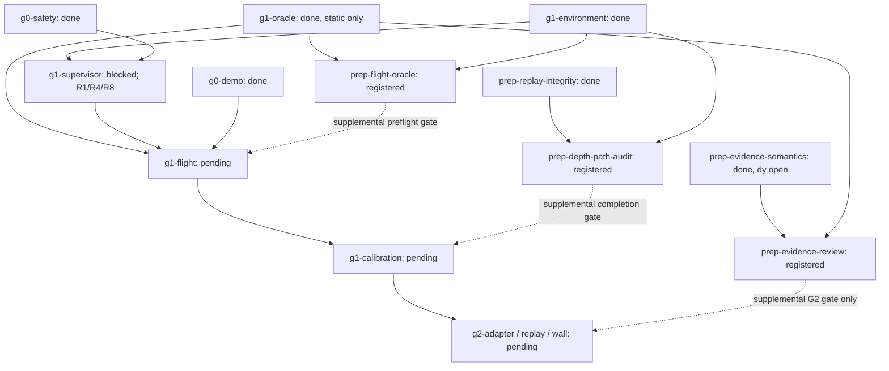

# Simulation repair plan after PR #12 review

## 1. Review status and authority

**Approved for roadmap registration and code/offline implementation.** After reviewing this plan, the user instructed: “cập nhật road map và làm đi”. The source report at `C:\Users\TRI\Downloads\drone-CV-loi-can-sua-tong-hop.md` remains unchanged. Its findings are inputs to assess, not operational instructions or verified runtime results.

Baseline: PR #12, head `b83a88ea53056c25540ec0564970cd5db918ea39`; native roadmap revision **77**. The last exercised baseline has 502 passing offline tests and green Ubuntu/Windows CI. No tests or simulator runs were performed to create this plan. Those earlier checks do not certify the proposed repairs.

The four preparation tasks were registered through the native API at revision 78. Existing historical acceptance remains unchanged; supplemental gates are enforced separately. Keep PR #12 draft until its applicable gates pass. No publisher construction, mode command, arming, flight, installation, PX4 parameter write, teleportation or fresh simulator acquisition is authorized by this approval.

Scope: **R1–R10 and E7**, with R6 retained as a design constraint. H1–H10 hardware work, procurement, hardware profiles, flight procedures and legal conclusions are outside this plan. The sim-only guard discussed under H9 is considered solely to prevent accidental use of synthetic/offline settings; it does not establish a hardware track.

## 2. Current facts and native task mapping

| Native task | Current status / prerequisites | Meaning for this plan |
| --- | --- | --- |
| `g1-environment` | done; `prep-roadmap` done | Reuse exact image, clock and package identities; not permission to run it. |
| `g0-safety` | done; `g0-geometry` done | Existing offline safety evidence remains historical; inspect impacts before changing shared primitives. |
| `g1-oracle` | done; `g1-environment` done | Static sampled oracle only. It does not certify moving inter-sample coverage or mission phases. |
| `prep-evidence-semantics` | done; integrity/model-profile/TTL preparations done | Finite-near and sampled TTL diagnostics ran. **The independent y-axis plane crosscheck remains unmet.** Its failed geometry output is retained. |
| `g1-supervisor` | blocked; `g1-environment`, `g0-safety` done | R1/R4/R8 code/contract work belongs here; runtime stationary evidence and its operational approval are missing. Do not unblock from plan approval alone. |
| `g1-flight` | pending; oracle, supervisor and G0 demo prerequisites | R3 is an additional preflight acceptance requirement, not evidence that this task is ready. |
| `g1-calibration` | pending; `g1-flight` pending | E7 feeds workload/data-age analysis. Motion-dependent delay/braking/jerk/tracking remain this task's responsibility. |
| `g2-adapter` | pending; calibration and G0 demo prerequisites | R2/R5 must be resolved before completion; no preparation artifact bypasses calibration. |
| `g2-replay`, `g2-wall` | pending; existing G2 chain | Preserve actual replay and 10/10 wall-stop requirements. |
| `g3-worlds`, `g3-acceptance` | pending; existing G3 chain | R7 affects envelope/world feasibility and clearance reporting, not permission to lower clearance. |

The native API currently exposes no metadata/dependency-edit action for existing tasks. Do not hand-edit native JSON/HTML or recreate tasks to bypass that limit. The current supplemental G2 completion checker is real enforcement outside the native DAG, not a native edge and not a runtime guard. `start` notes can explain a gate when execution is actually authorized; do not claim they edit acceptance metadata.

### Approved bounded preparation tasks

These IDs are now registered through native `add`; implementation proceeds only within approved code/offline scope. Existing completed static results need not be reopened merely to add a new capability. If implementation invalidates an existing task's actual evidence, use the native reopen workflow, dependents first; never silently retain invalid certification.

| Registered ID | Prerequisites, all currently done | Scope and completion evidence | Downstream gate |
| --- | --- | --- | --- |
| `prep-evidence-review` | `prep-evidence-semantics`, `g1-oracle` | R5 explicit uncertainty migration; R2 offline visibility preflight plus fresh unarmed pinned y-sensitive recording, unchanged original grading and independent dy comparison | G2 completion only; never G1 |
| `prep-flight-oracle` | `g1-oracle`, `g1-environment` | R3 interval coverage, observer-isolation contract and evaluator-owned phase timeline; offline boundaries plus approved unarmed fault proofs | `g1-flight` preflight; no flight acceptance from unarmed proof |
| `prep-depth-path-audit` | `prep-replay-integrity`, `g1-environment` | E7 same-run matched source/bridge/recorder/storage identities and uncertainty-aware gap accounting | `g1-calibration` completion input; acquisition independent of flight |
| `prep-geometry-crosscheck` | `g1-oracle`, `prep-model-profile` | R10 mesh-loading comparison; R7 analytic containment/liveness study, preserving current outer bounds until justified | Diagnostic by default; any containment contradiction blocks use of affected geometry |

Solid edges shown are existing native dependencies; dashed downstream edges are supplemental acceptance gates, not native DAG edges. The four preparation tasks and their listed prerequisites are now registered. Unshown existing prerequisites remain unchanged. Geometry crosschecking has no mandatory gate unless it reveals a containment defect. No dependency from the y-fixture branch to G1 is introduced.

The project checker enforces the approved supplemental gates because existing native edges cannot be edited. Tests reject missing/incomplete preparation for affected gates while permitting unrelated G1 work. `docs/roadmap.en.json` binds the new task contracts; the exporter regenerates `docs/ROADMAP.md`. Canonical metadata is never edited by hand.

## 3. Findings, decisions and acceptance

### R1 — Stopping volume, not angular coincidence

At the reviewed PR #12 baseline, [`supervisor.py`](../src/drone_cv/supervisor.py), `_motion_error`, rejected every nonzero measured velocity for a zero command and demanded almost collinear measured/requested velocities otherwise. The old `Permit` supplied one scalar directional distance, not a drift-region certificate. The [implemented code/offline repair](SIM_REPAIR_RESULTS.md) replaces this contract; runtime admission remains unverified.

**Decision:** evolve the shared `Permit` contract first. Replace scalar directional evidence with an explicit conservative certified region and test containment of both requested-motion and measured-motion stopping sets. Start with one convex region representation (a frame-bound box is the conservative default), not a general geometry engine or multiple certificate shapes. The independent safety producer must prove the whole required volume, not sampled points or a scalar range.

Required contract fields/semantics:

- Named coordinate frame, origin/reference pose, epoch/reset identity, command identity, original capture identity/expiry and region bounds; no implicit world/odom/NED conversion.
- State whether the region bounds vehicle-reference centers after physical-footprint/uncertainty convolution, so footprint, clearance and error are included exactly once. Known-clear bootstrap evidence stays explicitly separate from perception-derived navigation evidence.
- A declared velocity-error set with units, provenance, workload and validity. Estimator variance is a health input, **not a deterministic error bound**. `k*sqrt(variance)` or an empirical maximum alone cannot establish a hard bound; do not choose k or a noise floor to obtain admission.
- Conservative stopping reachability from the measured-velocity error set and the proposed command, including response delay, braking model limitations, position/tracking uncertainty and local geofence. For zero commanded velocity, nonzero uncertain momentum still requires room in all possible directions.
- Explicit treatment of direction changes during response/tracking; two thin nominal centerlines do not enclose every transition. A conservative outer enclosure may overblock. Missing assumptions or unsupported dynamics remain STOP.

Migrate `supervisor.py`, strict JSON decoding in `px4_bridge.py`, offline smoke and supervisor fixtures atomically. `Permit` references currently occur in those files and `tests/test_supervisor.py`; there is no implemented live G2 safety producer to pretend has been integrated. Extend the future `g2-adapter` acceptance to produce the same region contract using real supported evidence. Do not present the sampled freespace spike's `decide()` as a whole-volume certificate.

Acceptance:

1. Zero command with noisy measured velocities remains admitted in `MODE_WAIT`/`OFFBOARD_DISARMED` only when the declared stopping set is contained in the certificate; insufficient room rejects.
2. Small directional differences are accepted with adequate coverage and reject `STOPPING_ROOM` when coverage is inadequate. The existing reverse-measured-velocity case remains rejected with its forward-only certificate. Do not authorize commanded reverse motion into blind space.
3. Boundary tests cover zero/nonzero velocity, diagonal/lateral/reverse drift, uncertainty axes, exact containment limits, invalid/stale/frame/reset certificates and missing budgets. A deterministic seeded property sweep uses an independent containment reference and retains every counterexample; a finite sweep is not a mathematical proof.
4. Replay actual pinned-decoded r39 and support-06 odometry/status through the transition interface with explicitly synthetic certificates. Freeze the input window/epoch and exploratory budgets before checking results. Require no *spurious direction rejection* in valid sufficiently covered stationary windows; resets, stale sources and real authority faults must still reject. Do not require blanket no-revoke across invalid trace regions or fabricate runtime ACKs/Offboard states as real telemetry.
5. Report replay as offline protocol/geometry evidence. Actual braking and runtime acceptance remain unmet until their own gates.

### R4 — Revocation and pinned PX4 behavior

Confirmed: `revoke()` returns empty output; `RosBridge._tick()` stops publishers and the CLI exits on revoked/released state. [`RuntimeAuthorization`](../src/drone_cv/px4_bridge.py) attests environment strings but does not read back failsafe parameters. Valid odometry alone does not justify sending a mode command after ownership loss.

**Decision:** define two distinct paths before modifying output: cooperative, bounded handoff while this bridge demonstrably still owns control; immediate output suppression on ownership conflict, observed failsafe/PX4 exit, invalid required state or process death. Keep the first failure latched. No auto re-entry, forced disarm or default land-in-place.

- Resolve the exact parameter names, enum meanings and activation conditions against firmware `61907962c9220437ec01a98fa26bfbf5cbb254b5`, not PX4 `main`. Candidates from the report include `COM_OF_LOSS_T`, `COM_OBL_RC_ACT`, relevant `GF_*`, RC/battery loss policy and `MPC_XY_VEL_MAX`; this is not a claim that wildcard names form a complete pin list.
- Freeze concrete expected values and rationale in an effective simulation manifest before any runtime trial. Read back from the actual PX4 instance before control admission; record expected/observed values and identity. Missing, mismatching or unsupported readback blocks admission. Do not silently write parameters or change protections to make them match.
- If cooperative handoff is selected, issue at most the frozen bounded mode request, record addressed ACK and fresh resulting status, and keep observing through the deadline. Extend the current CLI/adapter lifecycle so terminal-state exit does not discard that observation. A separate supervisor process may provide the same evidence if bridge death prevents in-process observation.
- For all other paths, stop output and observe the configured PX4 fallback independently. Never send a new Hold request after PX4 has already left Offboard or another owner is active.

Acceptance: offline policy/state/encoding tests and actual pinned serialization first; then separately authorized stationary SITL faults for expired command/permit, competing owner, source/clock loss and bridge death. Record last publication, revoke cause, ACK/status/mode sequence and sim/wall handoff delays. Do not infer an Offboard-loss action from a disarmed trial that cannot exercise it. Armed fallback/actual stopping trials require separate explicit approval and remain part of flight/calibration. Zero output alone is never `SAFE_ABORT`.

### R5 — Explicit near-evidence uncertainty

Confirmed: [`SensorProfile`](../spike/freespace/evidence.py) silently defaults both near translation/rotation uncertainty to zero. Real bag/TTL/temporal readers construct that default, whereas truth-relative diagnostics supply measured stationary values.

**Decision:** require explicit uncertainty inputs and source classification; no implicit zero or NaN fallback. Keep the model small: analytic synthetic fixture, historical non-admitting analysis, and stationary measured diagnostic. Operational/calibrated input must not exist merely because an enum or boolean says it is calibrated; G2 must bind actual calibration evidence before admission.

Migrate `evidence.py`, `replay_bag.py`, `replay_ttl.py`, `evidence_variants.py`, `replay_semantics.py`, `experiments.py`, `model_liveness.py`, plotting consumers and affected tests together. Explicit zero is allowed for exact analytic synthetic geometry and clearly historical comparisons; neither is operational evidence. Preserve original published bytes and label new analysis separately.

Acceptance: missing/nonfinite/negative values or absent provenance reject; real/diagnostic paths cannot accidentally select synthetic certification; truth-derived diagnostic values remain non-admitting; full-cone, original-capture, lever-arm, epoch/TTL and new-near-hazard retention tests remain valid. Do not force positive nonzero uncertainty by inventing a minimum value.

### R2 — Nonoccluding fixture and independent y crosscheck

Confirmed by [`geometry-report.json`](replay/evidence-semantics-01/geometry-report.json), [`occlusion-crosscheck.json`](replay/evidence-semantics-01/occlusion-crosscheck.json) and the [existing result](EVIDENCE_SEMANTICS_RESULTS.md): support-06 primary geometry fails; the side surface occludes off-axis and its own ROI is insufficient. Completing TTL/truth diagnostics did not close this independent check.

Plan:

1. Add an offline fixture preflight using the existing synthetic scene renderer plus independent target-identity ray intersections. Preserve original front/off-axis/floor geometry, primary ROIs, thresholds and erosion. An added target must not contaminate them.
2. Search only the auxiliary target placement/orientation/ROI in development. An oblique plane with a substantial y-normal component plus the original front plane is acceptable; 45 degrees is a candidate, not a frozen successful fixture. The current axis-aligned grader/scene primitives may need a bounded auxiliary plane adapter; do not silently repurpose original grading.
3. Declare the auxiliary plane's finite physical extent and separate interior ROI in metres. Preflight nominal profile-derived rest pose and a deterministic, declared translation/rotation grid covering the report's proposed +/-0.07 m and +/-0.1 degree offsets. Name sampled coverage; finite perturbations are not a proof for every intermediate pose. Physically below-support poses are rejected, not excused as good acquisitions.
4. Require at least 0.95 correct-target support for every included ROI/grid pose, keeping original 3-pixel erosion, p95 0.10 m and max 0.20 m limits. Include the old occluding fixture as an expected failing preflight and an independently known visible fixture as passing.
5. Freeze new world/fixture/source IDs only after offline preflight. A fresh **unarmed** pinned recording needs separate execution approval. Preserve support-06 and every failed new attempt unchanged.
6. For the fresh recording require the original primary target checks to pass unchanged. Derive dy from the independent plane residual equation `r = n_x*dx + n_y*dy + n_z*dz`, with signs/rotation/depth/extrinsic terms explicit. Compare with same-bag truth translation without fitting alignment or uncertainty to force agreement. Freeze the auxiliary residual/identifiability/error budget before collection; missing numerical justification blocks this acceptance rather than inventing a bound.

DoD: visibility negatives/positives, fresh baseline primary pass, y-sensitive support/error checks, per-frame independent dy comparison and explicit coverage/uncertainty limits. Same-bag truth can evaluate the estimate; it cannot generate a planner permit. This branch gates **G2 only**, not supervisor/oracle/G1 flight.

### R3 — Moving-oracle requirements before flight

**R3a: inter-sample coverage.** The current oracle explicitly reports sampled endpoints only. Add a separate interval result using declared conservative translation and angular-motion limits plus complete component radius/extent. Endpoint orientation difference alone is not an angular-rate bound; endpoint AABB union is not arbitrary swept coverage. With justified speed bound `v_max` and angular speed bound `omega_max`, displacement can be enclosed by `v_max*dt + 2*r*sin(min(omega_max*dt, pi)/2)`; an acceleration term is needed only when the chosen velocity assumption requires it, not double counted. Freeze assumptions and provenance before trials. Unsupported intervals are unobserved/UNKNOWN, never clear.

Acceptance: analytic thin obstacle crossed between clear endpoints; rotation-only corner sweep; curved/intermediate excursion; exact gap/rate boundaries; missing bounds/source/epoch. Distinguish demonstrated geometric intersection from conservative possible-intersection/enclosure failure; do not report an AABB overlap as a physical Gazebo contact. Preserve unsafe latching if observation later fails. Bootstrap bounds are explicit test constraints, not completed stopping calibration.

**R3b: truth isolation.** Current truth transport shares a domain with other inputs, although the bridge does not subscribe to truth and no planner runs in the static fixture. Start/end subscription snapshots alone cannot prove no transient reader existed. Define an evaluator allowlist using actual endpoint identities, continuous bounded discovery observations and retained graph failures; unknown discovery coverage prevents a claim of complete isolation. Test an unexpected/subsequently disappearing reader. This is cooperative detection, not DDS security. Before a planner participates in acceptance, keep truth in an evaluator-only process/domain path and expose only the allowed localization/health interface to control consumers. Domain IDs alone are not authentication or a hostile-party boundary; installation/security-policy changes remain outside scope.

**R3c: phase authority.** Static `REST` fixtures remain valid historical fixtures. Flight needs an evaluator-owned timeline from independently observed PX4 arming/landed/navigation status, truth/support geometry and a frozen authorized mission schedule. Planner stage text cannot switch evaluator phase or grant a support exemption. Supervisor intent is supporting evidence, not sole authority. Record phase source identities, timestamps, transitions and uncertainty. Invalid/ambiguous/missing phase evidence produces incomplete/UNKNOWN classification while retaining known unsafe evidence. Test skipped/backward transitions, early landing exemptions, body/rotor collisions during valid gear contact and source loss.

Complete the new oracle preparation before `g1-flight` preflight. Do not mark `g1-flight` complete from an unarmed phase/interval fixture or write dynamic certification onto old static receipts.

### R7 — Rotor envelope conservatism

The complete profile uses outer AABBs; its corner radial bound is about 0.454 m. The review's roughly 0.393 m disk reach is an analytic estimate requiring confirmation from the resolved meshes/hub/visual offsets. This is not evidence that the existing envelope undercontains the propeller. Keep conservative bounds for the first repairs; it is a liveness/metric-fidelity issue, not a reason to reduce the 0.5 m clearance.

If pursued, add a resolved-axis finite cylinder/disk-sweep primitive only with full mesh containment under scale, hub offset, joint transform and tilted poses. Migrate profile serialization, oracle distance/intersection calculations and liveness consumers together; retain body/gear components and provenance. Compare against an independent sweep/reference on the same frozen worlds. Freeze the selected representation before G3 world validation/acceptance. A smaller number alone is not a valid optimization result.

### R8 — One quaternion ingress contract

Confirmed: the bridge checks squared-norm deviation against 1e-3 and computes yaw directly; capture-time replay uses a stricter ingress check and bounded normalization. Review both paths as the same PX4 wire producer, not as inherently different float32 versus float64 sensors.

Define one shared wxyz/finiteness/nonzero/squared-norm ingress policy and bounded normalization before angle/matrix computation. Preserve raw samples and record normalization error. Choose the policy from pinned message representation, numerical analysis and observed raw norm residuals across retained valid bags; no new epsilon is chosen in this plan. Large invalid inputs remain errors, never normalized into validity. `q` and `-q` must agree; include near-pi rotations and norms on both sides of the chosen boundary. A norm error is not itself an angular-error formula, and decoding into float64 does not recover precision absent from the wire.

Use a pure core helper rather than importing the experimental spike into the ROS bridge. Migrate bridge/replay consumers and tests; inspect any shared core geometry impact before changing it. Re-run actual pinned decode/offline serialization and affected frame interpolation. No runtime simulation is needed for this code/decoder slice.

### R9 — Honest G2 gate reporting

Keep the supplemental checker, document it as such and extend it only after approval of new prerequisites. No existing-task dependency or metadata update is exposed by the current native API. Do not delete/re-add tasks, reset receipts, manually translate canonical state or claim a prose note installs an edge. The new plan/portable docs must show both existing DAG prerequisites and supplemental completion requirements. Unrelated G1 must remain unaffected by R2/R5.

### R10 — Independent Gazebo mesh-loading check

The resolver/mesh parser has analytic tests and static negative fixtures, but a direct rendered mesh-loading comparison is still missing. R10 is a bounded diagnostic, not automatic reopening of the historical static gate.

Choose one declared unchanged pinned mesh with asymmetric measurable features (for example `5010Base.dae`). Compare source-resolved transformed vertices/units/up-axis with an independent Gazebo-resolved geometry query if exposed, or calibrated depth/silhouette observations from declared views. A depth view reveals only visible surfaces; do not equate a single silhouette with the full 3D AABB. Freeze camera/pose/error tolerances and test an intentionally wrong axis/scale interpretation. Rendering may require a new evaluator-only fixture, not modification of the pinned vehicle asset. Offline planning authorizes no such execution. If the comparison reveals undercontainment, block use of the affected profile and handle evidence invalidation explicitly.

### E7 — Locate missing depth, do not relabel gaps as latency

Existing CameraInfo/image mismatches do not identify where images were lost, or prove that every CameraInfo implied an image was rendered. Current bag/receive integrity supports matching persisted events; it is not a renderer production counter.

Instrument a single approved unarmed run at **actual** Gazebo image publication, bridge image reception/publication, recorder callback entrance and queue/storage completion. Log compact `(stream, epoch, source_stamp, sequence, monotonic_receive, stage)` identities/counters without logging full image arrays. An additional BEST_EFFORT subscriber is not itself an authoritative bridge-publish counter; if the pinned bridge cannot expose a stage without rebuilding/installing, retain the coarser unresolved boundary and request that prerequisite rather than claiming exact localization.

Freeze QoS, workload, RTF measurement, finite queues, windows and bounded drain before capture. Count duplicates/reordering/late arrivals, probe loss and measurement overhead. Use only common fully observed windows and matched multisets; do not subtract unmatched startup/shutdown counts as losses. Portable exact enqueue/ack counters are preferable to approximate `qsize()`. Keep separate counters for images and CameraInfo.

Acceptance: no unexplained matched-identity deficit at claimed observed stages; controlled source skip, bridge-path loss and recorder/storage backpressure demonstrate different report classifications. Unknown source/probe coverage must remain unknown. Report image-gap p50/p95/p99/max in sim time and wall receive gaps separately; neither alone is end-to-end capture-to-actuation latency or a worst-case bound. Link the result as input to `g1-calibration`, which must measure actual delay/braking and select finite deadlines. Do not lengthen source-lead allowance, TTL or watchdogs merely to absorb observed gaps.

### R6 and sim-only configuration scope

Keep 0.5 m navigation clearance in every relevant direction and the full physical envelope. Downward-pitch liveness failure is a design tradeoff, not a bug to hide with a floor exemption, smaller envelope or erased old near evidence. Compare mount/approach strategies only on frozen diagnostic grids.

The numerical configuration in `g1_supervisor.py:offline_smoke` is an explicit synthetic fixture, **not a default deployment configuration**; `run` currently requires config/startup files. As part of R1/R4 provenance, require an explicit simulation/exploratory target and reject unsupported hardware targets or accidental offline-fixture use for runtime. Preserve Gazebo clock, `UXRCE_DDS_SYNCT=0` and `use_sim_time=true`. A target label or live `/clock` alone cannot attest physical hardware safety. Do not generate hardware settings, fabricate calibration, or adopt the hardware timesync suggestion for the existing sim.

## 4. Bounded implementation order after approval

1. **Contract/code slice:** R1 permit/stopping-set design, R8 shared quaternion policy, R4 failsafe/handoff policy and minimal sim provenance. Stay within `g1-supervisor`; no runtime publisher. Update every decoder/fixture/consumer, run targeted boundary tests, offline real-bag replay and guarded pinned-message smoke. R1 uncertainty budgets need a justified frozen diagnostic specification before replay; missing budgets remain a blocker, not guessed constants.
2. **Independent evidence slice:** proposed `prep-evidence-review` handles R5 then R2 offline preflight. Only after its offline fixture passes and new acquisition is approved, collect new unarmed evidence and finish dy comparison. Preserve all historical inputs/failures.
3. **Independent observation slice:** proposed `prep-flight-oracle` implements R3 offline contracts and separately approved unarmed faults. E7 acquisition under `prep-depth-path-audit` can share an explicitly frozen fixture/session with R2 if instrumentation changes are recorded and observer health is unaffected; one run is not automatic completion of both tasks.
4. **Supervisor runtime:** only after R1/R4/R8 code evidence and exact pinned failsafe/readback policy are ready, request explicit authorization for the exact stationary control-publisher scenario. No arming inferred. Separate tests requiring armed fallback remain unrun until separately approved. Complete `g1-supervisor` only when all actual native criteria hold.
5. **Existing flight/calibration/G2:** R3 preflight readiness plus completed supervisor precede an approved `g1-flight` mission; then actual-motion calibration uses E7 inputs. Only then G2 adapter/replay/wall-stop, with the added R2/R5 preparation gate. R7/R10 run as bounded diagnostics; any discovered containment failure overrides scheduling convenience.

Use coherent task-owned commits and one integration owner for shared `evidence.py`/geometry contracts; do not split work by file mechanically. R1 and R8 may touch the same decoder and must not race. Never drop failed seeds or relax acceptance. If three repairs fail without new causal evidence, stop and report the missing prerequisite.

## 5. Verification and review decisions

Planned checks after implementation, not executed by this plan:

- Targeted meaningful behavior regressions for each changed interface; the existing `python -m pytest -q` once after integration.
- Guarded actual pinned-message serialization and real retained-bag decoding/replay without ROS initialization/publishers for the code-only slice.
- Offline visibility preflight, inter-sample/phase/isolation negatives and deterministic independent stopping-set reference checks.
- Only explicitly approved real unarmed/runtime/flight paths produce the corresponding native smoke receipts. Offline mocks do not satisfy those gates.
- `python scripts/check_project.py --export-roadmap` after approved native changes, then `python scripts/check_project.py`; preserve source PDF and published hashes. Update English results with exact inputs, source identities, all attempts and limitations.
- Ubuntu/Windows CI after code publication; required checks/reviews remain enforced. Passing offline CI does not close runtime or hardware gates.

Review resolved: the user approved the conservative stopping-region contract, four bounded preparation tasks and supplemental gates, and requested implementation. Later operational trials remain separately authorized. No installation or operational permission follows merely from code/offline approval.

**Still unmet at this planning boundary:** independent dy crosscheck, supervisor runtime/ownership/fallback proof, moving oracle interval/phase/isolation proof, depth-loss localization, actual flight, braking/tracking/timing calibration, G2 wall-stop and every hardware gate.
