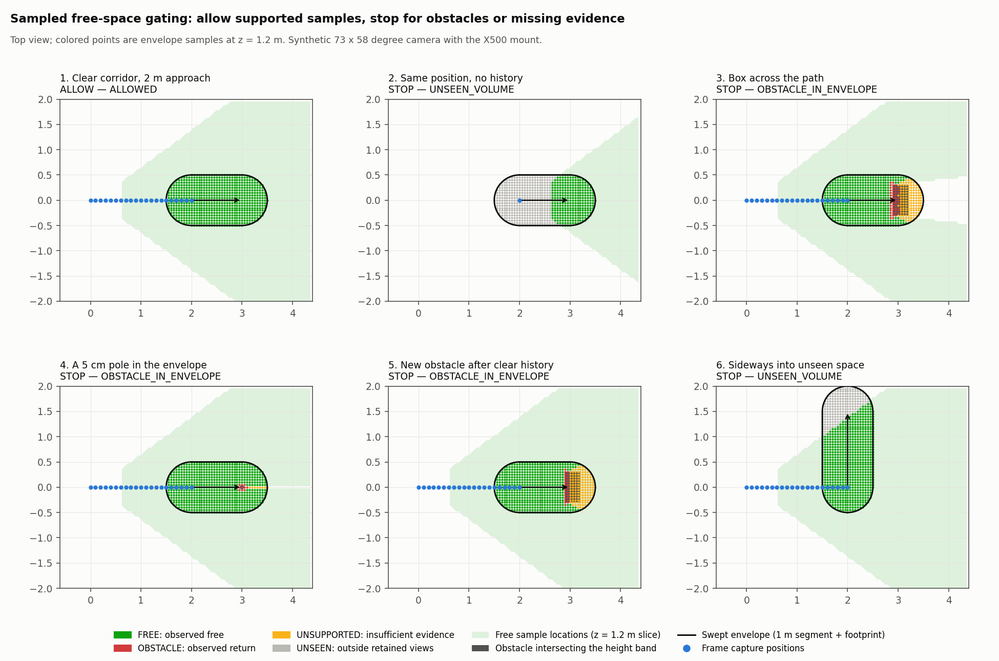
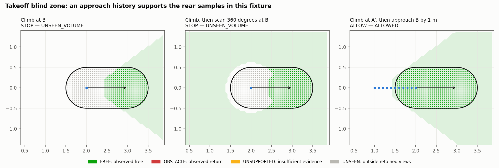
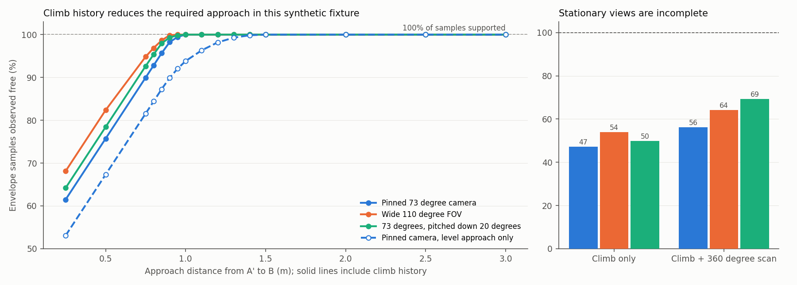

# Offline spike: seen-free gating for a short A-to-B move

A Python/NumPy experiment with posed synthetic depth frames. It demonstrates a short move that is allowed by accumulated perception evidence, rather than a gate that always stops.

**Experimental only:** this is outside the `drone_cv` package. It is not a planner, live ROS perception node, supervisor, flight controller, or continuous-volume safety certificate. G1 flight and G2 acceptance remain pending.

## Run the synthetic spike

Use the project's existing Python 3.12, NumPy 2.0.0 and pytest 8.2.2 environment. No ROS, PX4, Docker or GPU is required.

From the repository root:

```sh
python -m pytest -q
python spike/freespace/experiments.py --trials 0 --output artifacts/freespace-demo
```

Default pytest discovery includes the core and spike tests. The second command runs the takeoff/blind-zone experiment and writes `results.json`. `--trials 0` explicitly skips the optional Monte Carlo sweeps; zero-trial output is not safety evidence.

For the full synthetic sweeps, choose a different output directory:

```sh
python spike/freespace/experiments.py --trials 400 --output artifacts/freespace-sweeps
```

Optional figures use Matplotlib 3.9.0, which is not required by the tests or CI:

```sh
python spike/freespace/plots.py --results artifacts/freespace-demo/results.json --output artifacts/freespace-figures
```

The experiment and plot scripts write inside the selected directory and can overwrite their own output filenames. Use a fresh directory to preserve earlier results. They do not send control commands or install dependencies.

## Files

| File | Role |
| --- | --- |
| `camera.py` | Pinhole transforms and capture poses with optional full orientation. The historical synthetic mount is not the corrected real bag's body-relative mount. |
| `scene.py` | Synthetic box/cylinder/ground ray caster and a separate geometric collision grader. |
| `capture.py` | Posed frame histories, optional depth noise and odometry pose perturbations. |
| `evidence.py` | Retained depth evidence, sampled swept-envelope queries and decisions. Does not import scene ground truth. |
| `experiments.py` | Seeded obstacle sweeps and takeoff/blind-zone strategies. |
| `plots.py` | English-language scenario and blind-zone figures. |
| `tests/test_freespace.py` | Geometry, liveness, obstacle, freshness and gating regressions. |
| `capture_pose.py` | Pure PX4 capture-time interpolation, frame conversion, depth decoding and recorded intrinsics. |
| `record_sensor_bag.py` | Bounded unarmed ROS recording; no control publisher. |
| `replay_fixture.py`, `replay_fixture.json` | Frozen fixture and independent target grader; never imported by the evidence gate. |
| `replay_bag.py` | Actual rosbag CDR decoding, capture-time pairing, geometry and six explicit fault variants. |
| `plot_bag_replay.py` | Reproducible real point-cloud/target and stationary-query figures. |

## Real stationary Gazebo replay

The [observed experiment and commands](../../docs/SENSOR_REPLAY_RESULTS.md) provide immutable raw bags and per-target/frame results. Actual bag decoding uses the pinned ROS image; pure tests and synthetic experiments still do not need ROS. The accepted bag paired 152 frames and stayed Disarmed. Its query returns STOP for near-floor returns with a remaining blind zone, not ALLOWED navigation.

The real path derives a 0.02078 m body-relative camera z from the merged SDF, uses `no_return_certified=False`, and preserves full capture orientation. The old synthetic fixtures retain their declared 0.26078 m model-like mount so their results are not silently recast as calibrated body-frame data.


## Evidence and decisions

Each frame carries depth, capture pose, epoch, simulation time and sequence. A query retains only same-epoch frames that are not from the future and have not expired.

The query is a straight horizontal capsule with a vertical band. The illustrative radius is 0.35 m body + 0.10 m margin + 0.05 m pose allowance; these are assumptions, not calibrated bounds. Queries normally use a 5 cm regular grid.

For each sample:

- Transform the point into each retained capture frame.
- Require trusted range and image support. All four surrounding pixel returns must be valid or synthetically certified no-return, and farther than the point plus the configured depth-noise margin.
- Accumulate supported free sample locations across frames.
- Check reconstructed valid returns against the capsule continuously in point position. A return inside the margin-inflated capsule blocks motion even if older frames marked samples free.

The gate returns `ALLOWED` only when the sample set is nonempty, every sample is supported, and no retained obstacle/near-hazard rule blocks it. Other reasons include `NO_FRESH_FRAMES`, `NO_ENVELOPE_SAMPLES`, `TOO_CLOSE`, `OBSTACLE_IN_ENVELOPE`, `UNSEEN_VOLUME` and `UNSUPPORTED_VOLUME`.

### Three integration fixes

1. **Retained near hazards survive dropout.** Any `TOO_CLOSE` in the retained epoch/TTL window blocks motion. A following all-NaN image cannot erase it. The conservative block expires with its evidence; expiry alone does not grant motion, and the normal fresh-coverage query must still pass.
2. **An empty sample grid cannot grant motion.** A coarse spacing can leave no points inside the capsule. Such a query now returns `NO_ENVELOPE_SAMPLES`, not vacuous `ALLOWED`.
3. **Trusted range must fit the camera clip range.** `EvidenceStore` rejects a profile whose near/far trusted interval extends outside the associated camera's clip interval. A short-range no-return cannot certify space out to the default longer range.

Regressions cover the original failures, conservative near-hazard retention and expiry/recovery, empty grids at two spacings, invalid profile bounds, and a clipped obstacle with a correctly matched short-range profile.

## What the demo shows



| Synthetic case | Expected decision |
| --- | --- |
| Clear corridor with a 2 m approach history | Allow the sampled short forward query. |
| Same location with only its current frame | Stop for the blind zone. |
| Box or 5 cm pole in the envelope | Stop for observed obstacle returns. |
| New visible obstacle after clear history | Stop; older free evidence does not override its return. |
| Sideways query into never-viewed space | Stop for missing evidence. |





For the pinned-camera synthetic fixture, climb history followed by a 1 m approach supports the forward query's samples. A level-only approach first succeeds at the tested 1.5 m distance. Climbing at B, even followed by the tested yaw scan, leaves unsupported samples.

These are outcomes for the tested poses, depth model, profile, TTL and sampling grid, not universal minimum distances or proofs that no other observation strategy can work. The initial approach is a bootstrap assumption, not perception-authorized movement from the first frame. A future flight harness must contain that phase independently; only sensor-derived evidence may authorize a navigation handoff.

Monte Carlo reports preserve attempted worlds, rejected unsafe approaches, valid trials, false allows and conservative blocks. Changing the query envelope can change the evaluated population; compare counts with their denominators. Zero false allows in a finite seeded sweep is not a proof of safety.

## Limits before any runtime integration

- **Samples are not continuous coverage.** A regular 5 cm grid does not cover every point of the curved capsule or its boundary. Four center rays also do not prove all intervening pixel-cone space free. Tiny or subpixel obstacles may be missed. Do not describe all samples passing as the entire volume being certified.
- **Static, idealized scenes.** Gaussian depth noise, perfect primitive geometry and independent pose perturbations omit correlated drift, edge artifacts, blur, reflection and real depth-estimator failure modes. A finite sigma margin is not a hard error bound.
- **No-return is synthetic.** `no_return_certified=True` applies to the renderer's contract only. Matched clip bounds do not certify Gazebo or hardware `+Inf` semantics.
- **No stopping dynamics.** The queried 1 m is a geometric parameter, not measured braking distance. There is no latency, jerk, tracking, roll/pitch or moving-turn envelope.
- **Offline clock and storage.** This spike has simulation-time TTL only, not the core's wall-progress watchdog. The store keeps its input history and filters at query time; it is not a bounded long-running runtime cache.
- **No flight claim.** Tests and synthetic plots cannot replace oracle, supervisor, sensor-specific geometry checks, calibration or actual SITL acceptance.

## Provenance

Adapted from the user-supplied `0001-spike-offline-seen-free-gating-for-a-short-A-to-B-mo.patch` and matching `spike-freespace.tar.gz` (source patch commit `5928103c385c2654ab9f1932c647ee87b0fa85a6`). Integration adds the three gating fixes, regressions, CI discovery and English documentation/figures. The source patch's commit identity is not replayed as a repository commit.
